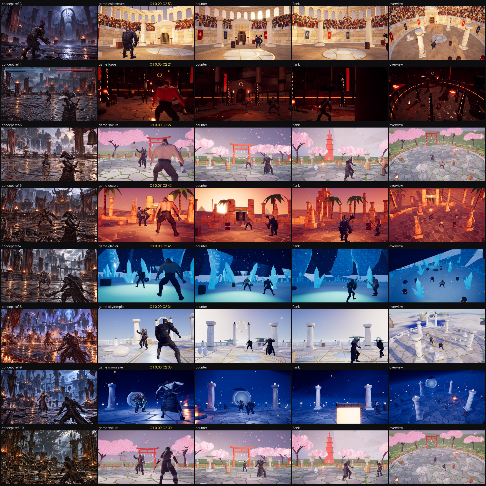

# A0: concept-match harness and Blender probes

Branch `anim-plan`, 2026-10-18. Spec: `docs/arena-art-plan.md` (A0 row, sections 3.2, 3.3, 5.1, 5.6, 5.8-5.10). No visual change to the game: the only runtime code is a debug mode (`?concept=`), and `src/sim` is untouched (`sim:test -- 40`: overall win rates 45.7-54.6 %, 0 timeouts, 0 kills without contact, determinism true; `fx:check` passes; `npm run build` passes).

## What shipped

| Part | Files | How to run |
|---|---|---|
| Concept camera presets (calibrated, one per ref image) + game-only extra views that scale with the layout (`counter` az 180, `flank` az -90, `overview` high three-quarter) | `src/render/arena/conceptCams.ts` | |
| Concept mode: `?concept=ref-3[&view=counter\|flank\|overview][&theme=&layout=&aseed=]` loads the preset's theme / layout / fighters, freezes the fight at frame 0, puts the fighters on the preset marks, hides the UI, holds the camera; `__arena.conceptView(id)` returns the projected guides (horizon, landmark azimuth, fighter boxes, draw calls / triangles); `conceptSkyMask()` (geometric sky mask), `conceptSkyOnly(on)` (sky-only frame for the visual sky mask) | `src/main.ts` (hooks only) | dev server `/?concept=ref-3` |
| Headless harness: renders every preset (+ extra views) from a built `dist/` at the concept's pixel size, one Chromium, seeded `Math.random`, then runs the comparison | `tools/shots/concept.cjs` | `npm run build && npm run arena:concept -- [--refs=ref-3,ref-7] [--q=0\|1\|2] [--views=none] [--clip=4] [--out=...]` |
| Comparison: side-by-side with guides, 50 % blend, sky masks, metrics C1-C5 + C8 + luminance histogram + warm/cool split + calibration deltas, contact sheet, summary table | `tools/arena/concept_compare.py` (Pillow + numpy; run without `-I`, numpy lives in the user site-packages) | called by the harness, or `python tools/arena/concept_compare.py --dir <out> --q 1` |
| By-eye concept annotations (floor edge, landmark x, fighters' feet / heads / shoulder width, skyline profiles, dressing counts for C6) | `tools/arena/concept_targets.json` | |
| Calibration solver (prints and rewrites the preset block) | `tools/arena/calibrate.py` | `python -I tools/arena/calibrate.py [--measured docs/milestones/A0/concept/info.json] [--write]` |
| Blender job runner: one Blender per job, sequential, resumable (`done.json` hash), RAM watchdog with suspend / resume / kill, `ram.csv` + `run.log` per job, `summary.json` | `tools/arena/bake.py`, `tools/arena/jobs.json` | `npm run arena:bake -- a0` (or `python -I tools/arena/bake.py <job\|group\|all> [--force] [--list] [--dry]`) |
| Shared bpy module for all arena jobs (timed steps with RAM, result.json, Cycles device pick, selected-to-active bakes, GLB export, equirect camera with latitude limits, 5.0 compositor File Output) | `tools/arena/blender/abake.py` | |
| Probes | `tools/arena/blender/probe_env.py`, `probe_bake.py`, `probe_pano.py`, `probe_misc.py`, `tools/arena/ktx_probe.mjs` (also exports `findKtx()`) | groups `a0` (about 15 min) and `a0-long` (about 35 min) |
| Baseline (current 7 themes; ref-10 rendered with the `sakura` stand-in until `rootwood` exists) | `docs/milestones/A0/concept/` (`contact_q1.jpg`, `ref-N_side.jpg`, `_blend.jpg`, `_sky.png`, `_metrics.json`, `summary_q1.md/json`, `info.json`); raw PNGs in `concept/game/` are gitignored | |

Gitignored (local only): `tools/arena/_bake/`, `tools/arena/_work/`, `tools/bin/`, `docs/milestones/*/concept/game/`.

## How the comparison works (read this before trusting a number)

**Camera calibration.** The plan's camera numbers were eye estimates, and two of its assumptions were wrong:
1. *The line where the far floor meets the boundary is not the horizon.* The boundary is 15-20 m away, so its base sits well below eye level. The solver therefore treats the annotated line as the **floor edge** and puts OUR arena's boundary there (ellipse + 1 m wall offset).
2. *The concept cameras are low.* Using the opponent as a ruler (its feet and head on screen, an assumed height of 1.55-2.0 m by stance), the camera heights come out at **0.6-1.5 m** (plan: 1.0-1.9 m). Where an inlay ring is visible this agrees with its ellipse (ref-7: ruler 0.95 m, ring 0.97 m; ref-5: 1.35 m vs 1.53 m).

Solved per preset (camera x / z kept from the plan): camera height and pitch jointly (opponent spans its feet..head AND the floor edge lands on the concept's floor edge), yaw (the azimuth-0 landmark at its plan distance lands on its annotated x), the opponent mark (its feet ray onto the floor), and the foreground fighter (from its shoulder width, then backed off until the upright game fighter's head is at least 12 % below the frame top: the concepts draw that fighter hunched and huge, which an upright game rig cannot match). Results (`docs/milestones/A0/concept/ref-N_metrics.json`, `calibration`): landmark x exact; opponent feet within 0.001 of the annotation; opponent head within 0.02-0.05 (the game fighters' heights differ); the foreground fighter's head sits at y 0.12-0.27 instead of the concepts' 0.43-0.50 (by design, above).

| Preset | vFOV | camera height | pitch | yaw | true horizon y (concept floor edge y) | opponent distance |
|---|---|---|---|---|---|---|
| ref-3 | 44.7 | 1.00 (no ruler: plan value) | +6.4 | -17.4 | 0.64 (0.70) | (none) |
| ref-4 | 41.9 | 1.52 | -2.7 | -7.5 | 0.44 (0.53) | 8.4 m |
| ref-5 | 43.0 | 1.35 | -1.0 | -7.0 | 0.48 (0.565) | 6.5 m |
| ref-6 | 43.0 | 0.79 | +2.9 | -8.9 | 0.57 (0.615) | 7.5 m |
| ref-7 | 43.0 | 0.95 | +1.7 | -5.4 | 0.54 (0.60) | 6.4 m |
| ref-8 | 46.7 | 0.93 | +2.4 | -13.5 | 0.55 (0.60) | 5.9 m |
| ref-9 | 46.7 | 0.61 | +7.2 | +11.7 | 0.65 (0.68) | 5.3 m |
| ref-10 | 43.0 | 0.85 | +6.5 | +2.0 | 0.65 (0.70) | 6.5 m |

Roll stays at the plan's eye estimate (ref-8 -3, ref-9 -2); it was not calibrated. **Bigger arenas** (the sim milestone after A2) move the boundary out, so the floor edge rises: re-run `calibrate.py --write` after any arena size change (the extra views already scale with `rx`/`rz`).

**Metric definitions** are in the header of `concept_compare.py`. Deviations from the plan's wording, decided here:
- C1: a colour-based sky segmentation does not work on these painterly images (dark ruins and dark clouds have the same colour; tried and dropped). The **concept** sky is a by-eye skyline profile per image (`skyline` in `concept_targets.json`; the moon inside the ref-3 arch is a sky hole); the **game** sky is *visual*: where the frame equals a sky-only render of the same view (so far geometry the fog has dissolved still counts as sky; the geometric mask is saved as `_skygeo.png` for reference). C1 also reports `profileErr` (mean per-column skyline difference in frame heights), which stays meaningful for ref-4 / ref-6 / ref-10 where the concept has under 8 % sky and IoU is noise.
- C3 counts hue 345-360 as warm too (crimson banners), besides the plan's 0-50.
- C4 measures bright pixels in the bottom third. It cannot tell a wet specular streak from a light-coloured floor: today's bright floors (sakura, glacier, skytemple) "exceed" the concept. Read it with the side-by-side.
- C6, C7, C9, C10 are manual: the metrics JSON lists the concept's dressing counts (C6) for the person counting; `--clip=4` writes 8 frames over 4 s for C9.

## Baseline (current themes, q1, before any arena art)

| ref | theme | C1 IoU / profileErr | C2 dE median / worst | C3 warm concept -> game | C4 floor bright (streaks) | C8 far/mid concept -> game | L* hist overlap |
|---|---|---|---|---|---|---|---|
| ref-3 | colosseum | 0.29 / 0.10 | 53.1 / 63.3 | 0.007 -> 0.417 | 0.07 -> 0.67 (10 -> 10) | 1.24 -> 0.99 | 0.28 |
| ref-4 | forge | 0.00 / 0.04 | 21.1 / 36.5 | 0.025 -> 0.043 | 0.05 -> 0.02 (11 -> 12) | 0.97 -> 0.65 | 0.54 |
| ref-5 | sakura | 0.00 / 0.04 | 26.7 / 39.9 | 0.023 -> 0.037 | 0.16 -> 0.70 (13 -> 0) | 0.86 -> 0.88 | 0.42 |
| ref-6 | desert | 0.07 / 0.13 | 42.1 / 50.6 | 0.030 -> 0.695 | 0.07 -> 0.31 (27 -> 8) | 1.16 -> 0.81 | 0.43 |
| ref-7 | glacier | 0.00 / 0.03 | 40.8 / 53.4 | 0.034 -> 0.000 | 0.13 -> 0.80 (21 -> 0) | 1.09 -> 0.96 | 0.67 |
| ref-8 | skytemple | 0.20 / 0.27 | 33.9 / 52.1 | 0.112 -> 0.008 | 0.14 -> 0.87 (34 -> 4) | 0.80 -> 0.47 | 0.31 |
| ref-9 | moonlake | 0.00 / 0.05 | 33.3 / 47.1 | 0.014 -> 0.009 | 0.12 -> 0.22 (9 -> 5) | 0.88 -> 0.66 | 0.66 |
| ref-10 | sakura (stand-in) | 0.00 / 0.01 | 38.7 / 52.2 | 0.033 -> 0.032 | 0.07 -> 0.75 (23 -> 5) | 0.94 -> 0.88 | 0.25 |

As expected nothing passes (0-1 of 6 automatic checks per theme): wrong palettes (sunny sandstone colosseum vs indigo night; pastel sakura; bright skytemple), no landmark, few warm lights, no wet floor. What the numbers say and the images confirm: the current themes are bright and flat where the concepts are dark with small hot accents (C2 median 21-53 against a pass of 12). Several current themes hide their sky behind a mountain ring or walls in the concept framing (C1 0.00 for sakura, glacier, moonlake, forge); in the concepts the sky is open above the landmark. The fighter placement and the horizon / landmark guides line up (see the yellow / cyan guides on the side-by-sides). Judged by eye: the side-by-sides show what the metrics claim; I did not judge "AAA-ness" (that is the owner's call).

Harness cost: 32 views (8 presets x 4 views) in 340 s, 7-20 s per view, one Chromium; whole-frame draw calls 84-488 and 93k-340k triangles per view today (in `info.json`).

## Blender 5.0.1 probe results (real numbers, this PC)

Machine at the time: Core Ultra 5 125H, Arc iGPU, 15.6 GB, 6-7 GB free before each job. Times are wall clock for the step, RAM is the Blender process's peak working set (runner sampling every 2 s and in-process `GetProcessMemoryInfo`). Probe scene for renders: 5,400 linked-duplicate blocks / towers (40-600 m), a 60 m arch, mountains, emissive windows with an AOV, gradient world + sun.

| Probe | Result |
|---|---|
| Cycles devices | **oneAPI works on the Meteor Lake Arc iGPU** ("Intel(R) Arc(TM) Graphics"), listed with and without `CYCLES_ONEAPI_ALL_DEVICES=1` (the variable is not needed). GPU output equals the CPU's (mean abs. difference 0.013 / 255 on the 4096x683 layer). First GPU render in a process pays about 3 s of kernel load |
| Panorama 2048x341, 32 spp | CPU 15.9 s (0.96 GB); GPU 6.5 s cold / 3.4 s warm (2.2 GB) |
| Panorama 4096x683, 64 spp + OIDN (medium layer) | CPU 138 s (2.84 GB); **GPU 45 s (3.87 GB)** |
| Panorama 8192x1365, 128 spp + OIDN (high layer) | **CPU 816 s = 13.6 min, peak 4.7 GB** (free RAM fell to 2.1 GB); **GPU about 200 s active, peak 5.7 GB**: free RAM fell to 1.44 GB, the runner suspended Blender for 767 s and resumed it when RAM came back, then it finished (so the high layer on GPU needs about 6-7 GB free) |
| Multilayer EXR per high layer (Image + Depth + AOV, half float) | 224 MB on disk (keep in `_bake`, never commit) |
| Volume fog (Cycles 5.0 default unbiased volumes), 2048x341 32 spp | 39.6 s vs 15.9 s: x2.5 |
| Hero-inset-like perspective 2048x1024, 128 spp + OIDN | CPU 157 s (2.26 GB) -> 4096x2048 estimated about 10.5 min CPU, about 3 min GPU |
| Throughput (this scene) | CPU 570-770 ms per megapixel per sample; GPU 150-250 |
| Equirect camera with latitude limits (-12..60 deg) | works in Cycles (`cam.data.panorama_type = 'EQUIRECTANGULAR'`, `latitude_min/max`) |
| **EEVEE panoramic camera** | **not supported**: EEVEE renders the PANO camera as a plain perspective view (1 of 4 test pillars visible). Use the plan's perspective-slice fallback |
| EEVEE 45 deg slice 1024x1365, 32 samples | 7.4 s (first render in a process +6 s for shaders), 1.8 GB |
| EEVEE 512 px volumetric card frame | first frame 10.6 s (shader compile), then 1.46 s per frame: a 32-frame sequence is about 1 min, 1.37 GB |
| 5.0 compositor API | `scene.compositing_node_group` + File Output `directory` / `file_name` / `file_output_items` works; Render Layers sockets are `Image`, `Depth`, AOV by name (`emit`); `media_type` before `file_format` works |
| Bake API (selected-to-active) | unchanged in 5.0: `bpy.ops.object.bake(type=...)` with `scene.render.bake.use_selected_to_active / cage_extrusion / margin / normal_space / normal_r,g,b` |
| Bake 256 px from a 442k-tri high | normal 1.1 s + AO 128 spp 2.3 s, 0.63 GB |
| **Bake 1024 px from a 1.77 M-tri high** | **normal 6.0 s + AO 128 spp 19.8 s, 1.3 GB** |
| UV | Smart UV Project + `pack_islands(shape_method='CONCAVE')` works |
| Voxel remesh 1 cm on a 3 m pillar (442k-tri high) | 1.3 s, 303k tris, 0.43 GB |
| GN SDF grid nodes | all present (`GeometryNodeMeshToSDFGrid`, `SDFGridBoolean`, `SDFGridFillet`, `SDFGridOffset`, `GridToMesh`, plus Mesh/Volume nodes). **Gotcha:** `Grid to Mesh` defaults to Threshold 0.1 (a density value) and returns an EMPTY mesh for an SDF: set Threshold 0. Then 2 cm voxels + fillet on the pillar: 62k tris in 0.3 s |
| Banner cloth 40x80, 60 frames, wind | 5.1 s point-cache bake, 0.22 GB |
| glTF exporter (5.0.21) | GLB, `export_yup`, `export_apply`, `export_extras` (custom props arrive as extras), Draco options, **WebP images** (`export_image_format='WEBP'`, WebP fallback); no meshopt / KTX2 (as planned: gltf-transform does those) |
| Sky Texture node | still has `sun_direction`, `turbidity`, `ground_albedo` properties and types `SINGLE_SCATTERING`, `MULTIPLE_SCATTERING`, `PREETHAM`, `HOSEK_WILKIE` (the research note that they were removed is wrong for 5.0.1; the plan still prefers HDRIs + our gradient) |
| Python thread during `render.render()` | keeps running (31 of 39 expected ticks), so in-process RAM sampling is possible; the runner samples from outside anyway |
| Runner guard | exercised for real on the GPU high layer: suspend at < 1.5 GB free, resume at > 2.5 GB. Added afterwards: kill early when the job itself is the hog (paused 3 min, free RAM not recovering, job > 2 GB) |

### KTX2 / meshopt / WebP

- **KTX-Software 5.0.0-rc2 is installed** (the owner ran the installer): `C:\Program Files\KTX-Software\bin\ktx.exe`, on the machine PATH (shells started before the install do not see it; `findKtx()` in `tools/arena/ktx_probe.mjs` also checks that folder and `tools/bin/ktx/`). Version 5 has **no `toktx`** (only `ktx create`), so nothing had to be extracted into `tools/bin`.
- **gltf-transform 4.x `uastc` / `etc1s` do not work with KTX-Software 5.0**: they pass `--assign-oetf`, which 5.0 renamed to `--assign-tf` ("Option 'assign-oetf' does not exist"), and the CLI still exits 0 with the PNGs left in place (silent failure; the probe now detects it).
- **`ktx create` directly works**: 1024 normal map, UASTC + zstd 18 + mips: 949 KB in 2.6 s; 1024 AO, ETC1S (basis-lz q128) + mips: 101 KB in 2.9 s.
- **gltf-transform `webp` fails** in this `node_modules` (sharp / libvips: "colourspace: parameter space not set"). F2 made its WebP files with Pillow. Blender's exporter can also write WebP.
- `meshopt` works (2.7 s on the probe GLB).
- FX side note: `tools/fx/encode_ktx2.mjs` looks for `toktx`, which KTX-Software 5 no longer ships, so it will keep reporting "WebP only" (logged in the backlog for the FX owner).

## Corrected estimates (replace plan 5.9)

| Job | Plan estimate | Measured / derived (CPU; GPU where measured) |
|---|---|---|
| High->low bake 1024: normal | 20-60 s | 6 s |
| AO 128 spp + curvature 1024 | 2-5 min, "3-5 h for the kit" | 20 s AO (+ curvature emission bake, not measured, expected seconds): **the 60-asset kit bakes in about 30-45 min** including scene build and export |
| Bake RAM | 1.5-3 GB (2-5 M tri high) | 1.3 GB at 1.8 M tris |
| Voxel remesh (statue) | 3-5 GB peak | 0.43 GB for 300k output tris at 1 cm on 3 m; a 6-8 m statue at 1-2 cm is roughly 4-10x the output: expect 1.5-3 GB (not measured) |
| Banner cloth settle | 1-2 min, < 1 GB | 5 s, 0.22 GB |
| Panorama layer 8192x1365, 128 spp + OIDN | 20-45 min, 3-6 GB | **13.6 min CPU, 4.7 GB; about 3.5 min GPU, 5.7 GB** (stand-in scene; a real theme with scans, hair-free foliage and volumes may be 1.5-3x, volumes alone 2.5x) |
| Medium layer 4096x683, 64 spp | | 2.3 min CPU (2.8 GB), 45 s GPU (3.9 GB) |
| Hero inset 4096x2048 | 15-30 min, 3-5 GB | about 10.5 min CPU (derived from 2048x1024: 157 s, 2.3 GB), about 3 min GPU |
| EEVEE shaft / fog card sequence 512 px x 32 | 1-3 min, 1.4 GB | about 1 min, 1.4 GB |
| EEVEE slice preview (8 x 45 deg, 1024x1365) | 1-2 min | about 1.2 min (8 x 7.4 s + shader warm-up), 1.8 GB |
| **Per theme** (3 high layers + inset + cards, CPU) | 2-4 h | **about 1-1.5 h CPU** with no volumes in the layers, **2-3 h** with volume fog rendered into all layers; **about 20-40 min on the iGPU** when 6-7 GB are free |
| **Whole plan** | 30-40 h | **about 10-15 h CPU**, or a few hours with the iGPU for the panoramas |

GPU recommendation: use oneAPI for the panorama and inset jobs **only when at least 6-7 GB are free** (the high layer peaked at 5.7 GB); keep bakes on the CPU (already seconds; GPU bake not measured). The runner's start threshold for GPU jobs is `startMinFreeMb: 6000` in `jobs.json`.

## Decisions made while the owner was asleep (please confirm)

1. Camera presets follow the calibrated low cameras (0.6-1.5 m), not the plan's eye estimates (1.0-1.9 m). The foreground fighter is placed so its head stays in frame (upright rigs cannot copy the concepts' hunched pose); posed foreground stances are a possible later improvement (A22).
2. The concept sky for C1 is a hand-drawn skyline profile (by me, from the images; about +-0.02 of frame height). If the owner disagrees with a profile, edit `skyline` in `concept_targets.json`.
3. ref-10 (`rootwood`) is rendered with the `sakura` stand-in until A17 adds the theme.
4. The runner is Python (`tools/arena/bake.py`), not `bake.mjs`: it needs Win32 calls (process memory, suspend / resume) that Node lacks without native modules. Run it with `python -I` (no third-party packages).
5. Baseline quality tier for the harness: q1 (medium). `--q=2` works (same presets).
6. Panorama jobs may use the iGPU (oneAPI) when RAM allows; the plan said CPU only.

## What I could not judge or verify

- By eye: whether the calibrated framing "feels" like each concept beyond the guides (horizon, landmark, fighter feet line up numerically). The owner should look at `concept/ref-N_side.jpg`.
- The C4 / C5 metrics are crude on today's bright floors; they become meaningful once the wet floor (A2) exists.
- GPU bake speed, GPU render speed for volumes and scanned assets, and RAM of a real theme scene (the probe scene is a stand-in).
- Roll (ref-8, ref-9) and the hFOV estimates were not calibrated (no reliable cue); the horizon / floor-edge solution depends on the hFOV guess.
- KTX2 in the game (three's KTX2Loader decoding the `ktx create` output) is for A1 to test.

## For A1 (asset pipeline + loader)

- Runner, job registry and shared bpy module already exist: add A1's jobs to `tools/arena/jobs.json`, build on `abake.py` (`Job`, `bake_maps`, `export_glb`, `cycles_device`, `pano_camera`, `compositor_outputs`).
- **KTX2 path:** do NOT rely on `gltf-transform uastc/etc1s` with KTX-Software 5.0 (silent failure). Either encode with `ktx create` directly (`findKtx()` in `tools/arena/ktx_probe.mjs`; flags verified above: `--format R8G8B8_UNORM --assign-tf linear --encode uastc --uastc-quality 2 --zstd 18 --generate-mipmap` for normals, `--format R8G8B8_SRGB --assign-tf srgb --encode basis-lz --qlevel 128 --generate-mipmap` for colour) and swap the images in with the gltf-transform API (`KHR_texture_basisu`, mime `image/ktx2`), or ask the owner to install KTX-Software 4.4.x instead. Check for errors in the tool's log, not its exit code.
- **WebP fallback:** gltf-transform `webp` is broken in this install (sharp); use Pillow (as F2 did) or Blender's `export_image_format='WEBP'`.
- GN SDF erosion: set `Grid to Mesh` Threshold to 0.
- Bakes are cheap (seconds): spend the budget on better high-polys, not on lower sample counts.
- Concept harness for any later milestone: `npm run build && npm run arena:concept -- --out=docs/milestones/A<n>/concept`; compare against this baseline's `summary_q1.json`.
- Memory: the harness (Chromium) and the runner (Blender) must not run at the same time.

Raw probe outputs (each job's `result.json`, the runner summary, the RAM trace of the suspended GPU job, the EEVEE "panorama" that came out perspective, a GPU panorama preview) are copied to `docs/milestones/A0/probes/` (the `_bake` folder itself is gitignored).
