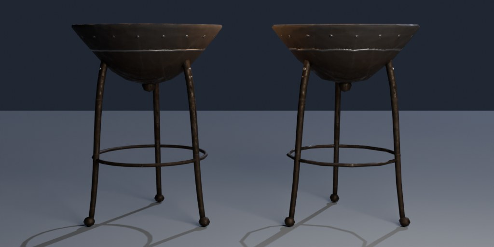
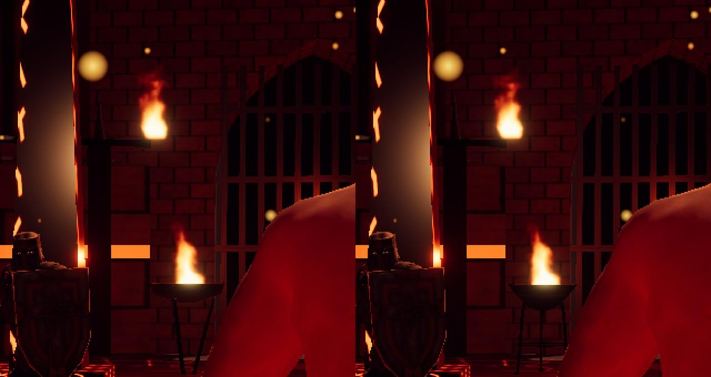

# A1: asset pipeline, loader and data-driven dressing skeleton

Branch `anim-plan`, 2026-10-18. Spec: `docs/arena-art-plan.md` (A1 row, sections 4.1-4.3, 5.1, 5.8, 6.6, 6.7) and the A0 README (KTX / WebP findings). One test asset, the **tripod brazier** (the sim's `brazier` prop), goes through every step: CC0 fetch -> Blender (build, fit to the sim contract, bake) -> compression -> budget gate -> runtime loader -> in game on all quality tiers. `src/sim` is untouched.

Gates: `npm run build` passes; `npm run fx:check` all passed; `npm run sim:test -- 40`: overall win rates 45.7-54.6 %, 0 timeouts, 0 kills without contact (0/2240), determinism true (same numbers as A0: the sim did not change). `npm run arena:budget` PASS. `node tools/arena/check_load.cjs` 7 of 7 runs OK.

## What shipped

| Part | Files | How to run |
|---|---|---|
| CC0 fetcher + licence ledger (Poly Haven and ambientCG APIs, md5-checked, files outside git in `../Assets/arena-src/<source>/<id>/` with a `meta.json`) | `tools/arena/fetch_cc0.mjs`, `public/arena/credits.json` | `npm run arena:fetch -- polyhaven:metal_plate_02 --res=1k` (`--list` shows the ledger) |
| `abake.py` A1 helpers: `load_cc0`, `load_image`, `fit_bounds` (exact radius / top / base at 0), `bounds`, `tri_count`, `uv_unwrap`, `bake_emit_inputs` (PBR channels of the high material as emission bakes: a DIFFUSE colour pass is black on metals), `pack_orm`, `empty` (sockets / roots with extras); `bake_maps` takes several high objects; `export_glb(images='NONE')` | `tools/arena/blender/abake.py` | |
| Brazier job: LOD0 (1,884 tris) + LOD1 (664 tris) built procedurally (lathe bowl with a rolled lip, three curved legs with ball feet, ring brace, finial, lumpy coal bed), fitted to the contract per LOD, high-poly = Catmull-Clark + hammered dents + rivets + a raised band (high only, so they live in the normal map), CC0 iron scan box-projected + soot + worn edges, bakes per LOD (normal, AO 128 spp with a ground plane, base colour / roughness / metal), ORM pack, raw GLB + `asset.json`, Cycles preview | `tools/arena/blender/kit_brazier.py`, job `kit_brazier_tripod` (groups `kit`, `a1`) in `tools/arena/jobs.json` | `npm run arena:bake -- kit_brazier_tripod` |
| Asset build: per asset 2 tiers x 2 formats; textures attached per material from `asset.json`; KTX2 by `ktx create` directly with the **log checked** (error / warning lines + KTX2 magic in the output, exit code not trusted); WebP by Pillow; `dedup`, `prune(keepLeaves)`, `meshopt`; manifest; ledger `usedBy` | `tools/arena/build_assets.mjs` -> `public/arena/kit/brazier_tripod[.low][.webp].glb`, `public/arena/manifest.json` | `npm run arena:assets` |
| Budget + contract gate: measures the shipped GLBs (not the manifest): radius / top / base against `PROP_BASE` and `TOP` parsed from the sim source, KIT_ extras, LOD node per tier, COL, sockets, extensions, triangles, texture sizes, primitives, file size, kit texture GPU memory per tier vs plan 6.6, CC0 ledger rows, stray files | `tools/arena/check_budget.mjs` | `npm run arena:budget` |
| Runtime loader: manifest, GLTFLoader + MeshoptDecoder + KTX2Loader (transcoder in `public/basis/`), cache per id / tier / format, KTX2 -> WebP fallback on failure, `prefetch`, `release(keep)` (disposes what the new pack does not use), `KitAsset.instantiate()` (shares geometry / materials, sockets in the asset frame) | `src/render/arena/assets.ts`, `public/basis/basis_transcoder.{js,wasm}` (copied from three r170) | |
| `ThemeArt` types (props wired now; floor, ring, gates, obstacles, hazards, backdrop typed for A2-A7), `artFor(theme)`, `assetsOf(art, layout)` (only kinds the layout spawns), `KIT_DEFAULT` (brazier -> `kit/brazier_tripod`) | `src/render/arena/art/types.ts`, `art/index.ts` | |
| `dressKit` skeleton: wraps the legacy builder and replaces the props its art maps to a loaded asset (`Dressing.propAsset`); TODO markers for A2 floor, A3-A7 ring / gates / obstacles / hazards, A6 backdrop | `src/render/arena/dressKit.ts`, `dressing.ts` (`buildDressing` -> kit or `legacyDressing`) | |
| Arena: optional `kit` pack in the constructor; `addProp` uses the kit asset and its `SOCK_flame` {size, light} (legacy: the old mesh and fixed flame spot, byte for byte); `dispose()` skips kit clones (the cache owns them) | `src/render/arena/arenaView.ts` | |
| `?arena=legacy` (pre-A1 path, never fetches the manifest), `?arenatex=webp` (force the fallback files) | `assets.ts` (`arenaMode`, `arenaTexOverride`), `main.ts` | `/?arena=legacy` |
| Async `ensureArena(spec, force)`: kit mode awaits the theme's assets, then builds synchronously; a newer call supersedes a pending one; legacy mode never awaits (builds inside the call, as before). `tick` waits while the first kit arena loads; Q rebuilds without dropping the old arena first | `src/main.ts` | |
| In-game check (one headless Chromium on `dist/`): q0 / q1 / q2 x KTX2 / WebP + legacy, forge / cross / aseed 1 (6 braziers): kit used, bounds in the prop's frame, LOD per tier, compressed vs RGBA textures, draw calls, console errors, close-up screenshots | `tools/arena/check_load.cjs` -> `docs/milestones/A1/load/` | `npm run build && node tools/arena/check_load.cjs` |
| Concept harness passes `--arena=legacy` / `--arenatex=` through | `tools/shots/concept.cjs` | |

`.gitignore` already had `tools/arena/_bake/` and `tools/arena/_work/` (added in A0); the CC0 raw files live outside the repo (`../Assets/arena-src/`).

## Order of operations for a new kit asset (what A3+ repeat)

1. `npm run arena:fetch -- polyhaven:<id>` (or `ambientcg:<id>`) for any scan it needs (adds a ledger row).
2. Write `tools/arena/blender/<asset>.py` on `abake.Job` (copy `kit_brazier.py`): build LOD0 / LOD1, `fit_bounds` to the sim contract, `uv_unwrap`, high-poly, `bake_maps` + `bake_emit_inputs` + `pack_orm`, root `KIT_<id>` with extras, `COL`, `SOCK_*`, `export_glb(images='NONE')`, `asset.json` (materials -> PNG set per LOD, `sources`).
3. Add the job to `tools/arena/jobs.json`, run `npm run arena:bake -- <job>` (one Blender, RAM watchdog, resumable).
4. `npm run arena:assets` then `npm run arena:budget` (add a `BUDGET` row for a new role in `check_budget.mjs`).
5. Map it in a `ThemeArt` (`art/index.ts` `KIT_DEFAULT` or `art/<theme>.ts`) and consume it in `dressKit.ts`.
6. `npm run build && node tools/arena/check_load.cjs` (adapt the arena / prop kind for other assets) or the concept harness.

## Measurements

**Blender job** (`kit_brazier_tripod`, CPU, this PC): 40-70 s per run, peak working set 0.9-1.0 GB (min free RAM 6.7 GB). Steps: build 5-8 s; high 0.7 s (120k tris); LOD0 bakes 34 s (normal 2.2 s, AO 128 spp 19 s, three emission bakes 3.5-3.8 s each); LOD1 bakes 15 s; export 0.7 s; preview still (1024x512, 48 spp) 14 s. Full record: `kit_brazier_tripod_result.json`.

**Shipped files** (`npm run arena:budget`):

| file | variant | tris | prims | radius | y | textures | GPU MB | KB |
|---|---|---|---|---|---|---|---|---|
| kit/brazier_tripod.glb | full/ktx2 | 1884 | 3 | 0.4500 | 0.0000..1.2000 | 1024 ETC1S colour, 1024 UASTC normal, 1024 ETC1S ORM | 2.67 | 710 |
| kit/brazier_tripod.webp.glb | full/webp | 1884 | 3 | 0.4500 | 0.0000..1.2000 | 3 x 1024 WebP | 16.00 | 490 |
| kit/brazier_tripod.low.glb | low/ktx2 | 664 | 3 | 0.4500 | 0.0000..1.2000 | 3 x 512 | 0.67 | 315 |
| kit/brazier_tripod.low.webp.glb | low/webp | 664 | 3 | 0.4500 | 0.0000..1.2000 | 3 x 512 WebP | 4.00 | 219 |

(prims = iron + coals + the hidden COL; the visible prop is 2 draw calls + the flame.) Encoder trials on the 1024 set: UASTC + zstd for the ORM was 785 KB (ETC1S q192: 184 KB), UASTC normal 949 KB without RDO, 429 KB with `--uastc-rdo --uastc-rdo-l 1.0`. `ktx create` per texture 0.5-3 s.

**In game** (`docs/milestones/A1/load/load.json`, close-ups `brazier_q*_*.jpg`): all 6 braziers on q0 / q1 / q2 use `kit/brazier_tripod`, LOD1 on q0 and LOD0 on q1 / q2, measured in the prop's own frame r = 0.4500, y = 0.0000..1.2000 on every tier and format; KTX2 runs got compressed textures (BC7 / `COMPRESSED_RGBA_BPTC_UNORM` on this ANGLE D3D11), WebP runs RGBA; no console errors. Asset load inside `ensureArena` 0.2-0.5 s (one asset, local files); the arena build itself is unchanged (2.7-3.5 s, the legacy CPU texture generation). Draw calls of the close-up frame: 513 legacy vs 517-523 kit (6 braziers x one extra primitive for the coals). The `first frames` time in `load.json` (0.5 s or about 10 s) is the per-quality-tier shader compile on a cold headless cache, not KTX2: tested by alternating orders (whichever run first meets a tier pays it).

**Legacy path unchanged:** concept harness renders of ref-3 (colosseum) and ref-4 (forge) from a build of the A0 commit vs this build with `--arena=legacy`: **pixel-identical** (max difference 0). Kit mode on colosseum (no braziers): identical too. Kit mode on forge differs only around the braziers (`ref4_before_vs_kit.jpg`: left before, right kit).

## Decisions made while the owner was asleep (please confirm)

1. **CC0 source for the iron:** Poly Haven `metal_plate_02` (Rob Tuytel, CC0), 1k maps, box-projected at its real 1.35 m scale (its plate seams read as riveted plates). Fetched by script; the raw files stay in `Assets/arena-src/`, the ledger row is in `public/arena/credits.json` (shipped with the game as attribution even though CC0 does not require it).
2. **Textures are attached by `build_assets.mjs`, not by Blender's exporter:** Blender writes geometry + named materials only (`export_image_format='NONE'`) and an `asset.json` with the PNG set per material, so every texture is encoded exactly once, with our own flags, and both formats come from the same PNGs.
3. **Encoders:** colour ETC1S q128 (sRGB), ORM ETC1S q192 (linear), normal UASTC q2 + RDO lambda 1 + zstd 18; all mipmapped. (Plan said UASTC for normals and the hero inset, ETC1S for the rest; the RDO flag is new.)
4. **Tiers:** q0 = `low` = LOD1 with its own 512 bake (baked natively at half size from the same high-poly, not downscaled); q1 / q2 = `full` = LOD0 + 1024. `build_assets` halves the full set with Pillow for assets that have no own low set.
5. **Format:** KTX2 by default; any KTX2 failure retries that asset as WebP and switches the session to WebP; `?arenatex=webp` forces it. The `.webp.glb` files are shipped (about 0.7 MB for this asset) so the fallback works offline from the transcoder.
6. **Brazier shape:** deep bowl with a rolled lip at exactly r 0.45 and top 1.2 (the legacy one was r 0.50, 0.05 m wider than the sim footprint, so the new one looks a little smaller), legs to ball feet at r 0.43, ring brace at 0.40 m, finial under the bowl, coals as a second material with a constant emissive (1.0, 0.32, 0.06) x 1.6. The flame keeps the legacy size (0.9) via `SOCK_flame` at the rim. It is a test asset: A4 builds the four brazier types properly.
7. **Which themes use it:** `KIT_DEFAULT` maps `brazier` for every theme; only forge spawns brazier props today. Assets load only for prop / obstacle / hazard kinds the generated layout contains (other themes download nothing yet).
8. **Kit mode first build:** no loading veil (the kit is under 1 MB); the menu and the render loop wait for the first arena (`tick` returns early until it exists). In kit mode the flame atlases are prefetched at startup so the flipbook flames are as early as with the synchronous legacy build (without it, the concept harness caught frames before the flame textures arrived).
9. **Quality changes:** in kit mode a match start after an auto-tune tier change (to or from q0) rebuilds the arena so the LOD matches; legacy keeps resetting only, as before. The Q key now rebuilds through `ensureArena(spec, true)` without dropping the old arena first.
10. **Budgets for `prop`:** LOD0 <= 2000 tris, LOD1 <= 800, textures <= 1024 / 512, <= 4 primitives (COL included), file <= 1.0 MB / 0.45 MB (KTX2). Plan 6.6 texture memory per tier summed over the kit.
11. `prefetch(theme, quality, layout)` exists but is not called from the select screen yet (plan A21).

## What I could not judge or verify

- **By eye:** the brazier reads as an iron tripod brazier in the Blender preview and in the forge close-ups (`load/brazier_q2_ktx2.jpg`), but whether it fits the concept art's braziers (ref-3 / ref-4) is the owner's call; the hammered dents are subtle at game distance, and the LOD1 bowl is visibly faceted up close (12 sides) on the low tier.
- Real GPU / non-headless browsers: only headless Chromium with ANGLE D3D11 on the Arc iGPU (transcoded to BC7). ASTC / ETC2 targets (phones, Macs) were not tested. Transcode time of a large theme pack is unmeasured (one small asset here).
- Frame-time cost: not measured with timer queries (one prop kind, 6 instances; draw calls +1 per brazier).
- ambientCG download path in `fetch_cc0.mjs` is written but not exercised (only Poly Haven was needed).
- Network failure / 404 at runtime falls back to the legacy dressing by design; tested only through the code path, not by breaking the server.

## For A2 (wet floor)

- The floor slot is typed (`ThemeArt.floor: { set, inlay?, wetness? }`) and marked `TODO(A2)` in `dressKit.ts`; `Arena.kit` (the loaded `ArenaPack`) is available inside `arenaView.ts` for the floor builder, and the legacy floor stays the fallback.
- Floor sets are texture-only assets: extend `build_assets.mjs` (today it expects `lods.LOD0/LOD1` + materials) with a texture-set role, and add a `BUDGET` row (plus tiling / texel-density checks) in `check_budget.mjs`. Keep KTX2 via `ktx create` with the log check; masks can use ETC1S linear like the ORM.
- Scans: `npm run arena:fetch -- polyhaven:<id> --maps=diff,rough,nor_gl,disp,arm` (Poly Haven `monastery_stone_floor`, `stone_tiles_02`, `slate_floor_02` are the plan's candidates); Blender reads them with `abake.load_cc0`.
- Runner, harness and checker: `npm run arena:bake -- <job>`, `npm run arena:concept -- --refs=ref-3 [--arena=legacy]` (pixel-identical legacy baseline technique above), `node tools/arena/check_load.cjs` as a template for an in-game check. Never run Blender and the browser together.
- `Arena.dispose()` skips `userData.kit` objects; anything A2 builds from cached assets must carry that flag (instantiate() sets it) or the cache's textures get disposed under it.
