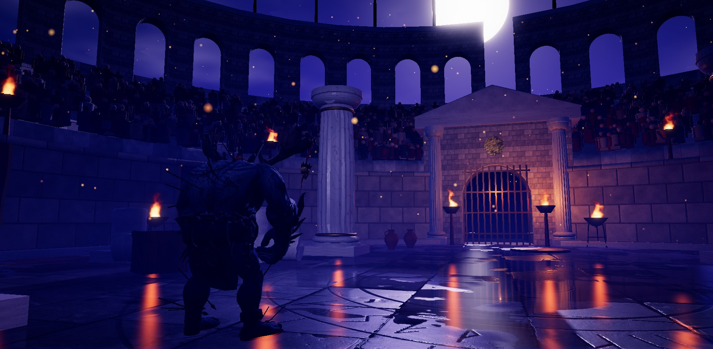

# A2: wet floor system

Branch `anim-plan`, 2026-10-18. Spec: `docs/arena-art-plan.md` (A2 row, sections 5.3, 5.7, 6.1, 6.2, 6.6, 8) and the A1 README ("For A2"). `src/sim` is untouched.

Gates: `npm run build` passes; `npm run fx:check` all passed (the planar pass renders the FX_ADD layer and the arena flame cards with the soft-depth fade off, and the F1 depth copy / soft particles / heat distortion run unchanged after it); `npm run sim:test -- 40`: overall win rates 45.7-54.6 %, 0 timeouts, 0 kills without contact (0/2240), determinism true (same numbers as A0 / A1); `npm run arena:budget` PASS. `?arena=legacy` is **pixel-identical** to the A1 build (ref-3 and ref-4 concept renders, max difference 0).

## What shipped

| Part | Files | How to run |
|---|---|---|
| Floor texture sets (Blender, Cycles on the Arc iGPU via oneAPI): CC0 scan graded to the theme stone, joints darkened, periodic Voronoi cracks added (albedo + normal), AO baked from the displaced scan on a 3x3 tile grid onto the centre tile (seamless), WATER RANK mask (uniform 0..1, hollows / joints / cracks fill first). Two sets: `floor/flagstone_bluegrey` (Poly Haven `large_grey_tiles`, 4.2 m tile) and `floor/slate_slabs` (Poly Haven `stone_tiles`, 5 m tile). Cycles preview of each, wet | `tools/arena/blender/floor_set.py`, jobs `floor_flagstone`, `floor_slate` (group `a2` / `floor`) | `npm run arena:bake -- a2` |
| Moon Gate engraved ritual circle: rings r 0.9 / 2.5 / 3.0 / 3.9 / 5.6 / 7.0 + 7.16, a 40-rune band (futhark-like templates), 16 spokes, 8 crescent moons with dots, worn depth and broken strokes; signed-distance height field in numpy -> displaced 1280^2 grid -> Cycles NORMAL + AO bakes onto a flat 16 m plane, 2048 px (7.8 mm/px) | `tools/arena/blender/inlay_moongate.py`, job `inlay_moongate` | |
| Texture-set role in the pipeline: a carrier GLB (one `TEXSET` quad + one material with baseColor / normal / ORM), so KTX2 + WebP + `.low` + the loader + the fallback all work unchanged; budget row `texset` (3 square power-of-two textures, `tileM` / `sizeM` extras, minimum texel density per tier) | `tools/arena/build_assets.mjs`, `tools/arena/check_budget.mjs` | `npm run arena:assets`, `npm run arena:budget` |
| Wet floor shader (MeshStandardMaterial + onBeforeCompile: shadows, fog, lights and the IBL BRDF keep working): world-space tiling, seeded non-tiling macro mask (puddle level + albedo variation), puddles at the tile's lowest water ranks (coverage = puddles x macro x wetness), inlay blended at the arena centre (albedo multiplier, normal, AO; grooves hold water), damp darkening 38 %, standing water another 25 %, roughness to 0.035 in water, normals flattened in water, light map added to the diffuse | `src/render/arena/floor.ts` | |
| Planar reflection (medium / high): mirrored camera (Reflector maths turned 180 deg about the view axis so camera-facing flame cards still rise), oblique near plane, **frustum cropped to the rows the visible floor reflects** (15 floor rays per frame), mip chain, LOD from roughness, normal distortion, 7-tap vertical streak, extra gain on hot sources, Fresnel from the standard IBL BRDF, fade to the probe at the edges, **half-rate refresh** (a camera cut or > 0.3 m / 4 deg move forces a render). Renders LAYER_REFLECT (sky, tall dressing, gates, obstacles, props, ring of fire, flame cards) + FX_ADD, and fighters (LAYER_REFLECT_HI) on high. Every scene light is tagged too (same lights state, no program switches); shadow maps are reused, not re-rendered | `src/render/arena/reflection.ts`, `post.ts` (`preScene` hook, timer `reflect`), `arenaView.ts` (`tagReflect`), `main.ts` (fighters) | `?refl=0` turns it off |
| Low tier: the IBL probe (`scene.environment`, the sky with the moon) through the same BRDF + streak cards; the planar code is compiled out (`FLOOR_LOW`) | `floor.ts`, `reflection.ts` `StreakCards` | `?q=0` |
| Streak cards (one instanced draw): an additive floor quad per flame, placed at the flame's mirror point, stretched toward the camera (long at grazing views, short from high cameras), broken up by the floor's water rank; full strength on low, 0.6 as an accent on medium / high; plus a long broken **moon path** on night themes | `reflection.ts`, `arenaView.ts` `collectFloorSources` | |
| Floor light map: point-source Lambert irradiance (E = P h / (d^2 + h^2)^1.5) of every flame without a real light and every lava pool into a 512^2 HDR target, re-rendered only when a source moves / appears / breaks; a global flicker in the shader | `src/render/arena/lightmap.ts` | |
| `Arena.surfaceAt(x, z)`: water / lava hazards, then the floor's water test on the CPU (macro mask + a one-time 128^2 read-back of the water rank, same maths as the shader), else `THEME_FLOOR` | `arenaView.ts`, `floor.ts` | |
| Kit colosseum: floor + inlay, and until A7 a **Moon Gate night preview** look (moon az -1.7, elev 27, #d8d4ff, violet mist, indigo grade, embers, lavender rim light) + 10 decorative tripod braziers on the boundary (render only) | `src/render/arena/art/colosseum.ts`, `art/types.ts` (`FloorArt`, `RingFlamesArt`, `LookArt`), `art/index.ts` (`withLook`), `themes.ts` (`lookId`) | `?moongate=0` (floor, golden-hour look, no braziers), `?floorset=slate_slabs` |
| Legacy floor removal in kit mode: `floorDisc` and the colosseum medallion / gold rings are flagged; dressKit swaps them for the wet floor with the same pad and disposes what nothing else uses | `common.ts`, `dressClassic.ts` (flags only), `dressKit.ts` | |
| Checker: screenshot, reflection and light-map dumps, surfaceAt grid, draw calls with / without the pass, console errors | `tools/arena/check_floor.cjs` | `npm run build && node tools/arena/check_floor.cjs --q=0,1,2` |

## Measurements

**Blender** (Core Ultra 5 125H, Arc iGPU, oneAPI used for all three jobs): `floor_flagstone` 48 s, peak 3.8 GB (AO bake on 2.65 M tris: 20 s); `floor_slate` 48 s, 3.8 GB; `inlay_moongate` 48 s, peak 4.0 GB (3.3 M tris; normal 8 s, AO 96 spp 19 s). Previews and results: `blender/`.

**Shipped files**: each set 3 x 2048 (ETC1S colour + ORM, UASTC normal), 10.7 MB GPU each (checker's estimate); low 3 x 1024. KTX2 files: flagstone 4.4 MB, slate 5.6 MB, inlay 0.7 MB (UASTC normals dominate). Kit texture memory (KTX2): low 8.7 MB / 64, medium+high 34.7 MB / 128-192. WebP fallback is 4x bigger in GPU memory (the colosseum's floor + inlay = 128 MB on full: too much for medium if KTX2 ever fails).

**GPU time** (timer queries, `tools/shots/postprobe.cjs`, colosseum gorak-erika seed 4242 t=20, fixed side camera at 1.9 m, 1920x1080, 120 frames, builds interleaved before (A1 HEAD) / after / before / after; raw JSON in `perf/`):

| Tier | reflect pass, average per frame (half rate) | per actual render (about 2x the average; p95) | before half rate + crop (first try, full frustum, 0.5 / 0.7 scale) |
|---|---|---|---|
| High | **0.58 / 0.70 ms** (budget 1.5) | about 1.2-1.4 ms (p95 1.7-1.9) | 6.1 ms |
| Medium | **0.46 / 0.48 ms** (budget 0.8) | about 0.9-1.0 ms (p95 1.2) | 2.4 ms |
| Low | 0 (no pass) | | |

Honest reading: the budgets are met **on average** thanks to the half-rate refresh; a single reflection render costs about 1.3 ms on high (inside 1.5) and about 0.95 ms on medium (over 0.8). The GPU clock state of this machine moves everything by up to 2x between runs (scene pass on high 16-17 ms in one session, 8 ms in the next), so compare within a run. Medium could drop to scale 0.3 if the owner prefers per-render budget over sharpness. Measured cost breakdown (same-page experiments): about 0.3 ms fixed (82 draw calls) + about 2.7 ms per million pixels; fighters add 0.2-0.8 ms on high; the instanced crowd was dropped from the reflection.

Scene pass (whole floor shader + the preview's 10 braziers + streak cards + night look), same rounds: high 7.9 / 8.7 vs 8.8 / 7.7 before, medium 14.1 / 16.6 vs 15.3 / 14.4, low 10.6 / 12.6 vs 9.4 / 9.8. Within the noise on high / medium; **low looks about 1-3 ms slower** (the first session, at the slower clock, measured +2.8 ms). Draw calls on the ref-3 frame: 186-192 without the pass, +82-83 with it (`floor/floor.json`).

Light map: one render at build (6-29 ms on first use, mostly the shader compile), then only when a flame moves.

**Concept match (C4, ref-3 preset, `concept/`)**: bright floor share of the bottom third (L* > 55) concept 0.072 -> game **0.054 (q1, 9 fire streaks), 0.097 (q0, 13), 0.053 (q2, 8)**: within the +-50 % rule with at least 3 streaks on every tier (A0 baseline: 0.67, a bright sand floor). C2 colour distance improved from 53 to 27 (the night preview look). Other C checks stay failing (no landmark, sandstone walls: A6-A8).

`surfaceAt` over the fight ellipse (0.25 m grid): 36.9 % water, 63.1 % wet (spec: 35 % puddles).

## Decisions made while the owner was asleep (please confirm)

1. **Moon Gate night preview on the colosseum in kit mode** (look override + 10 decorative braziers) so the A2 acceptance (moon + fire streaks in the ref-3 preset) is testable before A7 builds the theme. It changes how the colosseum plays in kit mode today; `?moongate=0` gives the golden-hour colosseum on the wet floor. The theme name is unchanged. Moon god rays are off (they cost about 1.5 ms on high); A7 decides.
2. **Streak cards on every tier**: the planar reflection of a flame card is dim after the Fresnel term, so fire streaks on medium / high come mostly from the cards (gain 0.6), as the plan's table allows ("low tier + accents everywhere"). The **moon path is painted** (a streak card): the real mirror image of a moon 27 deg up falls under the frame of a 1 m camera.
3. **Half-rate reflection refresh** on medium and high (forced on camera cuts / fast moves) to meet the budgets; the reflection can lag one frame on slow pans.
4. **Frustum crop** from floor rays every frame; target heights are sized for a crop of about 42 % of the frame (more floor in view = lower vertical resolution).
5. **Macro mask at runtime** (seeded fbm over the layout's floor bounds, 128^2) instead of a Blender bake per theme: arena sizes vary by layout and seed, and `surfaceAt` needs it on the CPU anyway.
6. **ORM blue channel = water rank** for floor sets, groove mask for engraved inlays (metal mask for future metal inlays, `inlayStyle` from the asset's `style` extra).
7. Scans: `large_grey_tiles` (rectangular blocks) for the blue-grey flagstone, `stone_tiles` (irregular slate) for the slabs; the slate set is shipped but no theme uses it yet (ref-4 / forge at its theme milestone); preview with `?floorset=slate_slabs`.
8. Light map at 512^2 (plan: 1024); the pools are smooth, 6 cm per texel is plenty. Only flames without a real PointLight contribute (the real ones light the floor themselves).
9. "Box projection" for the low-tier probe is not implemented: the probe is the sky at infinity (the moon is in it), where box projection does not apply. A baked local cube probe can come with A7 if low looks flat.
10. `surfaceAt` is exposed but not wired into footstep / splash FX yet (A20 owns those FX).
11. The camera rim light behind the fighters is lavender in the preview: on the wet floor it reads as the concept's moonlit sheen.

## What I could not judge or verify

- **By eye**: the frames show a dark wet stone floor with the engraved ring, puddles mirroring the gate and walls, vertical orange streaks under every brazier and a lavender path toward the moon; whether it is "as close to ref-3 as possible" is the owner's call. Known look gaps: puddle edges are crisp blobs (no wet-edge gradient), damp stone between puddles reflects only blurred light, the light-map pools are subtle from the high overview camera, and the walls / landmark are still the legacy colosseum (A6-A8).
- Headless Chromium (ANGLE D3D11) on the Arc iGPU only; no real browser, no phone / Mac transcode targets. The GPU-clock noise is large (see above); I did not lock clocks.
- Reflection lag from the half-rate refresh during fast camera moves was not checked by eye in motion (only still frames).
- Fighter reflections on high were not inspected close up.

## For the next agent (sim milestone: bigger arenas + interactables; then A3)

- Bigger arenas: the floor follows `rx` / `rz` (+ the legacy floor's pad), the macro mask and light map cover the floor bounds automatically. Re-run `tools/arena/calibrate.py --write` and `npm run arena:concept -- --refs=ref-3`, then `node tools/arena/check_floor.cjs --q=0,1,2`.
- New render-only objects that should appear in the wet floor: anything tall built in the Arena constructor before `tagReflect()` is tagged automatically; objects added later need `o.layers.enable(LAYER_REFLECT)` (reflection.ts). New flames from `Arena.flame()` feed the light map and streaks automatically (`light: false` = light-map pool only).
- New interactables / hazards that change the floor: `Arena.surfaceAt(x, z)` and `WetFloor.waterAt` are the CPU queries; lava pools already feed the light map.
- The `Post.preScene` hook belongs to the arena now (one callback; chain it if another system needs a pre-scene pass).
- Perf: any new tall dressing adds to the reflection pass (about 0.3 ms fixed + 2.7 ms / Mpx, draw calls count); keep crowds out (instanced meshes are skipped).
