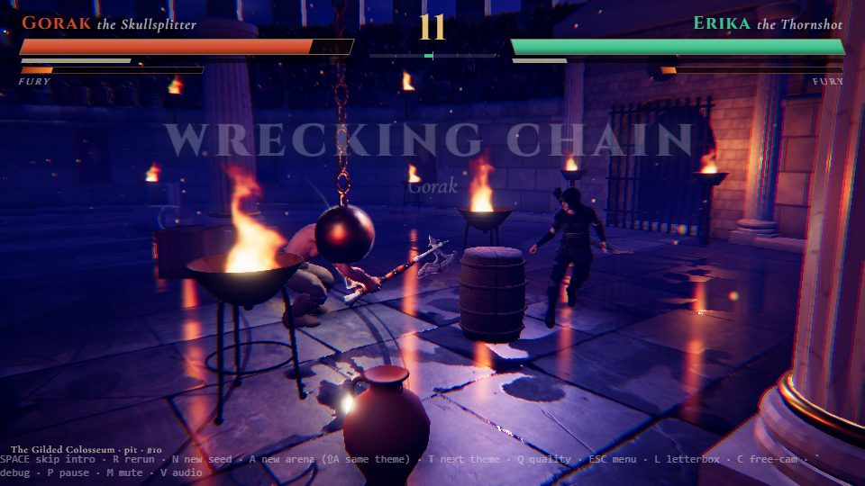

# A2b: bigger arenas + more interactables (sim milestone)

Branch `anim-plan`, 2026-10-18. Brief: `docs/QUEUE.md` row 2 (OWNER UPDATE: bigger arenas, more things, more interactability) and the 2026-10-18 owner-feedback block in `docs/BACKLOG.md` (only one prop pickup / throw seen in 10+ fights). This milestone **moves the sim baselines** on purpose (new arena contents, AI environment use); the new baseline is below. Finisher rates and the killing-blow rule are untouched (separate backlog item).

## Gates

| Gate | Result |
|---|---|
| `npm run build` | passes |
| `npm run fx:check` | all FX checks passed (6 new defs) |
| `npm run sim:test -- 40` (2240 matches) | win rates **46.8-53.6 %**, 0 timeouts, **0/2240 kills without contact**, determinism true, mean fight **70.4 s** (p10 56.1, median 69.2, p90 86.0) |
| `npm run arena:budget` | PASS |
| Camera audit (`__arena.cameraAudit`, the standard 8-match list in `tools/anim/_scratch/camaudit.expr`, old build vs new build) | readable **94.4 -> 93.8 %**, contact visible 94.7 -> 95.9 %, cuts/min 24.1 -> 23.5, shots < 0.5 s 16 -> 12 |
| Entrance validator (`__arena.validateEntrances({fighters: ['gorak', 'maw']})`, all 7 themes x 5 layouts x 2 gates = 140 configs) | **0 new failures**. 20 failures remain, all `support` at the gate threshold of the kit colosseum: the **same 20 fail on the pre-A2b build** (`307a9fa`, checked on colosseum + desert), so they come from A1/A2's kit floor, not from this milestone (logged in BACKLOG known issues). Two failures this milestone caused were fixed: a barricade on the west entrance walk (features now stay off the gate-to-mark lane) and a forge chandelier lying on the floor before the first frame (now hung at 6.2 m when built) |
| Wet floor checker (`check_floor.cjs --q=1`) + ref-3 concept render | no console errors; C4 bright-floor share 0.060 (concept 0.072, A2 0.054), 10 fire streaks; draw calls on the ref-3 frame **381** (A2: about 270): more props, features and flames (see decisions) |

## What shipped

| Part | Files |
|---|---|
| **Bigger arenas**: `ARENA_SCALE = 1.35` on every layout's semi-axes (pit 12.3 -> 16.6 m, oval 14.5 x 10.5 -> 19.6 x 14.2, gauntlet 15.5 x 7.8 -> 20.9 x 10.5, split 12.6 -> 17.0) and on the skeleton placements (pillar rings, split bridges at z = +-6.75, gauntlet spacing). Start marks stay at +-5 m. | `src/sim/arenaGen.ts` |
| **Ring of fire** closes to the same *absolute* size as before (6.5 m geometric-mean radius) instead of the same fraction, so the end game stays as tight in the bigger arenas (`ringScaleAt`, `RING_END_GROW = 1.0`) | `src/sim/arena.ts`, `match.ts` |
| **More things**: 12-16 props per arena (was 7-10), placed at 0.22-0.85 of the radius (was 0.35-0.92, i.e. closer to where fights happen); 3 boulders (was 2); braziers added to the colosseum, skytemple, moonlake and desert prop lists | `arenaGen.ts` `THEME_RULES`, `generateArena` |
| **Features** (`THEME_RULES.features`, new obstacle kinds): `banner` = banner pole (r 0.28, h 4.6, hp 50-70, toppleable: falls onto whoever is in its line, 28 dmg crush, leaves one throwable shaft chunk); `barricade` = plank barricade / gate (r 0.7, h 1.5, hp 42-58, not toppleable: **shatters in place**, `obstacle_break` event, leaves two throwable chunks) | `arenaGen.ts`, `world.ts` `damageObstacle` |
| **Braziers tip and ignite**: a broken brazier (struck, hit by a thrown prop, a fighter knocked or launched into it) spills **burning oil**: a 1.25 m fire patch for 7 s that burns whoever stands in it (14 dmg, push-out, 1.5 s cooldown per fighter); `brazier_tip` event, `Frame.fires` | `world.ts` (`igniteOil`, `updateFires`, `fires`), `types.ts` |
| **Hanging chains** (`chains` hazard): an iron weight on a 3.2 m chain (pivot 4.3 m) that swings for 3 s along a tangential axis when a slam / knockdown / blast happens nearby (`shake`) or when a melee swing strikes it (it swings away from the striker); the weight hits a fighter when it visibly reaches the body in the low part of the swing (14 + 2.2 x speed dmg, knockdown at speed, `hitEvent`). Exact swing maths shared by sim and renderer (`chainSwing`), encoded in the hazard byte (1/40 s) | `arenaGen.ts` (`chainSwing`, `CHAIN_*`), `world.ts`, `match.ts` `worldContact` |
| **Fire traps** (`flamejet` hazard): floor vent, 6.5 s cycle, 1 s warning glow, 1.2 s jet (22 dmg, push-out) | `world.ts` |
| **Collapsing floor / edges** (`crumble` hazard, placed at 0.55-0.85 of the radius = the crumbling rim): cracked floor that weakens under nearby impacts (`shake`) and under standing weight (about 3 s), cracks (1.1 s warning), drops (30 dmg + knockdown to anyone on it, props on it are lost) and stays a **pit** (fall in = 20 dmg + knockdown, pop-out) | `world.ts` |
| **Per-theme hazards** (`THEME_RULES.extras`): colosseum chains + crumble; skytemple 2 x crumble (broken sky edges); sakura chains; forge 2 x flamejet; glacier crumble (thin ice) + chains; moonlake crumble + chains; desert flamejet + crumble (sinkhole). Features: colosseum 2 banners + barricade, skytemple 2 banners, sakura 2 banners + barricade, forge barricade + banner, glacier banner, moonlake 2 banners, desert banner + barricade | `arenaGen.ts` |
| **AI environment use** (`ENV_AI` knobs): prop search radius 6 -> 8.5 m and "closer than them" margin 1.5 -> 0.6 m; grab utility base 1.2 -> 1.7 and usesProps weight 1.6 -> 1.9; per-pickup decay x0.8 -> x0.9; lift-safety discount 0.35 -> 0.45 x usesProps; ranged fighters' grab factor 0.35 -> 0.45. New tactics: **tip the brazier beside them** (melee swing or shot at it), **swing the chain weight through them** (strike it when they stand in its sweep on the far side). Avoidance of burning oil, active fire jets, cracking floor / pits and a swinging chain's sweep line; pressure-into-hazards ignores still chains and idle vents | `src/sim/ai.ts` |
| **Per-fight counters** in `sim:test`: finishers, pickups, throws, hazard kills, interactable triggers (non-periodic hazard triggers + topples + barricade breaks + brazier tips + explosions), brazier tips, barricade breaks, floor collapses, matches with a pickup / with environment use, triggers by kind | `tools/aiMetrics.ts` |
| **Render / anim hooks** (placeholder visuals until the art kit, A3-A5): banner pole + ragged cloth swaying, plank barricade (hidden on shatter + wood debris); chain weight (chain from the dark above, spiked iron ball, exact sim swing); fire-jet grate + glow + fire column + flipbook flame; crumble crack decal -> shaking -> black pit with broken rim and sinking slabs; burning-oil pool (glow disc + 3 flames, pre-built pool of up to 4 per arena so the A2 reflection tagging sees them). Toasts + audio for every new event (existing pools), FX from existing ops (`oil.ignite`, `floor.collapse`, `barricade.break`, `hazard.chains/flamejet/crumble.trigger`; hits reuse `hazard.fire.hit`, `prop.hit`, `crush`), camera shake, chain weights as camera `hanging` obstacles, banners get a wider camera radius, the throw shot opens its FOV for far targets | `src/render/arena/arenaView.ts`, `src/render/fx/fxDefs.ts`, `src/main.ts`, `src/audio/soundDirector.ts`, `src/camera/director.ts`, `src/render/playback.ts` |
| Concept presets re-calibrated for the bigger arenas (`calibrate.py` now reads `ARENA_SCALE`) | `tools/arena/calibrate.py`, `src/render/arena/conceptCams.ts` |

## Before / after (sim:test -- 40, 2240 matches, means per match)

"Before" = commit `307a9fa` run with the new counters (`tools/aiMetrics.ts` copied onto the old sim).

| Counter | Before | After |
|---|---|---|
| Finishers | 0.26 | 0.27 (rule unchanged on purpose) |
| Prop pickups | 0.33 | **1.08** (x3.3) |
| Throws | 0.25 | **0.83** (x3.3) |
| Matches with a pickup | 25.8 % | **51.2 %** |
| Matches with environment use (pickup, topple, barricade break, brazier tip, explosion, hazard hit, crush) | 52.6 % | **79.6 %** |
| Interactable triggers (non-periodic) | 0.79 | **1.51** |
| - brazier tips / barricade breaks / floor collapses / chain swings | 0 / 0 / 0 / 0 | 0.35 / 0.04 / 0.09 / 0.17 |
| - explosions / topples / spike triggers | 0.32 / 0.13 / 0.30 | 0.44 / 0.16 / 0.24 |
| Hazard hits | 0.35 | **0.94** |
| Hazard kills | 0.003 (7 kills) | 0.012 (27 kills: burning oil 7, swinging chain 6, collapsing floor 6, spikes 3, pit 2, firepit 2, geyser 1) |
| Thrown-prop kills | 9 | 25 |
| Mean fight duration | 69.7 s | 70.4 s |
| Win-rate range | 45.7-54.6 % | 46.8-53.6 % |
| Kills without contact | 0 | 0 |
| Cornered episodes | 1.98 | 1.41 (more room) |

Barricade breaks stay rare (0.04): nobody targets them on purpose yet (they break when someone is slammed into them or swings through them). Interaction rates per theme follow the theme rows: sakura (water + chains) is still the quietest theme (45 % of matches with environment damage, was 15 %).

## New baseline (re-established)

`npm run sim:test -- 40` at this commit: 2240 matches, mean 70.4 s (p10 56.1 / median 69.2 / p90 86.0, 93.3 % in 45-90 s), >= 2 swings 52.2 %, timeouts 0, one-sided 1.9 %, comebacks 43.0 %, win rates gorak 51.8, aldric 46.8, ozrel 53.6, erika 50.2, vex 47.3, fenrik 47.9, maw 51.2, hollowjack 51.2 %, kills without contact 0/2240, determinism true; per fight: hits 36, knockdowns 8.8, launches 0.91, finishers 0.27, pickups 1.08, throws 0.83, interactable triggers 1.51, hazard hits 0.94. Raw output is not committed; rerun the command to compare.

## Decisions made while the owner was asleep (please confirm)

1. **Size +35 %** (`ARENA_SCALE = 1.35`, the middle of the asked 30-40 %). Measured: fights +0.7 s on average, cornered episodes down 28 %, camera readability -0.6 pt (noise level). Start marks unchanged (+-5 m), so the walk-out after the entrances is longer.
2. **Ring of fire ends at the old absolute size** (6.5 m), not the old fraction (that would have left an 8.8 m ring). Tried 1.1x and 0.95x the old end size and starting the shrink 4 s earlier: each moved the mean duration by 0.3 s or less, so pacing stays as it was; the extra 0.7 s comes from walking and grabbing in bigger arenas. Mean 70.4 s is at the top of "about 60-70 s"; if the owner wants it lower, the lever is damage, not the ring.
3. **Placeholder visuals only** (procedural meshes, existing FX ops, existing sounds). They cost draw calls: the ref-3 frame went from about 270 to 381 calls (more props, banners, chains, flames); the A3-A5 kit and the A21 perf pass should batch them. The A3-A5 kit replaces them (`ThemeArt.obstacles.banner/barricade`, `ThemeArt.hazards.chains/flamejet/crumble` slots exist through the shared kind types).
4. **Barricades shatter in place** (no topple) and leave two throwable chunks; banners topple like columns but hit lighter (28 vs 48).
5. **Chain weights** do not block movement (fighters walk under / through the resting weight); they only hit while swinging.
6. **Crumble pits are permanent** for the rest of the fight (the ring of fire may close over them). The hole is a black disc on the floor (the floor plane is not cut).
7. **Burning-oil pool cap**: the renderer pre-builds up to 4 fire patches per arena (one per brazier, max 4); a 5th simultaneous fire would burn in the sim but not show (never seen in testing: at most 2 at once).
8. **Periodic hazards** (geyser, fire jet cycles) are listed but not counted as "interactable triggers"; the counter is about things the fight set off.
9. **AI tuning stays in v1** (knob table `ENV_AI` in `ai.ts`); AI v2 owns real spacing / environment tactics.

## What I could not judge or verify

- **By eye**: I did not look at every new interactable in motion. The chain weight's render position is verified numerically to match the sim (`chainSwing`, 0 mm difference before byte quantisation, at most 12.5 ms of swing time after it). I looked at 5 frames from the built game (`shots/`): the chain weight hitting Gorak, a burning-oil pool with flames next to a swinging chain, the floor collapsing under Gorak (debris burst), a fire-jet column next to a plank barricade, and the ref-3 preset (banners and chains now appear in the view). They read as what they are, as placeholders; nothing was judged in motion at full speed, and the crack decal before a collapse is hard to see on the dark wet floor.
- The entrance validator ran on a subset (2 fighters: gorak and the big maw; all themes, layouts and gates), not all 8 fighters (the full run takes about 70 min).
- Camera audit per-match numbers are not comparable one to one (every fight is different after the sim change); only the 8-match totals are.
- Feel: whether 1 pickup + 1.5 triggers per fight is "much more often" enough is the owner's call; the knobs are `ENV_AI` (ai.ts) and the counts in `THEME_RULES`.

## For the next agent (A3 shared stone kit)

- New sim kinds to dress (all placeholders today, in `arenaView.ts`): obstacles `banner` (r 0.28, h 4.6, cloth 1.05 x 2.5 hanging from a crossbar at h - 0.25, faces the arena centre) and `barricade` (r 0.7, h 1.5, about 1.7 m wide); hazards `chains` (pivot `CHAIN_PIVOT_H` 4.3 m, `CHAIN_LEN` 3.2 m, weight radius about 0.36, swing axis = `HazardDef.phase` in the atan2(x, z) convention), `flamejet` (vent radius `h.r`, 0.85-1.1), `crumble` (radius 1.4-1.9; states 0 intact, 1 cracking, 2 collapsing, 3 pit).
- Hazard state byte for chains: 0 = still, else `1 + swing time / (1/40 s)`, `+127` for a negative swing; decode as in `arenaView.ts` and call `chainSwing(tau)`.
- `Frame.fires` = burning-oil patches `[x, z, r, life fraction]`; the A2 light map / streak cards pick up their flames automatically (they are built before `tagReflect()`).
- Bigger arenas: the kit's ring braziers keep their count (10) so they are spaced wider; walls / stands follow `rx` / `rz` as before. The concept presets were re-calibrated (`calibrate.py` reads `ARENA_SCALE`).
- Brazier props now appear in 5 themes (colosseum, skytemple, forge, moonlake, desert): the A1 tripod brazier asset is the kit slot for them; a tipped brazier is `prop_break` + `brazier_tip` (spawn the spill decal there).
