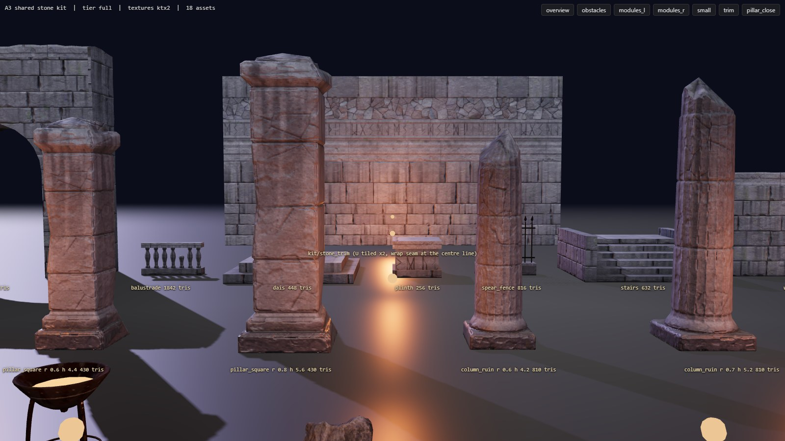
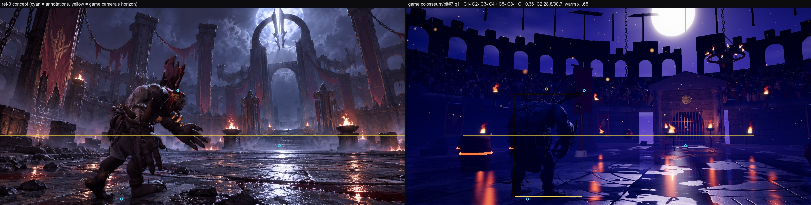
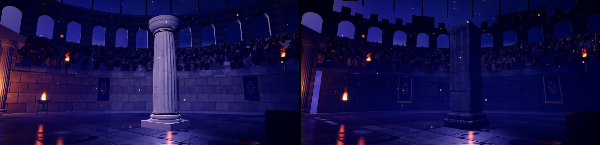
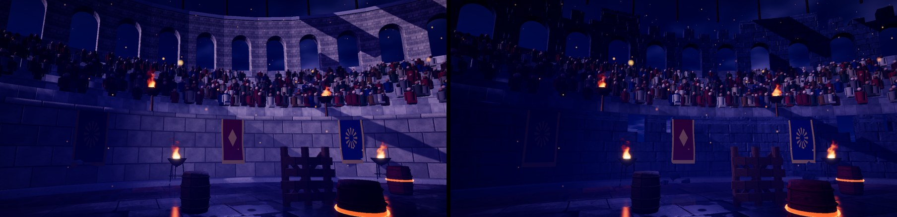

# A3: shared stone kit

Branch `anim-plan`, 2026-10-18. Spec: `docs/arena-art-plan.md` (A3 row, sections 4.2, 4.3, 5.2, 5.3, 6.6) and the A1 / A2 / A2b READMEs. Target look: `docs/concept-art/ref-3..10.png` and the owner's 2026-10-18 feedback (hard, heavy, broken, weathered dark stone; not clean tiles). `src/sim` is untouched.

## Gates

| Gate | Result |
|---|---|
| `npm run build` | passes |
| `npm run fx:check` | all FX checks passed |
| `npm run sim:test -- 40` | identical to the A2b baseline: win rates 46.8-53.6 %, 0 timeouts, 0/2240 kills without contact, determinism true, pickups 1.08 / throws 0.83 per fight |
| `npm run arena:budget` | PASS (21 assets x 2 tiers x 2 formats; contracts, structure, budgets, CC0 ledger) |
| `?arena=legacy` | **pixel-identical** to the A2b build (ref-3 and ref-4 concept renders, max difference 0; HEAD built in a temporary worktree) |
| Entrance validator, colosseum x 5 layouts x 2 gates, gorak + maw (`tools/arena/check_entrances.cjs`) | the same 20 known `support` failures with and without the kit stone (pre-existing since A1/A2, BACKLOG known issues); 0 new |
| In-game check (`tools/arena/check_kitstone.cjs`, colosseum pit + cross on q0 / q1 / q2, 60 s of fight each) | 0 console errors; every kit pillar / column top measured at exactly the sim's `o.h` (9-slice fit), footprint 1.46-1.53 x r; topples ran (2 per cross run) |

## What shipped

| Part | Files |
|---|---|
| **Stone trim sheet** `kit/stone_trim` (2048 over 8 x 8 m = 256 px/m; low 1024): rows ashlar (4 x 0.5 m courses), big blocks (2 x 1 m), cornice moulding, carved rune frieze, fractured rough stone, plain slabs. numpy height field, periodic in U (wobbly joints, worn irregular arrises, shaped chips along the arrises, cracks, pillow faces, the CC0 scan height as micro relief); normal computed exactly from the field; AO baked in Cycles from the displaced high (2.4 M tris); albedo = graded stone x scan luminance x per-stone tint x joint/crack cavity x fresh chips x soot / water streaks x grime x lichen | `tools/arena/blender/kit_stone_trim.py` (job `kit_stone_trim`) |
| **Hero obstacles** with unique high -> low bakes (high = voxel remesh of a detail source + numpy weathering in `stonekit.weather_high`: convexity from Laplacian smoothing, conchoidal **chips** (Worley cells breaking along a per-cell threshold of the arris band), **spalled** flakes, **cracks** (Worley borders), erosion + pits, and a per-vertex tint/roughness attribute: fresh stone lighter, cavities dark, **soot streaks** from the top, **wet darkening** at the base, sparse moss): `kit/pillar_square` (ref-3 square masonry pillar: plinth, 4 offset courses with real joints, capital with a broken corner and broken top; 2048 / 1024; LOD0 430 tris), `kit/column_ruin` (fluted, broken top, flutes in the normal map; 1024 / 512; 810 tris), `kit/rubble_pile` (broken blocks + toppled drum; 1024 / 512) | `tools/arena/blender/stonekit.py`, `kit_stone.py` (jobs `kit_pillar_square`, `kit_column_ruin`, `kit_rubble_pile`) |
| **GLB conventions** (plan 4.2): `KIT_<id>` root extras (`role obstacle`, `kind`, `r0`, `footprintR`, `height`, `stretch`), `LOD0` / `LOD1`, hidden `COL`, **`SHAFT {y0, y1}`** (the 9-slice band), **`FRAC_0..3`** per LOD (pillar: 4 horizontal slices, column: drums; hidden at runtime, for A5) | same |
| **Architecture modules on the trim sheet** (geometry + vertex AO only, the texture set is shared): `wall_a`, `wall_b` (podium wall 4 x 0.9 x 3.45 m), `wall_broken` (stepped missing courses), `arcade_bay`, `arcade_broken` (gallery bay 3.5 x 0.9 x 6.4 m, round arch), `arch` (gate arch 6.6 x 1.6 x 7.5 m), `stairs` (6 steps + cheeks + landing), `plinth` (rune frieze body), `dais` (two tiers), `balustrade` (7 lathe balusters, one broken), `spear_fence` (stone course + wrought-iron spears). Faces carry a trim row + UV mode; the mesh is cut on a 0.5 m grid (1 m for LOD1) so every face stays inside one row band; COLOR_0 = Cycles AO baked to vertices x wet base; outline sagging / bitten tops and leaning ends (position-driven so the corners stay welded) | `tools/arena/blender/kit_ring.py` (11 jobs, group `a3-ring`) |
| **Scan rocks** (Poly Haven `rock_moss_set_02`, settled on its broadest side, graded to the kit stone): `kit/rock_prop` (exactly `PROP_BASE.rock` 0.4 / `TOP.rock` 0.75 per LOD), `kit/rubble_scatter` (render-only cluster: 5 scan rocks + 2 weathered masonry chunks) | `tools/arena/blender/kit_rock.py` |
| Pipeline: `build_assets` keeps module UVs (`prune keepAttributes` for role module); `check_budget` rows `obstacle` / `module` / `decor`, obstacle footprint <= 1.55 x r0, top = extras height, SHAFT validity, FRAC count + tris, module trim reference + COLOR_0, trim texel density | `tools/arena/build_assets.mjs`, `check_budget.mjs`, `jobs.json` (groups `a3`, `a3-ring`; small A3 jobs start at 2.5 GB free) |
| **Runtime, data-driven** (`ThemeArt`): `obstacles[kind]` accepts variants (picked by obstacle id); `kitObstacle` scales x / z by `o.r / r0`, stretches the SHAFT band so the top is exactly `o.h` (base and capital keep their size), patches a per-obstacle clone of the kit material with the existing crack overlay; the camera's `standing()` uses the asset's `footprintR / r0`. `ring`: the legacy podium wall becomes wall modules along the ellipse (intact under wall braziers and within 9 m of the gates, where the entrance perches stand; broken elsewhere, render seed), each legacy gallery segment is replaced in place by an arcade bay (mostly ruined), rubble clusters at the wall foot, and the legacy stone left in place (stands, curb, gate facades) is re-tinted toward the kit stone. All ring modules merge into **one trim mesh** (one draw call) + one decor mesh. FRAC nodes hidden, SHAFT read in `KitAsset` | `src/render/arena/dressKit.ts`, `art/types.ts`, `art/index.ts`, `art/colosseum.ts`, `assets.ts`, `arenaView.ts` (footprint, dispose), `dressClassic.ts` (flags only) |
| `rock` prop -> `kit/rock_prop` in `KIT_DEFAULT` (every theme in kit mode that spawns rocks) | `art/index.ts` |
| `?kitstone=0`: kit floor + A2 look but the legacy pillars / walls (before/after shots); `?view=pillar` / `?view=wall` concept-harness views | `art/index.ts`, `conceptCams.ts`, `tools/shots/concept.cjs` |
| **Kit gallery** `tools/arena/gallery/` (dev server): every kit asset lit (moon key, fill, warm fires, sky env) through the game's loader and fit; obstacles at nominal and stretched heights; the trim sheet on a 2x-tiled wall (wrap seam at the centre line); screenshots per view and tier with `node tools/arena/check_gallery.cjs` (starts Vite in-process, one browser) | `tools/arena/gallery/index.html`, `gallery.ts`, `tools/arena/check_gallery.cjs` |
| Checks: `check_kitstone.cjs` (in-game fit / errors / ring), `check_entrances.cjs` (validator with and without URL params) | `tools/arena/` |

## Measurements

**Blender** (CPU, Core Ultra 5 125H; `blender/results.json`): trim 83 s, peak 2.4 GB (AO on 2.4 M tris 30-43 s); pillar 126 s, peak 1.9 GB (high 408k tris, AO 2048 @128 spp 49 s); column 53 s; rubble 57-67 s; rocks 50-60 s; each module 16-32 s, 1.2 GB. Free RAM on the PC dropped to 1.3-3.3 GB during the session (other apps); the runner paused the trim job once for 14 s.

**Shipped** (`npm run arena:budget`): pillar 430 tris LOD0 / 302 LOD1 (+ FRAC 524 / 396), 3.8 MB (2048 set) / 1.06 MB; column 810 / 162, 1.0 MB; rubble 542 / 148; modules 256-2076 tris, 7-49 KB each; trim 4.1 MB / 1.2 MB. Kit texture GPU memory (all kit + floors, KTX2): low 16.7 MB / 64, medium+high 66.7 MB / 128-192. **Colosseum kit-mode download** (floor + inlay + trim + pillar + column + rubble + scatter + modules + brazier): full 17.0 MB, low 5.0 MB (plan target for the first visit: 14 MB medium / 22 MB high, 8 MB low).

**Normal / AO bake check**: tangent normals per bake (`normalCheck` in `blender/results.json`): pillar 0.18 % texels facing away (z < 0), column 1.3-1.5 %, rock 0.1-0.15 %, scatter 0.1-0.4 %; rubble pile 3.5 % (LOD1 5.9 %): these texels sit on faces buried inside other blocks or under the floor (the low blocks interpenetrate; rays start inside the remeshed union), looked at in `rubble_pile_preview.jpg` and in game: not visible from outside. Trim sheet: U-wrap seam ratio (first vs last column difference / mean inner column difference) height 1.15, albedo 1.02, normal x 0.16, i.e. the wrap is no different from any other column; the gallery `trim` view shows the 2x tiling with no visible seam.

**In game** (`load/kitstone.json`): the merged ring is 1 draw call (trim) + 1 (rubble); ref-3 preset draw calls 295 (A2b: 381; `?kitstone=0` on this build 300-430 depending on the view), triangles 583k (ring LOD0 57k, LOD1 30k). Not timed with GPU timer queries (see below).

Before (A2b, `?kitstone=0`) / after, the new `pillar` and `wall` views:

## How close to ref-3 (by eye, side by side; honest)

- **What moved toward ref-3:** the near pillars are now square, dark, stacked-course masonry with chipped arrises, cracks and broken capitals instead of white Ionic marble columns, and they read as the right family as ref-3's pillars when lit close (gallery, the in-fight close-up `load/kit_q1_cross.jpg`). The upper gallery is now a ruined arcade with a broken, stepped skyline (ref-3's colosseum arcade with broken top edges) instead of an intact Roman wall with caps. The podium wall is dark ashlar with missing courses; rubble sits at the wall feet. The colosseum is no longer beige anywhere in the near ring (stands / gate re-tinted).
- **Still far from ref-3:** the ref-3 preset frame is dominated by things A3 does not own: no giant moon arch / backdrop colosseum (A6/A8), the crowd and the Roman gate pediment are still the legacy ones (A7), no banners on chains, no hooded statues, no stairs/dais at the east gate yet (the kit pieces exist; A7 places them), no fog band. The pillars of the pit layout stand outside the ref-3 preset frame (the preset looks between them), so the preset itself shows only the walls and the arcade skyline; the new `pillar` / `wall` views show them.
- **Lighting:** in the current night preview the backlit (moon from behind the camera target) kit stone renders very dark; the stone is only legible where fires or the moon hit it. ref-3 paints the same stone in a bright lavender moonlight. That is a lighting / grade task for A8 (key/fill, rim, fog), not an albedo one: I already raised the kit stone albedo once (linear 0.11 -> 0.20) after the first in-game look; going further would make it read as light stone in the gallery.
- **Shape language:** ref-3's architecture is bulkier and much more broken (huge blocks, jagged silhouettes everywhere). The trim modules are still straight-edged boxes with sagging tops; the damage lives in the textures. More silhouette damage (broken corners, missing blocks in the faces, fallen blocks at the feet) is the next lever (A7 / review pass).
- Overall: closer in material and family, not yet close in composition; I would not call the near field "ref-3" yet. The concept metrics barely moved (C1 0.33 -> 0.36, C2 28.8 / 30.6, C5/C8 still failing), as expected for a kit milestone.

## Decisions made while the owner was asleep (please confirm)

1. **Unique bakes for hero obstacles, trim sheet for the ring.** Pillars / columns / rubble are near the camera and toppleable, so they get their own high -> low bakes (512 px/m was not reachable: a 5 m pillar at 2048 is about 340 px/m; the column and rubble use 1024). Everything along the boundary uses the one trim sheet (plan 5.3), so the whole ring is one material and one draw call.
2. **Pillar at 2048, column at 1024** to keep the colosseum download near the plan (17 MB full); the pillar is the ref-3 hero. Budget rows: obstacle <= 5.5 MB full / 1.6 MB low; prop and decor file limits raised from 1.0 to 1.4 MB (a 1024 UASTC normal alone is about 1 MB).
3. **CC0 sources**: Poly Haven `lichen_rock` (2k, Rico Cilliers, CC0) as the stone micro detail (luminance + height only, graded to blue-grey), Poly Haven `rock_moss_set_02` (Kless Gyzen, CC0) for the rocks. Both fetched by `fetch_cc0.mjs`, rows in `public/arena/credits.json`. Nothing in `Assets/` fitted (no stone / rock sources there).
4. **Colosseum kit mode uses the kit** (pit-ring columns: pillar, pillar, ruin column by id; boulders: rubble pile; podium: wall modules, about half broken away from braziers and gates; gallery: one intact bay in three; rubble every ~7.5 m, a quarter skipped). `?kitstone=0` gives the A2b look. The rubble pile is drawn about 0.9 m high while the sim's `rock` obstacle is 5 m tall (same as the legacy fallen-column visual): unchanged camera behaviour, worth a look in A7.
5. **Kit stone albedo** linear (0.20, 0.205, 0.235), raised from 0.115 after the first in-game screenshots; the rest of the night look is for A8.
6. **Legacy stone re-tint** (stands, curb, gate facades x (0.36, 0.37, 0.43)) so the near ring does not mix beige and dark stone until A7 replaces them. Crowd, velarium masts and sails are untouched (A7 decides the crowd).
7. **FRAC pieces** are simple horizontal slices of the LOD mesh with filled caps (cap UVs point at a texel corner); A5 makes real fractures and spawns them. They ship in the GLB (hidden), 524 extra tris on the pillar.
8. **`rock` prop -> scan rock for every theme in kit mode** (`KIT_DEFAULT`), like the A1 brazier. Glacier / desert rocks are now grey stone in kit mode; a theme can override.
9. **Arch, stairs, plinth, dais, balustrade, spear fence** are built, budgeted and in the gallery, but not placed in any arena yet (gate / east-stair / statue placement is A7 by the plan).
10. The gallery is dev-server only (not in `dist/`); `check_gallery.cjs` starts Vite inside its own process and closes it.

## What I could not judge or verify

- **By eye**: the gallery and Blender previews show weathered, chipped, cracked masonry; in the night preview most of it is in shadow, so its detail is hardly visible at gameplay distance. Whether the pillars are "heavy and broken enough" for ref-3 is the owner's call; my honest read is that the pillar is close in kind, the trim modules are still too regular in silhouette.
- **No GPU timer queries** this milestone (no perf run per tier): draw calls went down (one merged ring mesh), triangles up by about 60k on medium/high. The A21 perf pass or A7 should run `postprobe.cjs`.
- The **low tier** (LOD1 + 512/1024 sets) was looked at only in the gallery (`gallery/low_*.jpg`) and in the q0 runs of `check_kitstone`; small black bake slivers are visible on the LOD1 scan rock up close.
- Real browsers, phones (ASTC / ETC2 transcode) and the WebP fallback in game were not tested this time (the gallery used KTX2; WebP files exist and pass the budget).
- Topple of a kit pillar was exercised in headless runs (no errors) but not watched in motion; the falling pillar is the stretched kit mesh, FRAC pieces are not spawned yet (A5).
- The entrance validator ran on 2 fighters (gorak, maw) for the colosseum only.

## For A4 (shared dressing kit)

- Copy the asset-job pattern: `stonekit.py` (weathering, materials, `bake_set`, `preview_scene`), `kit_stone.py` (unique bakes, FRAC, SHAFT), `kit_ring.py` (trim modules, vertex AO), `kit_rock.py` (CC0 model import, settle, fit to a prop contract). Register jobs in `jobs.json` (`startMinFreeMb` 2500 is enough for 1-2 GB jobs; free RAM on this PC has been 1.3-4 GB).
- New roles need a `BUDGET` row in `check_budget.mjs`; props are checked against `PROP_BASE` / `TOP` (chunk has no `PROP_BASE` row: add a contract for it if A4 ships a chunk asset, `TOP.chunk` 0.6, sim radius 0.38).
- Ring dressing: `dressKit.buildRing` merges everything placed into one mesh per material; A4's banners / chains need their own sway (not merged) but brazier / candle statics can go through the same path. The wall braziers on the podium are flagged `userData.wallBrazier`; the kit walls stay intact under them.
- Banner phase still uses `Math.random` (plan: fix in A4). Banner / barricade / chain / flamejet / crumble visuals are still the A2b placeholders (`arenaView.featureMesh`, hazards).
- Kit materials are dark by design (stone albedo 0.2); check new assets in the game's night look, not only in the gallery (the gallery lights are brighter).
- `?kitstone=0` and `?view=pillar|wall` are handy for before / after shots (`node tools/shots/concept.cjs --refs=ref-3 --views=pillar,wall`).
