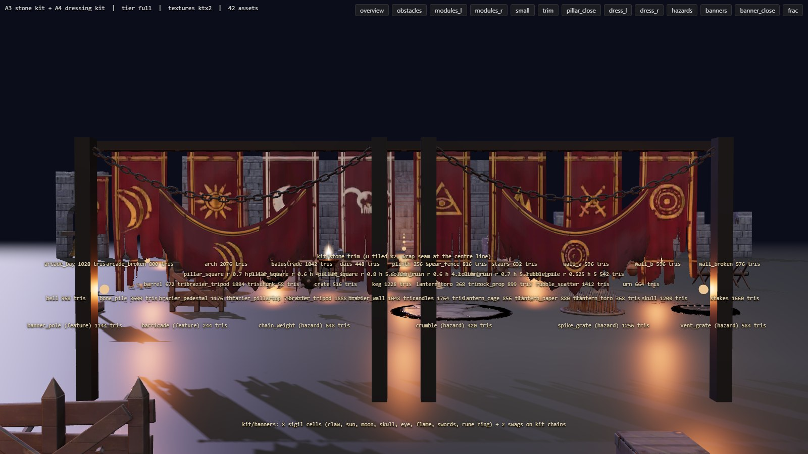
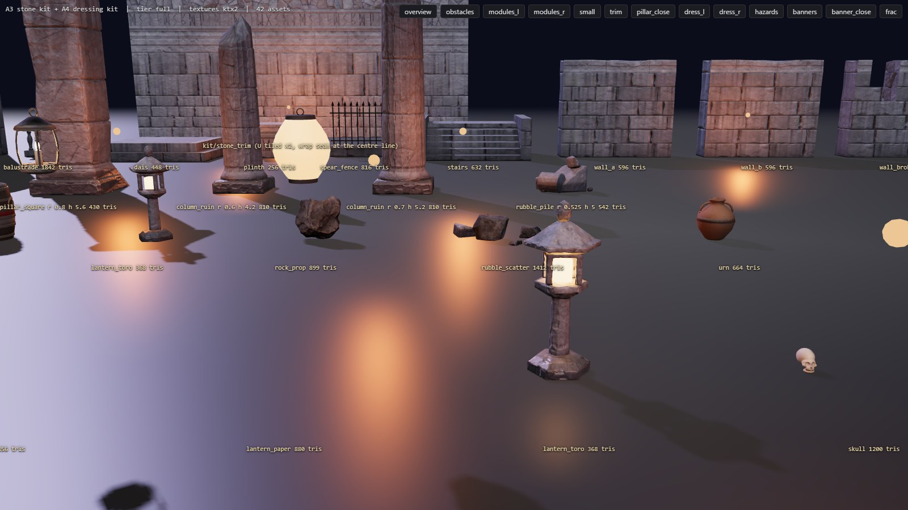

# A4: shared dressing kit

Branch `anim-plan`, 2026-10-18. Spec: `docs/arena-art-plan.md` (A4 row; sections 4.2, 4.3, 5.2, 6.5, 6.6) and the A1 / A2b / A3 READMEs. Target look: `docs/concept-art/ref-3..10.png` (tattered, heavy, dark-red banners with gold sigils hanging from huge chains; iron braziers with real fire; weathered, not clean). `src/sim` is untouched.

## Gates

| Gate | Result |
|---|---|
| `npm run build` | passes |
| `npm run fx:check` | all FX checks passed |
| `npm run sim:test -- 40` | identical to the A2b / A3 baseline: mean 70.4 s, 0 timeouts, 0/2240 kills without contact, determinism true, pickups 1.08 / throws 0.83 per fight |
| `npm run arena:budget` | PASS (45 assets x 2 tiers x 2 formats; new rows `dress`, `feature`, `hazard`, `chain`, `cloth`; prop FRAC pieces inside the contract) |
| Prop bounds vs sim tables | every kit prop exactly `PROP_BASE` r / `TOP` (budget gate on the shipped GLBs) and measured again in game: 0 mismatches over 90 props in 6 runs (`load/dress.json`) |
| `?arena=legacy` | **pixel-identical** to HEAD `ba6614c` (ref-3, ref-4, ref-6 concept renders incl. sky masks, max difference 0; baseline built in a temporary worktree) |
| Banner sway + chain swing CPU | **0.0001-0.0004 ms per frame** (the whole CPU side is one shared uniform write; `Arena.swayStats`, 1200 frames per run, 6 runs on q0 / q1 / q2). Budget 0.1 ms |
| In-game check (`tools/arena/check_dress.cjs`: colosseum pit / cross / oval on q1 / q2 / q0, forge, desert, sakura; 40 s of fight each) | 0 console errors; every prop, feature (banner pole, barricade) and hazard (spikes, chains, crumble, flamejet) uses its kit asset |
| Gallery (`node tools/arena/check_gallery.cjs --out=docs/milestones/A4/gallery`) | all 42 kit assets load on both tiers; one 404 on the full-tier page is the favicon |

## What shipped

| Part | Files |
|---|---|
| **Generic dressing-kit pipeline** (copies the A1 / A3 job pattern into one module): piece builder -> `Part`s per LOD (bmesh + material key + high mode) -> optional exact fit to the sim contract -> one textured body per LOD (Smart UV) + constant-emissive glow parts -> high derived per part (bevel, Catmull-Clark + clouds displacement, or `stonekit.weather_high` for stone) plus high-only detail (rivets, stave grooves, bell relief) -> bakes (normal, AO with ground, base colour / roughness / metal as emission, ORM) -> nodes split back out of the baked body (`SPIKES`, `SLAB_*`, `RIM`, `LINK_*`) -> FRAC_* pieces by random-plane slicing with capped cuts -> KIT_ root extras, COL convex hull, SOCK_* -> GLB + asset.json -> Cycles preview (LOD0, LOD1, FRAC exploded). Procedural high materials: forged iron (Poly Haven `metal_plate_02`, desaturated, soot + rust blotches, worn edges, partly metallic), rust (`rusty_metal_02`, new), wood (`weathered_planks`, new; scan mapped along each part's principal axis so grain follows every plank / stave / post), kit stone, clay, bronze with verdigris, bone, wax, rope, paper, gold, red paint | `tools/arena/blender/dresskit.py` |
| **23 pieces** (`npm run arena:bake -- a4`; group `a4`, small jobs start at 2.5 GB free): braziers `brazier_pedestal` (ref-3 wide dish on a squat stone pedestal, SOCK_flame 1.6), `brazier_wall` (podium-top stand), `brazier_pillartop` (ref-4 cradle); lights `lantern_toro` (the sim's `lantern` prop, stone, 0.35 / 1.6), `lantern_cage`, `lantern_paper` (hanging), `candles` (9 candles with drips, 9 `SOCK_candle_*`); dressing `bell` (bronze + relief + yoke), `skull`, `bone_pile` (mesh unions -> voxel remesh -> boolean sockets), `stakes` (cheval-de-frise with rope lashings); hazards `spike_grate` (`SPIKES` node), `chain_weight` (spiked ball, `SOCK_chain`), `vent_grate` (scorched stone ring + iron grate), `crumble` (7 heaved slabs `SLAB_*` + broken `RIM`), `chain_link` (`LINK_big` 96 tris / `LINK_small`, LOD1 48); features `banner_pole` (sim `banner`, `SOCK_banner {w, h}`, 3 FRAC), `barricade` (sim `barricade`, 8 FRAC); props `crate`, `barrel`, `urn`, `keg` (sim `explosive`, SOCK_glow at the fuse), `chunk` (rubble chunk, r 0.38 / 0.6), each with 4-8 FRAC pieces per LOD. The A1 tripod is the fourth brazier type | `tools/arena/blender/kit_dress.py`, `tools/arena/jobs.json` |
| **Banners**: cloth simulation in Blender (heavy cloth, starting pleats, wind + turbulence, 60 frames) of a vertical banner (1 x 2.8 m, pinned top) and a swag (2.6 m of cloth between pins 2.2 m apart) + an iron rod; LOD1 = every other vertex of the simulated grid. **Atlas** (numpy, 2048 RGBA; normal + ORM 1024): 8 vertical cells (claw, sun, moon, horned skull, eye, flame, crossed swords, Moon Gate rune ring) + 2 swags; maroon-crimson cloth with fbm variation, weathering streaks and sun-bleached blotches, gold trim bands, embroidered sigil (gold or bone white) with dark stitched outline and worn thread, mud rising from the bottom, burn holes with charred rims, and the **tear mask in alpha** (shredded bottom: ribbons of different lengths between V slits, ragged frayed edges, side notches, holes). Weave + embroidery + hem normals; gold metallic in ORM | `tools/arena/blender/kit_banner.py` (job `kit_banners`) |
| Pipeline: alpha textures (`colorA`: KTX2 `R8G8B8A8_SRGB` ETC1S, WebP / half-size keep alpha), `alphaMode MASK` + double-sided materials from asset.json; budget rows per role, FRAC bounds inside the prop contract, `chunk` contract parsed from `world.ts`, required sockets / nodes per role, FRAC primitives no longer counted as draw calls | `tools/arena/build_assets.mjs`, `tools/arena/check_budget.mjs` |
| **Vertex-shader banner sway** (`aSway` = sway axis, hang depth in metres, phase): two sine octaves growing with hang depth; one shader for single banners (phase from the model position) and for merged banners (phase per banner in the attribute), so all wall banners are ONE draw call. Off on the low tier (plan 6.6). `BannerKit` picks atlas cells by UV offset | `src/render/arena/cloth.ts` |
| **Instanced chains**: links along a parabola-catenary, alternate 90 deg roll, one `InstancedMesh` per link kind; swing in the vertex shader after the instance transform (`aSwing`: lateral vector, t along the chain, phase; ends fixed, belly swings) | `src/render/arena/chains.ts` |
| **Runtime wiring (kit mode only)**: `KIT_DEFAULT` maps every prop kind, the features and the hazards to the kit; `Dressing.feature / hazardKit / chainKit`; banner poles carry a kit banner on their crossbar (cell from the render seed), barricades shatter as before; the spike grate's `SPIKES` node rises through the bars; the chain weight hangs on instanced kit links (pendulum group, exact `chainSwing` as before); the vent replaces the cylinder grate (glow disc under its bars); the crumbling floor shows heaved slabs that jitter while cracking and tilt / drop into the pit, then the broken rim; the keg spark sits at its fuse socket (no torus band); the toro gets a small flame at SOCK_glow. Colosseum ring: legacy wall-top bronze braziers -> `brazier_wall` (merged statics), legacy wall banners -> kit banners on rods with short chains to the coping (one merged swaying mesh + one rod mesh + one instanced chain mesh), wall-foot decor (candles with one merged glow-card mesh, skulls, bone piles), ring flames alternate pedestal bowls and tripods | `dressKit.ts`, `arenaView.ts`, `dressing.ts`, `art/index.ts`, `art/types.ts`, `art/colosseum.ts`, `dressClassic.ts` (flags only) |
| **Math.random banner phase**: kit mode never uses it (kit banners: shader phase from the render seed / position; the legacy `banner()` in kit mode gets a deterministic phase and stops its CPU flutter once the kit ring removes it). On `?arena=legacy` the old `Math.random()` call is kept on purpose, see decision 2 | `common.ts` |
| Gallery: new rows (dressing with stand-in flames and socket lights, hazards + features, 8 banner cells on rods + 2 swags on swinging chains, FRAC pieces exploded), animated sway (`?still=1` freezes it for screenshots); in-game checker | `tools/arena/gallery/gallery.ts`, `tools/arena/check_gallery.cjs`, `tools/arena/check_dress.cjs` |

## Measurements

**Blender** (CPU): 18-100 s per job, peak working set 1.0-1.8 GB (crumble, 7 stone weathering passes, 1.8 GB); free RAM never below 3.9 GB; one job at a time. Banner job 62 s (cloth sims under 1 s, atlas 42 s).

**Shipped** (`npm run arena:budget`, KTX2 full / low): props 516-1228 tris LOD0 (+ FRAC 640-2292), 0.24-1.3 MB; braziers 752-1172 tris, 0.29-1.08 MB; banners 1208 / 290 tris, 0.51 / 0.21 MB (2048 RGBA atlas); chain links 192 / 96 tris; hazards 420-1256 tris, 0.32-1.0 MB. **Kit texture GPU memory: low 27.2 MB / 64, medium + high 108.7 MB / 128** (A3: 16.7 / 66.7). Colosseum kit-mode download grows by about 9.8 MB full (A3: 17 MB -> about 27 MB; plan first-visit target 14 / 22 MB): see "for later".

**In game**: ref-3 preset draw calls 272 (A3: 295), triangles 691k; sway / swing CPU 0.0001-0.0004 ms per frame. GPU cost of the sway vertex shaders not timer-queried (a few ALU per vertex on ~1-2k banner / link vertices).

## How close to ref-3 (by eye, honest)

- **Banners**: the material is right in kind: dark maroon-crimson cloth, gold (or bone) embroidered sigils with worn thread, shredded ribbon bottoms, burn holes, folds from the cloth sim. Differences: ref-3's banners are 8-10 m long, hang from the pillars and from huge chains in swags across the arena, and their bottoms are shredded much deeper (a third of the length in long strips). Ours on the colosseum are 2.6 m wall banners and pole banners; the big pillar banners and chain swags are A7 placement work (the assets exist: the vertical banner scales, the swag sits on kit chains in the gallery). The claw sigil is ours, not ref-3's trident-claw glyph.
- **Braziers**: the pedestal brazier follows ref-3's wide dish on a squat block; in the night look it reads as a dark iron dish with a fire. ref-3's fires are bigger and brighter than our flame cards (A19 fire FX) and its pedestals sit in pairs by the stairs (A7).
- **Night look**: in the wall view the kit banners, wall braziers and candles are legible but dark, like the A3 stone; the banners' crimson is visible only where fires or the moon touch them. Lighting / grade remain A8.
- I would not call the colosseum "ref-3" yet: composition, scale of the banners / chains and the backdrop are still missing (A6-A8).

## Decisions made while the owner was asleep (please confirm)

1. **One generic pipeline** (`dresskit.py`) for all 23 pieces instead of one script per piece; procedural geometry everywhere, CC0 scans only as material detail (new: Poly Haven `weathered_planks`, `rusty_metal_02`, both CC0, ledger rows added).
2. **`?arena=legacy` keeps `Math.random()` for the legacy banner phase.** Replacing it with a seeded phase would change legacy pixels (the concept harness seeds `Math.random`, so the old phase is reproducible there) and break the pixel-identical gate. Kit mode is fully deterministic (shader phases from the render seed / positions). The legacy builders go in A21; if the owner prefers, flip the legacy call too and accept a one-time legacy pixel change.
3. **Banner atlas**: 8 vertical cells at 512 x 768 (512 px/m across) + 2 swags, colour 2048 RGBA, normal / ORM 1024 (saves about 6 MB GPU). All cloth is crimson / maroon; per-theme recolours are a later option (tint or a second atlas).
4. **Iron is only partly metallic** (metal x 0.45, rougher): the first bakes read as copper under the warm fires.
5. **Kit props for every theme in kit mode** (`KIT_DEFAULT`): crate, barrel, urn, keg, chunk, toro lantern, banner pole, barricade, all hazards. The chunk asset is stone rubble for every chunk (banner shafts and barricade planks also leave "chunks" in the sim: they now look like stone).
6. **Hazard visuals scale in x / z by `h.r / r0`**, height unchanged; the chain weight keeps its size (ball 0.3 m + spikes, origin at the ball centre where the A2b ball was).
7. **Colosseum ring**: wall banners 1.25 x 2.6 m on rods with two short chains, wall braziers -> `brazier_wall`, decor every 6.5 m (45 % skipped), ring flames alternate pedestal / tripod. The pedestal flame is bigger (SOCK_flame 1.6).
8. **FRAC pieces ship hidden** (props, features, chunk); spawning them on breaks is A5 (debris pools).
9. **Candle flames** are one merged additive glow-card mesh (no lights, no flicker) to keep draw calls flat; A19 may swap in FX flames.

## What I could not judge or verify

- **By eye in motion**: the sway and swing were watched only as stills (gallery with `?still=1`, in-game screenshots); amplitude / speed feel is the owner's call (`swayMaterial(amp)`, `ChainKit.hang(swing)`).
- The crumble collapse, spike rise and chain-weight swing with the kit meshes ran in headless fights (no errors) but were not watched frame by frame.
- **Skull / bone pile** read as skulls and bones in the gallery but are blobby up close (metaball-free mesh unions); good enough as ground decor, not as hero props.
- No GPU timer queries this milestone; no real (non-headless) browser; ASTC / ETC2 targets untested (as before).
- Lanterns cage / paper, bell, stakes, skulls are built and in the gallery but placed in no arena yet (A7+ / theme milestones).

## For A5 (statues and fracture)

- FRAC pieces exist for every prop / feature / chunk (`FRAC_k` under LOD0, `FRAC_k_l1` under LOD1, hidden, `userData.frac`); the debris pools can take them per kind (`prop_break`, `obstacle_break`, `topple_impact`). Pieces are random-plane slices with capped cuts (cap UVs copy a neighbouring loop).
- New pipeline bits to reuse: `dresskit.Asset` (any lowfirst / highfirst piece in ~30 lines), `slice_pieces`, `split_nodes`, `col_proxy`, `remesh_smooth` + `boolean_cut` (kit_dress.py) for organic shapes.
- Check new assets in the night look (`node tools/shots/concept.cjs --refs=ref-3 --views=wall,pillar`) and with `node tools/arena/check_dress.cjs`; the gallery lights are brighter.
- Download: the colosseum kit pack is now about 27 MB full; A21 (or a theme pack split) must cut it (1024 sets on props are generous).
