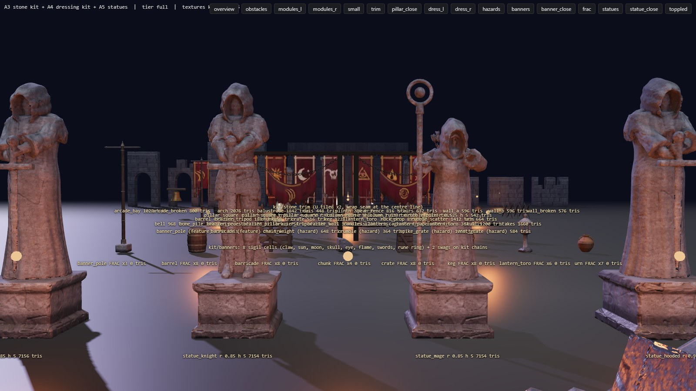
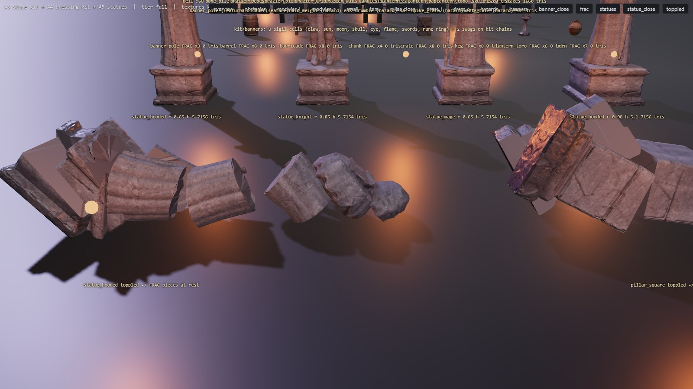
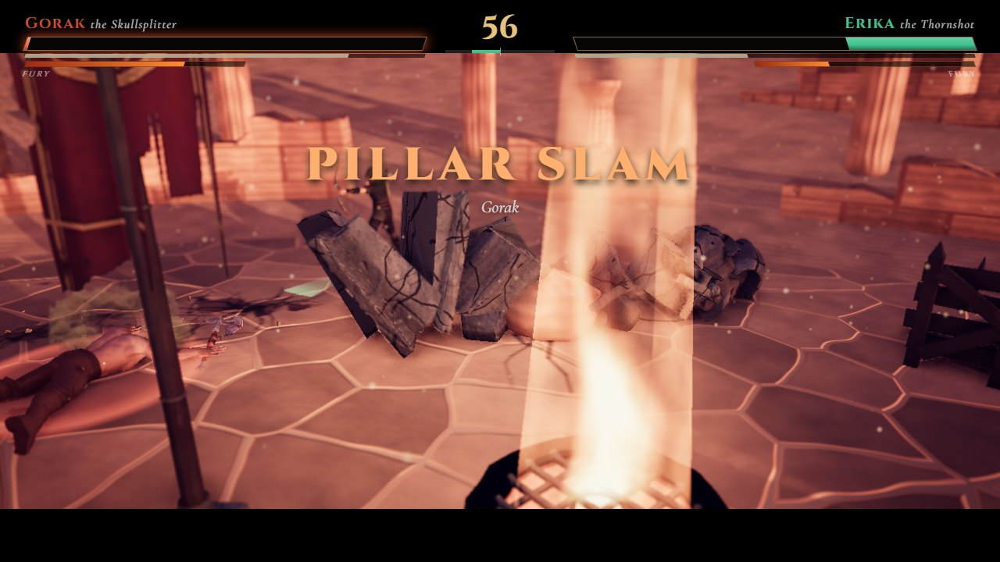
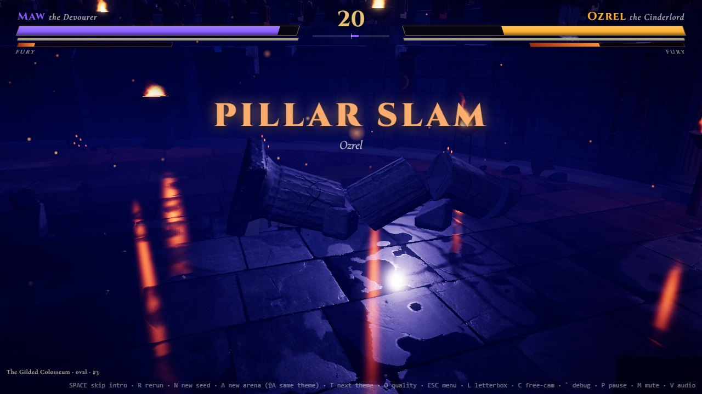
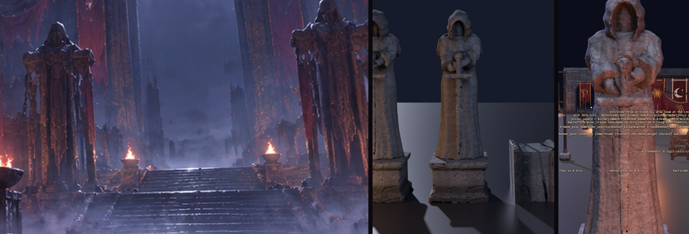

# A5: statues and fracture

Branch `anim-plan`, 2026-10-18. Spec: `docs/arena-art-plan.md` (A5 row, section 5.4) and the A1-A4 READMEs. Target look: `docs/concept-art/ref-3` (two hooded guardians flanking the stair), ref-7 (hooded knight colossi with swords point down), ref-8 (hooded staff figure), ref-9 (goddess colossus), ref-5 (seated colossus). Owner update 2026-10-18: statues are built in Blender; fighter models may be used as bases (the original Mixamo FBX files in `Assets/Models` were used; nothing from `Assets/Models_HF`). `src/sim` is untouched.

## Gates

| Gate | Result |
|---|---|
| `npm run build` | passes |
| `npm run fx:check` | all FX checks passed |
| `npm run sim:test -- 40` | identical to the A2b-A4 baseline (sim untouched): mean 70.4 s, 0 timeouts, 0/2240 kills without contact, determinism true |
| `npm run arena:budget` | PASS (48 assets; new role `statue`; kit texture GPU memory low 29.2 MB / 64, medium + high 116.7 MB / 128) |
| `?arena=legacy` | **pixel-identical** to HEAD `46d4841` (ref-3, ref-4, ref-6 concept renders incl. sky masks, max difference 0; baseline built in a temporary worktree, removed afterwards) |
| Topple + land shows FRAC pieces along the fall line (`node tools/arena/check_frac.cjs`, 4 fights that topple a kit obstacle, found by `npx tsx tools/arena/find_topples.ts`) | intact mesh hidden on landing, one FRAC mesh lying on the fall line: desert statue (pit, q2) along 0..6.4 m of a 5.1 m statue, lateral 1.2 m; desert statue (oval, q1) along -0.7..2.7 m (the pieces bunch up there); colosseum column (oval q1) 0.3..6.3 m; colosseum pillar (cross q0) 0.2..6.9 m; pieces rest on the floor (y min -0.02..-0.12 m). 0 console errors. Shots in `frac/` |
| Debris draw calls unchanged | debris pools: the same number of InstancedMeshes as legacy in every case (1 / 1 / 3 / 1, `frac.json` vs `frac_legacy.json`); one-frame A/B with the intact obstacle vs its FRAC set: 130 / 130, 157 / 157, 220 / 220 calls (the 4th case read 235 intact vs 176 broken: half-rate reflection frame, not comparable) |
| In-game dressing check (`check_dress.cjs`, 6 runs) | 0 console errors, 0 prop contract mismatches; the colosseum ring now includes `kitRing_kit/statue_hooded` (both guardians, one merged mesh) |
| ref-3 preset | draw calls 272 -> 275, triangles 691k -> 734k (the two guardians) |

## What shipped

| Part | Files |
|---|---|
| **Statue pipeline** (one Blender process per piece, group `a5`): import the original Mixamo FBX, **pose by aiming bones** (analytic two-bone arm IK + world-space bone directions + finger curl; the legacy Action API is gone), bake the posed meshes, thicken every open shell (solidify; without it whole armoured legs vanish in the voxel union), then **carved drapery as solid shapes built around the posed body**: robe lofted over the skeleton's sections (centre along feet -> hips -> chest, widened to cover the torso vertices, smoothed along the height, never narrowing below the hips), folds with rounded ridges and sharp creases deepening toward a flared hem, each fold its own depth; shoulder mantle with a wavy hem; deep hood (ellipsoid around the measured head minus a face opening, peak pulled back, cowl flaring onto the shoulders); sleeves along the arm bones; back-only cloak (knight); lap drape (seated); props (sword planted point-down, greatsword, ring-headed staff). Everything joined, voxel-remeshed + smoothed into one monolith, fitted to the plinth, then **`stonekit.weather_high`** (chips on every ridge, fold crest, knuckle and hood rim; cracks; erosion pits; soot streaks from the top; moss in up-facing cavities) with the CC0 lichen-rock scan. LODs = decimated monolith (7.2k / 2.3k tris) + a procedural moulded plinth, Smart UV, bakes (normal, AO, base colour, roughness), FRAC, COL hull, GLB | `tools/arena/blender/statue_kit.py`, `tools/arena/jobs.json` |
| **3 toppleable statues** for the sim's `statue` obstacle (nominal r0 0.85, H 5.0 = `THEME_RULES.desert`): `kit/statue_hooded` (ref-3 guardian: robe, mantle, hood, sleeves, hands on a sword pommel; Aldric's Paladin base), `kit/statue_knight` (ref-7: Aldric's plate armour visible, hood + cowl + back cloak, greatsword), `kit/statue_mage` (ref-8: robed hooded saint with a ring staff, left hand raised; Erika base). 1024 / 512 sets, 1.7 MB full / 0.55 MB low each (KTX2). Variants picked by obstacle id (`KIT_DEFAULT.obstacles.statue`) | `art/index.ts` |
| **Statue fit** (`fit: 'statue'`, `plinthTop`): the plinth takes the sim radius in x / z, the figure scales uniformly so the top lands exactly on `o.h` (a 9-slice band would squash the figure); statues face the arena centre | `dressKit.ts` (`kitObstacle`) |
| **Colossus backdrop sources for A6**: `colossus_goddess` (veiled goddess in a gown, hands at the chest, Erika base, 12 m, 319k tris) and `colossus_seated` (hooded seated lotus figure, hands in the lap, Gorak base, 9 m, 732k tris), weathered highs saved as `tools/arena/_bake/<id>/<id>_hi.blend` (object `COLOSSUS`, stone material with the `tint` attribute) + `colossus.json` | `statue_kit.py` (jobs `colossus_*`) |
| **Fracture sets**: `fracture.fracture_axis` cuts a mesh across its long axis with tilted planes, splits the biggest pieces along the axis, caps every cut and roughens the caps (longest interior diagonals subdivided and pushed in / out), cap UVs from a neighbouring surface loop, flat-shaded caps. Statues: plinth, plinth top, knees, hips, chest, neck + 2 axial splits = 9 pieces; **pillars and columns re-fractured** with it (A3 had plain horizontal slices): 5 pieces each | `tools/arena/blender/fracture.py`, `kit_stone.py` |
| **FracSet** (runtime): the hidden FRAC_* meshes of an object merged into one mesh per material and animated on the CPU as rigid bodies (hop / burst, spin, gravity, rest on the floor, slide, then after `linger` a slow sink), an **analytic function of the time since spawn** (seeded per object, so seeks land on the same picture). Toppled obstacles break on landing and their pieces settle along the fall line (`lie`, linger 10 s); barricades burst when they shatter; props burst on `prop_break` / keg `explosion` (linger 6 s). The intact mesh is hidden, so a breaking object costs the same draw calls as the intact one | `debris.ts` (`FracSet`), `arenaView.ts` |
| **Per-theme debris chunks**: `ThemeArt.debris` (debris kind -> kit asset); the pools instance the asset's most block-like FRAC piece with its baked material (stone -> `kit/chunk`, wood -> crate splinters, ceramic -> urn shards; marble / sandstone take the chunk shape with their flat colour). Only assets the layout loads anyway are used (no extra download). Still one InstancedMesh per debris kind | `debris.ts` (`setChunk`), `arenaView.ts` (`kitDebris`), `art/types.ts` |
| **Colosseum guardians**: two kit hooded statues (x1.4, 7 m) flanking the east gate (the azimuth of the ref-3 preset's landmark), plinths set into the podium wall, merged with the ring (one draw call) | `art/colosseum.ts` (`ring.guardians`), `dressKit.ts` |
| Tooling: budget role `statue` (footprint, exact top, fit / plinthTop extras, >= 5 FRAC pieces), Mixamo ledger rows (`mixamo/<fbx>`, licence "Mixamo", accepted only for those ids); gallery rows (statues through the game fit, a toppled statue and pillar broken into their FRAC pieces at rest); `check_frac.cjs`, `find_topples.ts` | `check_budget.mjs`, `public/arena/credits.json`, `gallery/gallery.ts`, `tools/arena/check_frac.cjs`, `tools/arena/find_topples.ts` |

## Measurements

**Blender** (CPU): statues 74-83 s per job, peak working set 2.15-2.25 GB (2048 AO bake of the first hooded version: 160 s); colossi 26-36 s, 1.9-2.1 GB; pillar 119 s / column 54 s. Free RAM never below 3.5 GB. One job at a time, never with a browser.

**Shipped** (`arena:budget`, KTX2 full / low): statues 7.15k tris LOD0 (+ FRAC 11.2k-12.5k) / 2.26k (+ 4.3k-4.6k), 1.7 MB / 0.55 MB; pillar FRAC 524 -> 730 tris, column 1358. GPU texture memory medium + high 108.7 -> 116.7 MB / 128. **Download**: colosseum kit mode + 1.7 MB (the guardian statue; about 29 MB full now); a desert arena with statues loads the three variants (5.1 MB full).

**Runtime**: a FracSet rewrites its vertex buffer only while pieces move (about 1 s after landing, then the sink); a statue set is about 18k vertices. Not timer-profiled (see below).

## How close to ref-3 (by eye, honest)

- **Reads as stone**: yes in the Blender previews and the gallery: weathered, chipped fold crests, cracks, soot streaks, carved folds, no plastic sheen. At 1024 px the surface is softer up close than the A3 pillar (2048).
- **Against the ref-3 guardians** (`compare_ref3_guardians.jpg`): the silhouette family is right (tall hooded robed figure, dark face opening, hands at the waist, square plinth), but ref-3's guardians are **broader in the shoulders, heavier and much more ornate**: carved trim bands, gold / red banners and chains draped over them, deep vertical robe channels and a shredded hem, hands lower and hidden in the sleeves, no visible sword. Ours are plainer and slimmer, with a smoother robe and a visible sword. Worth a second pass (ornament band, chains / banners from the A4 kit hung on them, wider shoulders) when A7 places them for real.
- **In the colosseum** the guardians are placed but **barely legible** in the ref-3 preset: they stand backlit (the moon is behind the gate), dark kit stone against the dark legacy crowd stands. In ref-3 they read as silhouettes against bright fog with fire at their feet. That is A7 (stair / dais, ruined tiers instead of the stands) and A8 (fog / lighting) work; I could not make them read with placement alone.
- **Knight** (ref-7): the closest match: hooded plate knight, hands on a greatsword point down, cloak behind. **Staff figure** (ref-8): right idea, the staff is thin and plain (ref-8 has a glowing orb).
- **Colossi**: usable first-pass sources only. The goddess reads as a praying veiled figure in a gown; ref-9's has bare arms, a halo and a much more sculpted body. The seated colossus is lumpy (the lap drape is a blob) and is a hooded monk, not ref-5's bald Buddha. A6 should treat them as blocking sources and may need a finer drapery pass.

## Decisions made while the owner was asleep (please confirm)

1. **Bases**: original Mixamo FBX files (`Assets/Models`): Paladin (Aldric) for the hooded guardian and the knight, Erika for the staff saint and the goddess, Brute (Gorak, axe removed) for the seated colossus. Vex's and Ozrel's models were tried first and dropped: their sickles / rings / shoulder blades poke through the drapery. Nothing from `Models_HF`. Ledger rows `mixamo/*` carry the Mixamo licence (repo private).
2. **Drapery is procedural solid geometry, not a cloth simulation**: deterministic, carved-looking, and robust against the posed bodies; a cloth-sim pass can come later if folds need more life.
3. **All statues use 1024 / 512 sets** (the first hooded bake was 2048 = 5 MB; dropped to keep the download lean and the medium GPU budget at 116.7 / 128 MB).
4. **Statue fit**: plinth to the sim radius, figure uniformly to the sim height (no stretch band). The visual footprint is the plinth (corner radius 1.08 m vs r 0.85, inside the 1.55 x r rule).
5. **Fallen pieces linger 10 s, then sink** into the floor over 1.6 s (props: 6 s); they are render-only (the sim keeps its two throwable chunks), so fighters walk through them while they lie there.
6. **Statues are the `statue` kind in every theme** via `KIT_DEFAULT` (today only desert spawns them). Glacier `crystal` (the plan's frost-crusted knight) stays as it is until its theme milestone.
7. **Guardians** stand on the colosseum floor at the east gate, plinths set into the podium wall (on top of the wall they disappeared into the stands); A7 moves them to the stair / dais.
8. **Debris chunks** use the kit material only for stone / wood / ceramic; marble and sandstone keep their flat colour with the kit chunk shape.

## What I could not judge or verify

- **Motion**: the hop / roll / settle of the pieces was checked as stills at +0.25 s and +2 s (`frac/*_hop.jpg`, `*_rest.jpg`), not watched in real time; speeds and the linger / sink timing are the owner's call (`FracSet` opts in `arenaView.spawnFrac`).
- The pieces do not collide with each other or with fighters (they can overlap a little); the desert oval statue's pieces bunch up instead of spreading along the full length.
- No GPU timer queries; the CPU cost of the vertex rewrites was not profiled (about 18k vertices for about 1 s per statue).
- Gallery screenshots on the full tier only; the low tier was exercised in game (`check_dress` q0, `check_frac` colosseum cross q0).
- The guardians' read in the ref-3 frame (see above): placed, not convincing yet.

## For A6 (backdrops)

- Colossus sources: `tools/arena/_bake/colossus_goddess/colossus_goddess_hi.blend` and `colossus_seated_hi.blend` (object `COLOSSUS`, 12 m and 9 m, stone material reading the `tint` colour attribute + `polyhaven/lichen_rock` from `Assets/arena-src`; the image paths are absolute on this PC). Link with `bpy.data.libraries.load` and scale to the landmark height (goddess 50 m, seated 45 m). Re-run with `npm run arena:bake -- a5-colossi`. They are first-pass shapes (see above): a finer drapery / hair / halo pass is expected.
- `statue_kit.py` can make more posed figures: a piece = FBX + pose function (aim / `arm_ik` / `leg` / `curl`) + drapery list + prop. Hooded statues in other themes (ref-7 knight court, ref-8) are already in the kit.
- `fracture.fracture_axis` works on any mesh object (cuts across Z, axial splits, rough caps): use it for broken backdrop pieces or new toppling kinds.
- Check new assets in the night look (`node tools/shots/concept.cjs --refs=ref-3 --views=wall,pillar`): kit stone still renders very dark there.
