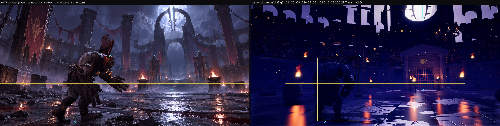
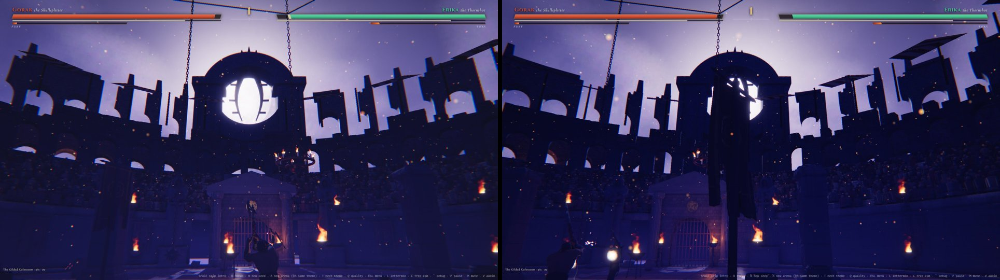
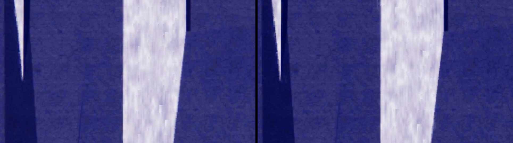
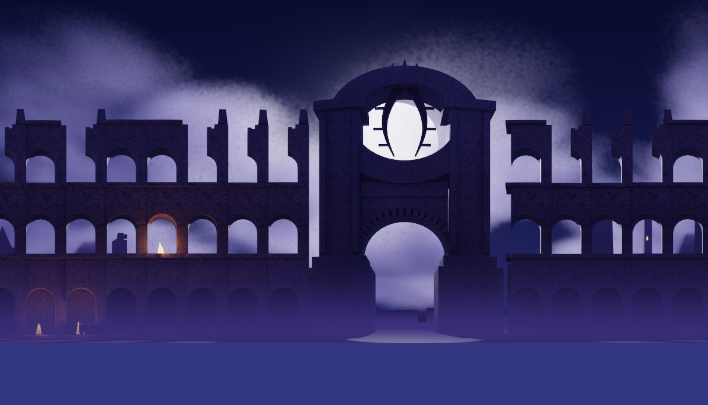

# A6: backdrop pipeline

Branch `anim-plan`, 2026-10-18. Spec: `docs/arena-art-plan.md` (A6 row, sections 5.6, 6.3, 6.4, 6.6) and the A0-A5 READMEs. Test scene: a Moon Gate arch **blockout** (ring arch with the moon behind, a ruined three-storey arcade around the arena, outer ruined towers, mountains, storm clouds), rendered with Cycles on the Arc iGPU. `src/sim` is untouched.

## Gates

| Gate | Result |
|---|---|
| `npm run build` | passes |
| `npm run fx:check` | all FX checks passed |
| `npm run sim:test -- 40` | identical to the A2b-A5 baseline (sim untouched): overall win rates 46.8-53.6 %, mean 70.4 s, 0 timeouts, 0/2240 kills without contact, determinism true |
| `npm run arena:budget` | PASS. Arena texture GPU memory (KTX2, kit + backdrop): low 30.3 MB / 64, **medium 123.4 MB / 128**, high 153.4 MB / 192 (backdrop low 1.1, medium 6.7, high 36.7 MB) |
| `?arena=legacy` | **pixel-identical** to HEAD `d65bfa6` (ref-3, ref-4, ref-6 concept renders incl. sky masks, max difference 0; baseline built in a temporary worktree, removed afterwards) |
| Parallax when the camera moves 5 m | yes: the arch top moves **60.7 px** against the moon (1920x1080, 50 deg vFOV) for a 5 m sideways move with the same view direction, on every tier (`check/check.json`; image below) |
| Waterfall / emission animate on a test AOV | yes: the waterfall view changes 6.3-6.8 % of its pixels in 0.5 s (mean change 7-9 levels on the lit pixels); fires flicker (2.8-3.3 levels on the lit pixels, HDR gain into bloom); clouds sway / breathe slowly (by design under 0.2 levels per 0.5 s) |
| Backdrop <= 0.6 ms on high (GPU timer queries) | **yes: 0.33 ms** (p95 0.37) isolated on high, + 0.02-0.04 ms in the floor reflection; medium 0.32 ms, low 0.16 ms. With a stand-in hero inset and all 16 fog banks + 3 shafts (synthetic textures, not shipped): 0.43 ms avg (p50 0.38, p95 0.49). Method below |
| Memory within the GPU texture budget | yes (above). Medium had about 11 MB of headroom; its backdrop is 6.7 MB. Download: high 1.4 MB, medium 0.7 MB, low 0.2 MB (KTX2) |

## What shipped

| Part | Files |
|---|---|
| **Panorama renderer** (Blender 5.0, one process per mode): `layers` = Cycles equirectangular camera at the arena centre, 1.6 m, latitude -12..+48.1 deg (the band is 360 x h / w), one **view layer per depth layer** (near / mid / far; the other layers' collections excluded, lights shared), film transparent; passes through the 5.0 compositor File Output: Image (RGBA), **Depth** (radial metres, checked with marker posts: 49.5 m for a post at 50 m), **AOV** `aov` (R emission, G water, B cloud). Near / mid render as **4 longitude strips** (`--strips 4`: the GPU job peaked at 3.9 GB instead of about 5.7 GB). `inset` = the **hero inset**, the near layer from the ref-3 concept camera, 4096 x 2048. `preview` = **EEVEE slice preview** (8 perspective slices of 45 deg, stitched; EEVEE has no panoramic camera, A0). `cards` = **EEVEE volumetric card sequences** (moon light shaft, fog bank; 32 looped frames, 8 x 4 atlas of 256 px). Mapping measured with marker posts: u = 0.5 + az / 360 | `tools/arena/blender/backdrop_pano.py`, jobs `backdrop_quick`, `backdrop_look`, group `a6` in `tools/arena/jobs.json` |
| **Moon Gate test scene** (blockout): ring arch at azimuth 0 / 74 m (two stepped pylons, a square-section ring framing the moon, a portal arch with an archivolt, a two-blade crescent sigil), a three-storey ruined arcade ring (r 62 m, 6 bay variants: full, broken spandrels, stumps, rubble; gap for the arch), 9 small tier fires (emit AOV + point lights), outer ruins 150-420 m (towers, spires, curtain walls, lit window slits), a cliff with three waterfall sheets at azimuth 160 (water AOV test; the concept has no waterfall), mountain silhouettes 0.9-1.4 km, 34 storm-cloud volumes with a clear hole round the moon, moon sun lamp at az -1.7 / elev 27 (#d8d4ff), night gradient world. The moon disc itself is drawn by `sky.ts` | `tools/arena/blender/backdrop_moongate.py` |
| **Post-process**: stitches strips, fills alpha-0 colour (push-pull, no dark fringes), blurs the cloud alpha / colour (Cycles denoises colour, not alpha), derives the cloud AOV, composites `farc` (mid over far) for medium and `all` for low, resizes per tier, builds per layer a **coarse depth grid** (low percentile per cell so silhouettes keep their foreground depth, holes filled from neighbours, smoothed in log space) and a **coverage grid** (cells with visible texels), and a by-eye preview (layers over a sky.ts stand-in with the game's fog formula) | `tools/arena/backdrop_post.py` |
| **Build**: KTX2 via `ktx create` directly (log checked; layers + inset ETC1S q220 sRGB+alpha, AOV ETC1S linear) + WebP (Pillow), depth / cover bins, `backdrop.json`, manifest `backdrops` entry | `tools/arena/build_backdrop.mjs` (`npm run arena:backdrop`), `build_assets.mjs` (exports its encoders), `public/arena/backdrop/moongate/` |
| **Budget**: backdrop files listed and present, block-size multiples of 4, depth-grid sizes, download caps per tier (2 / 6 / 16 MB), GPU memory per quality tier added to the kit's (q0 -> low, q1 -> medium, q2 -> high) | `tools/arena/check_budget.mjs` |
| **Runtime `backdrop.ts`**: each layer is a grid (near 512 x 96, mid 256 x 48, far 128 x 24) whose vertices sit at the **rendered depth** along their panorama direction (display radius capped at 1200 m; the true depth goes to the fog), empty cells skipped; drawn after the opaque scene (transparent queue, renderOrder far -> near, depth test on, depth write off): one draw call per layer. **Fog match**: the scene's `fog.ts` formula (exp2 distance + ground-hugging height term, same uniforms) on the true depth compressed by `fogRange` (R (1 - e^(-d/R))) and capped by `fogMax`, so the in-game mist runs on into the vista and distant layers haze over instead of vanishing. **AOV animation**: emission flicker per texel cell with HDR gain (bloom), waterfall streaks scrolling down + foam, clouds sway / breathe. **Hero inset** projected onto the near layer through the inset camera's view-projection (edges faded). **Cards** (medium / high): 3 additive moon shafts leaning out of the arch, 8 / 16 fog banks on a ring at the foot of the ruins in the scene's fog colour. The near layer is also drawn into the planar floor reflection (the arch mirrors in the wet floor); mid / far are not (cost) | `src/render/arena/backdrop.ts`, `arenaView.ts` (build + per-frame fog colour; `noReflect` flag in `tagReflect`) |
| **Loading**: `ArenaAssets.loadBackdrop(id, quality)` (KTX2 through the shared `KTX2Loader`, WebP fallback, flipY off, repeat in u), cached per id + tier, disposed by `release()`; `ArenaPack.backdrop`; `ThemeArt.backdrop = { id, tune }`; `?backdrop=0` turns it off | `assets.ts`, `art/types.ts`, `art/index.ts` |
| **Moon sizing**: `discRadius(diameterDeg)` and an optional size-scaled moon halo (`moonHalo`; 0 keeps the old fixed halo, so every legacy theme renders identically). Colosseum kit look: moon 12 deg wide (plan 3.1), halo on | `sky.ts`, `art/colosseum.ts` |
| **Checker**: parallax shots + projected shift, AOV frame pairs + pixel change, GPU cost (isolated timer + interleaved on / off), texture info, console errors, per tier | `tools/arena/check_backdrop.cjs` (`npm run build && node tools/arena/check_backdrop.cjs --q=2,1,0`) |

Tier contents (plan 6.6; medium was the tight one):

| Tier | Layers (colour) | AOV | Inset | Cards | GPU | Download |
|---|---|---|---|---|---|---|
| high (q2) | near 8192x1368, mid 8192x1368, far 2048x344 (see below) | half size | 4096x2048 (when rendered) | shaft + fog bank atlases | 36.7 MB (+ about 11 MB with the inset) | 1.4 MB |
| medium (q1) | near 4096x684, mid-over-far composite 3072x512 | 2048x344 / 1024x172 | 2048x1024 (when rendered) | yes | 6.7 MB (+ 2.8 MB inset) | 0.7 MB |
| low (q0) | one composite 2048x344 | 1024x172 | none | none | 1.1 MB | 0.2 MB |

## Measurements

**Blender** (Core Ultra 5 125H, Arc iGPU, oneAPI): near layer 8192x1368 128 spp + OIDN in 4 strips: 147 s; mid: 89 s; peak working set **3.9 GB** (A0's single-image high layer: 5.7 GB). Look-development renders at 2048x344 / 32 spp: 30-60 s for all three layers (3.0-3.5 GB). Quick pipeline test at 1024x172: 18 s.

**What did NOT finish (memory):** the group run (`npm run arena:bake -- a6`) was **killed by Claude Code's low-memory reaper** while it rendered the full-size **far layer** (cloud volumes, 4096x684, 128 spp): the runner had just paused Blender at 4.9 GB with 1.1 GB free. Per that notice I did not restart Blender. So these did NOT run at full quality and are not shipped:
- the far layer: the shipped far layer comes from the 2048x344 / 24 spp look-development render (same scene, top 2 rows cropped to the full-size band, cloud noise blurred). It is softer and lower resolution than planned;
- the **hero inset** render (Cycles 4096x2048): not rendered. The runtime path is **tested** with a stand-in made by re-projecting the near panorama into the ref-3 camera (red-tinted): it lands exactly on the arcade (no ghosting), so the mapping is right; nothing of it is shipped;
- the **EEVEE slice preview** and the **EEVEE card sequences**: written, not run. The card shader / placement was exercised with synthetic atlases (shafts visible through the arch, 16 fog banks), not shipped.
To finish when memory allows (nothing else heavy running, about 6 GB free): `npm run arena:bake -- a6` (the far layer alone is the hog: consider `--far-samples 64` or strips for it too), then `npm run arena:backdrop`, `npm run arena:budget`.

**GPU cost method.** The interleaved on / off difference of whole scene passes (24 short pairs, as in F1) swung between -1.3 and +1.0 ms run to run on this machine (GPU clock noise is several ms), so I added an **isolated** timer: after each normal frame the backdrop's own draws are issued again, alone, into the post's scene target with that frame's depth buffer bound (so walls still reject it), inside one timer query, 240 frames: **high 0.33 ms (p95 0.37), medium 0.32 (0.39), low 0.16 (0.17)**; the paired on / off medians of the same run agree (high 0.37, medium 0.42, low about 0). Reflection pass: +0.02-0.04 ms. The first version cost about 4.5 ms on high: drawing the whole latitude band of every layer (mostly transparent texels) and per-fragment noise in the clouds; the coverage grid (only cells with content are built) and a cheaper cloud path fixed it.

## How close to ref-3's upper half (by eye, honest)

- **What it adds**: a real landmark at last: the ring arch with the moon inside it, sigil blades in silhouette, a ruined arcade with sky through its arches, fires on the tiers, outer ruins and storm clouds, all backlit and violet like the concept, with parallax and haze. From gameplay cameras (`check/parallax_q2_base.jpg`) it reads well.
- **What is wrong in the ref-3 frame**: the scale. From the ref-3 camera (1 m high, pitch 6.9) the arcade is **far too tall and close**: its top sits at about 30 deg elevation, above the frame top, where ref-3's arcade top is at about 20 deg and the arch top at about 29 deg; so the frame top is filled with dark arcade fragments and the ring is cut off. C1 (skyline) fell from 0.36 (A5) to 0.10 for this reason. The plan's "arch 70 m away, 60 m tall" does not fit ref-3's framing either (that would put its top at 40 deg). **Fix for A8 (not re-rendered here, see the memory note):** storeys 8.5 m instead of 12 (arcade about 25 m at r 62), ring centre at the moon's elevation from the ref-3 camera (about 39 m at 74 m), ring radius about 10.5 m + 4.5 m section, pylons about 40 m, portal springing at 11 m; or keep the sizes and move everything out by about 1.5x.
- Also missing vs ref-3: the arch is plain blockout stone (no carving, no hanging banners / chains), the clouds are softer and smaller than ref-3's billowing storm, no god rays yet (the shaft cards exist but their EEVEE atlas was not rendered), and the legacy stands still hide the lower part of the vista (A7 replaces them with lower ruined tiers).
- Colour: the vista is violet / indigo with lavender rims, close to ref-3's palette; C2 colour distance 26.1 (A5: 27.0).

Look-development composite of the shipped layers (layers over a sky stand-in with the game's fog formula; azimuth -60..+45):

## Decisions made while the owner was asleep (please confirm)

1. **Layers per tier**: high = 3 layers + inset; medium = near + a mid-over-far composite + a 2k inset; low = one 2k composite, no inset, no cards (owner: low may use one cheap layer). Medium's GPU share is 6.7 MB of its 11 MB headroom.
2. **Tier is chosen when the arena builds** (A1 rebuilds only when low <-> medium / high changes): an auto-tune drop from high to medium keeps the high backdrop until the next build.
3. **Strips**: big layers render as 4 longitude strips (memory); seams at azimuth -135 / -45 / 45 / 135; none visible in the look-dev renders.
4. **Fog match** by compressing the true depth (fogRange 140 m) and capping the fog (0.8): with the colosseum's fog density a physically consistent fog would erase everything past 300 m.
5. **Only the near layer reflects** in the wet floor (mid / far add cost for little).
6. **Moon halo** scaled to the disc only where a theme asks for it (`moonHalo`), so legacy stays pixel-identical; the kit colosseum's moon is 12 deg wide.
7. **Blockout scene** built procedurally (no kit GLBs: Blender cannot read our KTX2 textures; A8 can import the raw kit GLBs from `_bake`); the colossus sources from A5 are not used here (Moon Gate has no colossus).
8. **The waterfall** behind the arena (az 160) is a test for the water AOV only; A8 decides whether the Moon Gate keeps it.

## What I could not judge or verify

- Full-size far layer, the hero inset render, the EEVEE slice preview and the EEVEE card atlases: not rendered (low-memory reap, see above). Their runtime paths ran with stand-ins only.
- The look of the cards with real atlases (shaft and fog-bank opacity / placement are first guesses in `art/colosseum.ts`).
- Motion: AOV flicker / water flow / cloud sway were checked as frame pairs and pixel differences, not watched in real time.
- Headless Chromium (ANGLE D3D11) on the Arc iGPU only; GPU clocks are noisy (see the method).
- Whether the scaled vista "feels" like ref-3: the owner's call once A8 rescales it.

## For A7 (Moon Gate part 1, near field) and A8

- The backdrop is on for the kit colosseum (`COLOSSEUM_ART.backdrop`); `?backdrop=0` turns it off for A/B shots. Anything A7 builds taller than about 15 m at the east gate hides it; the legacy stands (top about 15 m at r about 30 m) already hide its lower band, so lower ruined tiers in A7 will show more of it.
- A8 rescales the scene (numbers above), replaces the blockout with kit-based architecture, and re-renders: `npm run arena:bake -- a6` (needs about 6 GB free, nothing else heavy), `npm run arena:backdrop`, `npm run arena:budget`, `node tools/arena/check_backdrop.cjs`. `backdrop_look` (2048x344, about 1 min) plus `python tools/arena/backdrop_post.py --src tools/arena/_bake/backdrop_look --out tools/arena/_work/backdrop/look --preview <dir>` is the fast look-development loop.
- New themes: write `tools/arena/blender/backdrop_<scene>.py` with `build(opts)` returning the three layer collections + ranges (copy `backdrop_moongate.py`), add jobs, `node tools/arena/build_backdrop.mjs --id=<id>`, set `ThemeArt.backdrop`.
- Tuning knobs: `ThemeArt.backdrop.tune` (gain, emitGain, fogRange, fogMax, shafts, fogBanks).
