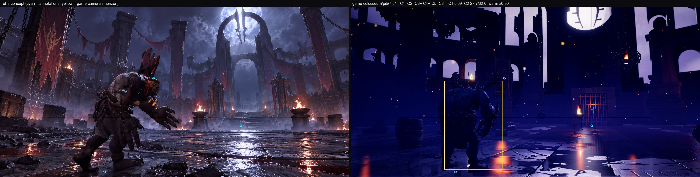
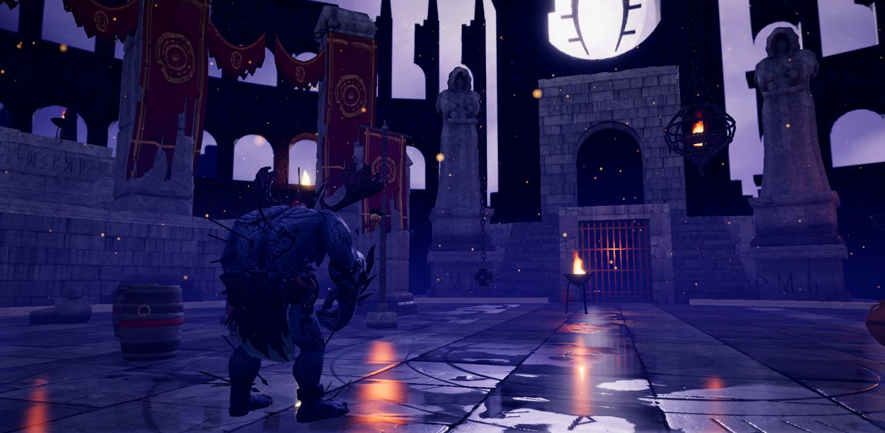
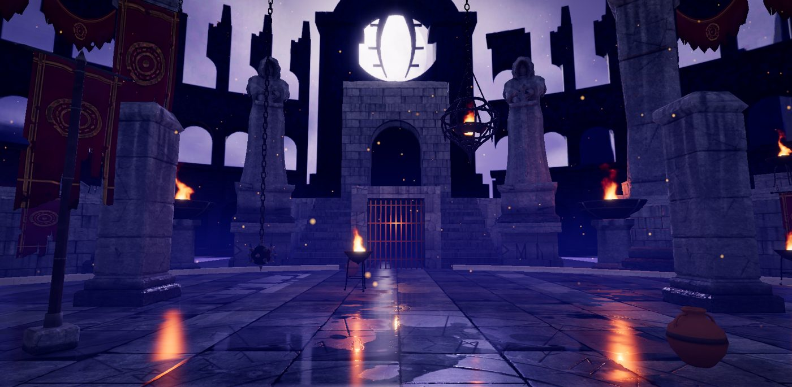
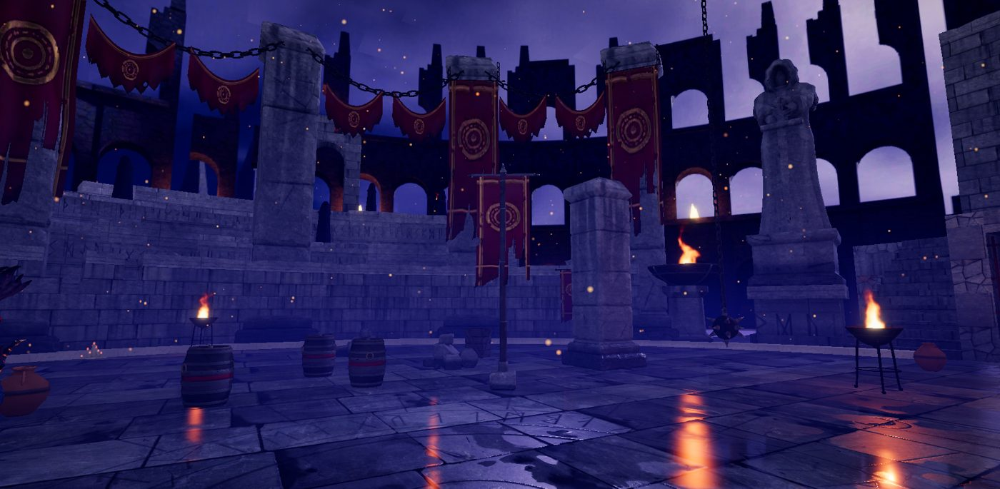
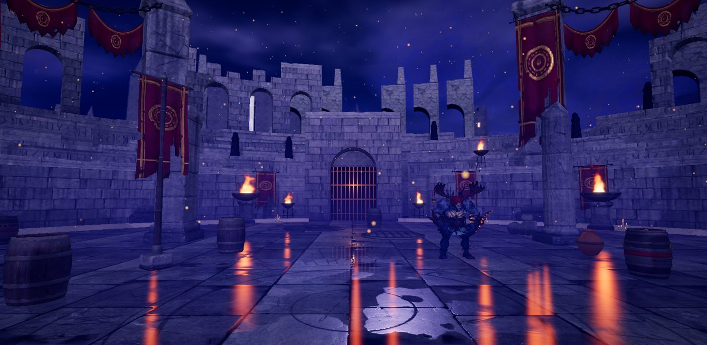
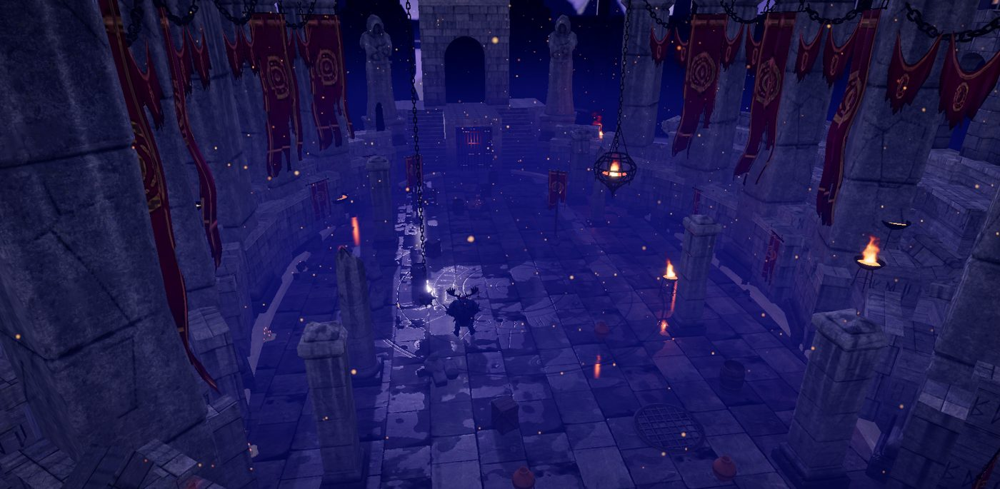

# A7: hero theme Moon Gate, near field

Branch `anim-plan`, 2026-10-18. Spec: `docs/arena-art-plan.md` (A7 row, 1.1 ref-3, 4.3 attachment rules, 6.6 budgets) and the A0-A6 READMEs. Target: `docs/concept-art/ref-3.png`. `src/sim` is untouched (no sim baseline change).

## Gates

| Gate | Result |
|---|---|
| `npm run build` | passes |
| `npm run fx:check` | all FX checks passed |
| `npm run sim:test -- 40` | identical to the A2b-A6 baseline (sim untouched): overall win rates 46.8-53.6 %, 0 timeouts, 0/2240 kills without contact, determinism true |
| `npm run arena:budget` | PASS (no new assets; GPU low 30.3 / medium 123.4 / high 153.4 MB) |
| Entrance validator, kit colosseum, 5 layouts x 2 gates x 8 fighters (`tools/arena/check_entrances.cjs`, `entrances.json`) | **95 configs, 0 failures** (before: the 20 known `support` failures on gorak / maw at every gate). `?arena=legacy`: 98 configs, 0 failures |
| Camera audit, standard 8-match list (`tools/arena/check_camera.cjs`, new; same list as `tools/anim/_scratch/camaudit.expr`) | **95.9 % readable** (HEAD before A7: 95.6 %; plan floor 93.8 %), contact visible 96.9 % (96.6), cuts/min 21.6, short shots 12 |
| Camera audit, colosseum-only list (5 layouts) | 93.8 % (HEAD 94.3 %): pit 97.5 -> 98.2, oval 91.3 -> 86.6, cross 90.4 -> 90.2, split 95.7 -> 97.6, gauntlet 96.0 -> 95.7. The oval loss is two-shot frames hidden by a sim column pillar (`LOD0_body`, an A3 obstacle, not A7 dressing) in a different camera sequence: the director's cosmetic choices come from Math.random, which the arena build used to consume (kit flames now take a deterministic phase), so the colosseum audits are not shot-for-shot comparable with HEAD |
| `?arena=legacy` | **pixel-identical** to HEAD `2e88a8a` (ref-3, ref-4, ref-6 concept renders + sky masks, max difference 0; HEAD built in a temporary worktree, removed). Note for later agents: creating ANY Object3D / material in a legacy build shifts Math.random (uuids) and breaks this gate; the losGroup is created in kit mode only for that reason |
| Draw calls / triangles (concept harness `renderer.info`, whole frame incl. fighters, shadows, reflection) | ref-3 preset q2: **211 calls / 567k tris** (A6: 283 / 971k); q1 206 / 558k; q0 152 / 205k; overview q1 257 / 590k; split overview 364 (river cells). The crowd (3400 instanced figures), stands and velarium are gone; the near field adds about 22k triangles |

## What shipped

| Part | Files |
|---|---|
| **Near-field builder** (`RingArt.ruins`, data in `art/colosseum.ts`): removes the legacy stands, crowd, velarium and gallery and builds **ruined tiers** (4 rings of 1.6 m x 0.85 m seats from the podium top at 3.45 m, 3.3 m segments, broken by the render seed: stepped breaks, stumps, fallen blocks, setback and height jitter, a projecting lip per seat; the vista sector towards the east gate keeps at most the first ring, broken), **arcade bays** on the top tier in broken runs (never within 70 deg of the vista), **ten square pillars** (kit pillar x 2 uniform + 9-slice stretched to 14 m, azimuths +-40/64/90/116/142, 2.1 m outside the boundary), **long banners** (2.3 x 8.6 m, two of three pillars) on rods and short chains, **heavy chains** (links x 2.6) swagging between neighbouring pillar tops with **swag cloths** under them, **sparse hooded watchers** (8 / 14 / 18 per tier, a 150-tri lathe figure, one merged mesh), **tier fires** (7 kit wall braziers with flames) | new `src/render/arena/nearField.ts`, `art/types.ts` (`RuinsArt`, `GateArt`), `art/colosseum.ts`, `art/index.ts` (assets) |
| **Hero gate (east)**: two 16-step flights (rise 0.275, run 0.38) rising away from the arena either side of a **central portal** (the gate passage, 3.1 x 3.75 m, runs under the landing, so every entrance still walks in at floor level through the legacy portcullis), a **dais** (4.4 m) behind them carrying the kit arch as the **doorway** (scale 1.25, near-black plate in its opening), the two **hooded guardians** on kit plinths beside the flights (plinth x 2, statue x 2: about 12.4 m to the hood top; A5 had them 7 m tall in the wall), big **pedestal braziers** at the stair foot (x 1.8, one real light), forecourt ground. Legacy facade / entablature / pediment / columns / bronze stands removed (flagged `gateDeco`), legacy gate flames hidden, the legacy tunnel box replaced by the dark passage | `nearField.ts` (`eastGate`), `dressClassic.ts` (flags only) |
| **West gate**: the kit arch frames the legacy portcullis and tunnel; kit tripod braziers; tiers bridge over the tunnel | `nearField.ts` (`westGate`) |
| **Anchors re-declared** on the new geometry (still verified by `snapAnchors`): east perches on the landing over the portal (4.4 m), stands on the flights (step 6, 1.65 m), tunnel depth 12 m; west perches on the arch top (7.5 m) and the podium walls, stands on the first tier | `nearField.ts` |
| **Trim geometry**: procedural blocks on the A3 stone trim sheet with the modules' UV conventions (u = metres along the face, v inside the row band, faces cut at world multiples of the row height so courses line up) and a ground-occlusion vertex colour; everything merges into the ring's one trim draw call | new `src/render/arena/trimGeo.ts`, `dressKit.ts` |
| **Ring integration**: one chain builder and one merged banner mesh for wall + pillar + swag banners; `Placed.stretch` (9-slice in the asset frame) in the ring merge; ring dressing (walls, wall braziers + their flames, wall banners, decor, rubble, ring braziers) keeps out of the gate zones and off the pillars (`gateZoneTest`) | `dressKit.ts`, `arenaView.ts` (`addRingFlames`) |
| **losGroup** (plan 4.3): `Arena.losGroup`, invisible proxy meshes (material.visible false, never drawn) that `solids()` / `rayProxies`, `validateEntrances` and `snapAnchors` hit. It holds the support proxy of the kit wet floor (a dyn mesh, so it was invisible to every ray cast: that was the cause of the 20 `support` failures) | `arenaView.ts`, `dressKit.ts` (`buildFloor`), `cameraAudit.ts`, `entrance.ts` (comments: both traverse the group, so they include it) |
| **Chandelier height constant** `CHANDELIER_H = 6.2` (hazard builder, `hangingNow`, `main.ts` camWorld) and the **iron fire cage** (hoops, curved bars, spikes, coal bowl, flames, three hangers) for the chandelier hazard in kit mode | `arenaView.ts`, `main.ts`, `nearField.ts` (`fireCage`), `dressKit.ts` |
| `standing()` from footprints: already done in A3 (kit obstacles carry `footK` = footprintR / r0); unchanged | `arenaView.ts` |
| Kit-mode flame flicker phase is deterministic (legacy keeps Math.random) | `arenaView.ts` |
| Tools: `check_camera.cjs` (camera audit on a built dist, standard / colosseum lists), `check_entrances.cjs` now writes the issues; concept views `gate`, `tiers`, `westgate`; `?lit=1` (kit, debug only: flat bright fill to judge the dark near field by shape); `concept.cjs` passes `--lit` / `--backdrop` | `tools/arena/`, `conceptCams.ts`, `tools/shots/concept.cjs` |

## How close to ref-3 (by eye, honest)

The same frame and views with `?lit=1` (flat fill, NOT the game look; for shapes only):

- **Composition (lit views)**: the ref-3 ingredients are now all in the near field and in roughly the ref-3 arrangement: a stair with a dark doorway at the end of the axis, two big hooded guardians flanking it, braziers at the stair foot, tall square pillars with long tattered crimson banners and heavy chains with swag cloths between them, ruined tiers with small fires and a few hooded watchers, the ruined arcade (backdrop) visible above low ruins towards the vista. The crowd, stands, velarium and Roman gate are gone. The gauntlet overview reads closest to the concept of all the views.
- **In the real night look (side-by-side above) it does NOT read yet**: the stair, guardians, banners and tiers are dark silhouettes against the violet backdrop; only the fires and the portcullis glow. ref-3 paints the same shapes in strong lavender moon rim light with fog behind them. That is the lighting / fog / grade pass (A7b in the queue), not geometry. Metrics did not improve: C1 0.10 -> 0.09, C2 colour distance 26.1 / 27.7 (A6, q2) -> 27.7 / 32.0 (A7, q1; the dark crowd-filled stands were closer to ref-3's dark mid-band than the bright violet backdrop now showing through), C4 / C8 still fail.
- **Differences in shape**: ref-3's stair is one wide central flight; ours is two flights split by the gate portal (needed: entrances walk in at floor level, see decisions). Our doorway arch reads as a blocky gatehouse, ref-3's is a dark slot under a moulded frame. Our guardians are plainer than ref-3's (A5 note). ref-3's banners carry a trident-claw glyph, ours the A4 atlas sigils (concentric rings). The swags read as festoons, ref-3's are rags. The top of the ref-3 frame is still filled by the A6 backdrop's oversized arcade fragments (A8 rescale).
- **Pillars in the ref-3 frame**: two pillars with banners on the left (x 0.15 and 0.38; ref-3 has them at 0.08 / 0.33 / 0.50); ref-3's right pillar at 0.93 has no counterpart (ours at azimuth +40 is out of frame).

## Decisions made while the owner was asleep (please confirm)

1. **Two flights + central portal instead of one wide stair.** The entrance system (all variants, the validator, the cameras) assumes the fighter walks in at floor level through a barrier at the boundary; a stair on the gate axis would need stair-walking entrances. The portal under the landing keeps every entrance working (0 failures).
2. **Sparse hooded watchers** (8 / 14 / 18 by tier) instead of no crowd, as the queue's default. They stand still (no excitement bob); `ruins.watchers` can be removed to hide them.
3. **Pillars are ring dressing, not sim obstacles**: ten 14 m pillars at 2.1 m outside the boundary (the sim's own columns keep the A3 kit pillar). Banners on two of three pillars; chains only between neighbours on the same side (none across the gates, to keep the vista).
4. **Tiers are procedural blocks on the trim sheet** (no new Blender assets: the brief asked for small Blender jobs and none was needed): uniform 0.85 m seats, damage from the render seed. More sculpted ruin silhouettes (Blender ruin chunks) can replace them later.
5. **Vista sector**: within 55 deg of the east gate only the first tier remains (broken), so the A6 arch / arcade shows above the near field; the hero gate's zone (lateral +-11.2 m) has no ring walls, tiers or ring braziers.
6. **The fire cage is procedural iron** (no kit asset); its coal disc is a glow card (not a camera solid).
7. **`?lit=1`** debug fill exists only to judge shapes while the night look is unlit; it is not a look proposal.

## What I could not judge or verify

- The near field in the real night look: almost everything new is a silhouette until A7b lights it; my by-eye judgement is from `?lit=1` renders.
- Banner sway and chain swing of the big pillar banners / chains were seen as stills only.
- No GPU timer queries (draw calls / triangles above went down, so no perf regression is expected); headless Chromium on the Arc iGPU only.
- The floor revisit from the owner's backlog note (bigger broken slabs, rubble, stains) was NOT done: it needs a new floor bake (Blender) and was out of time; logged in the backlog for A7b / A8 / review.
- 3 fewer valid entrance variant configs than legacy (95 vs 98): kit anchors that do not offer the same variant set at every gate; all that are offered pass.

## For the next agent (A7b light / fog / grade, then A8)

- The ruins data is `COLOSSEUM_ART.ring.ruins` (`art/colosseum.ts`); builder `nearField.ts`. Use `node tools/shots/concept.cjs --refs=ref-3 --views=gate,tiers,westgate,pillar,wall` (add `--lit=1` for shapes, `--backdrop=0` for A/B).
- Light targets in the near field: the stair landing and guardians want moon rim from behind the arch; the pedestal braziers at the stair foot are the main warm pools (one real light there); tier fires are flame cards without lights (light map only).
- Anything new that is instanced or `dyn` and must block rays or carry feet: add a proxy to `arena.losGroup` with `arena.losMat`. Do not create Object3Ds or materials on the legacy path (Math.random uuids break `?arena=legacy` pixel identity).
- A8 still has to finish the unrendered A6 layers (full-res far layer, hero inset, shaft / fog-bank cards: `npm run arena:bake -- a6` with about 6 GB free, nothing else heavy) and rescale the arch (A6 README numbers). The near-field heights to respect: doorway arch top 13.8 m at about 10 m behind the boundary, guardians about 12.4 m, pillars 14 m.
- Camera audits: `npm run build && node tools/arena/check_camera.cjs --list=standard` (about 10 min) and `--list=colosseum` (about 15 min, slower since the ring mesh grew; the live director uses tiled `rayProxies`, the audit does not).
