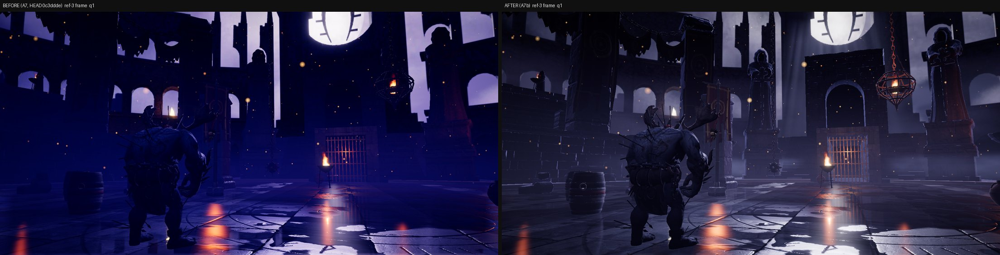
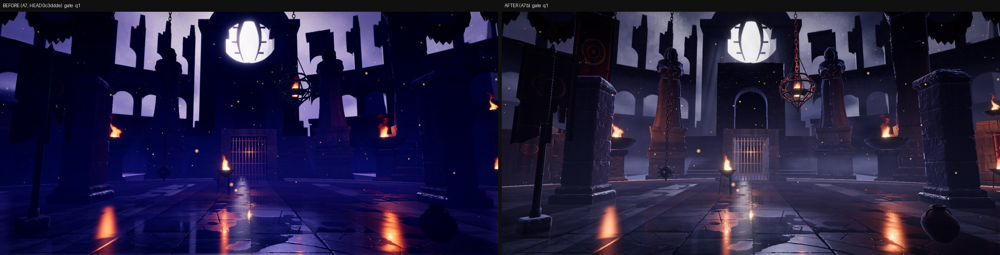
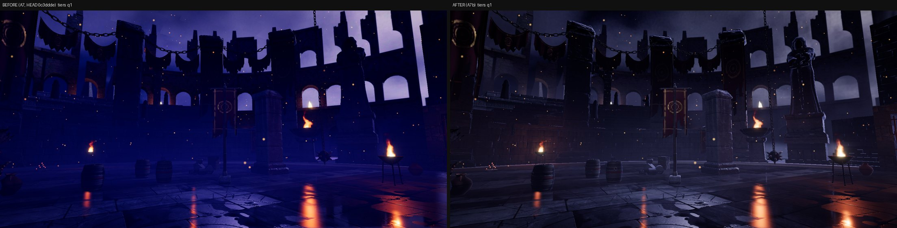
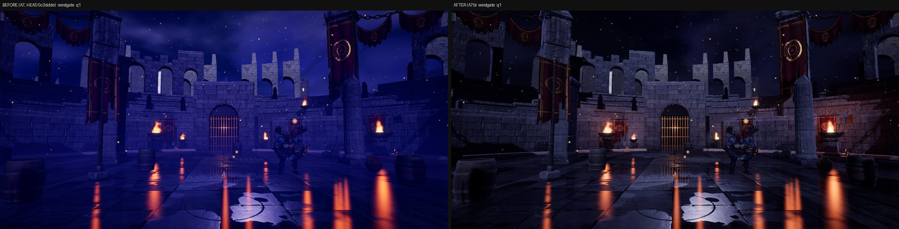
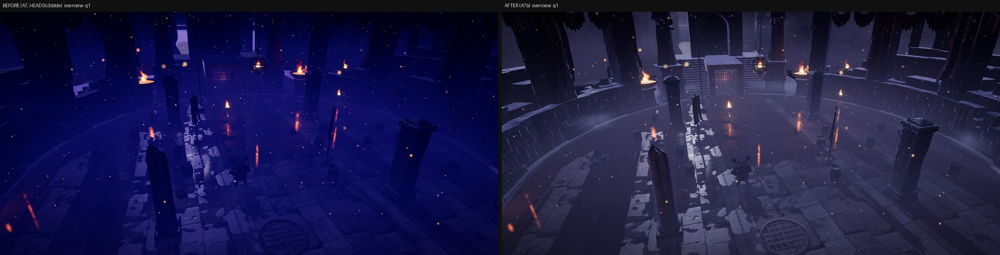
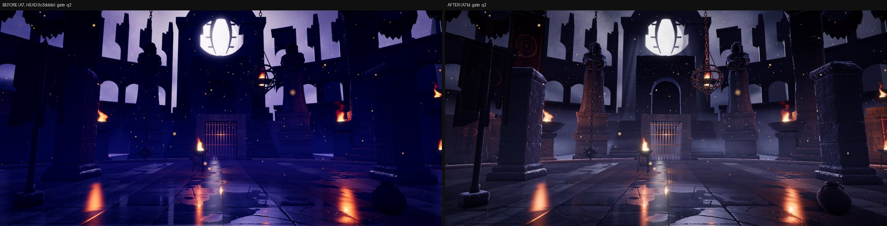
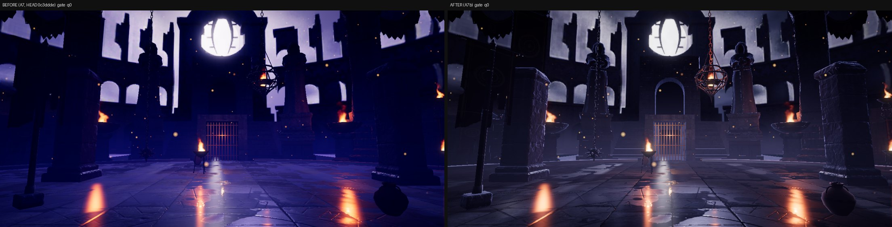
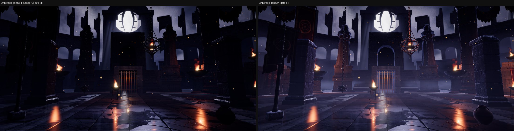
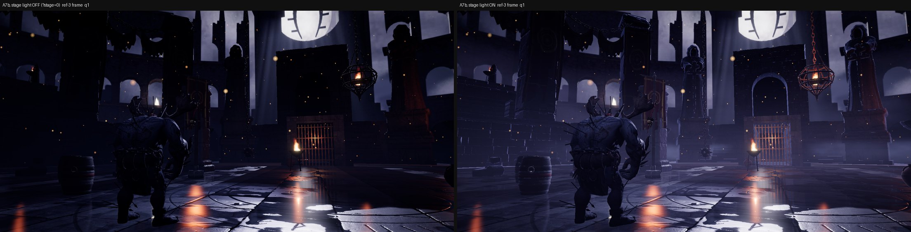

# A7b: Moon Gate light, fog and grade

Branch `anim-plan`, 2026-10-18. Brief: the owner compared the kit colosseum with `docs/concept-art/ref-3.png` and called lighting the biggest gap; addendum from the owner's review: the sky / backdrop must be the LIGHT SOURCE (probe from the backdrop, moon rim on edges, textured cloud behind the ring, haze coloured by the sky). Scope: the colosseum theme in kit mode only. `src/sim` untouched. No Blender job was needed (see decisions).

## Gates

| Gate | Result |
|---|---|
| `npm run build` | passes |
| `npm run fx:check` | all FX checks passed |
| `npm run sim:test -- 40` | unchanged (sim untouched): 0 timeouts, 0/2240 kills without contact, determinism true, colosseum 331 matches 69.7 s |
| `npm run arena:budget` | PASS (no shipped assets changed; low 30.3 / medium 123.4 / high 153.4 MB). Runtime-generated textures (not in the budget script): storm deck 1 / 2 / 4 MB (q0 / q1 / q2), mist 256x64 + two 256x256 card stand-ins about 0.6 MB on q1 / q2; medium then sits at about 126 of 128 MB |
| Entrance validator, kit colosseum, 5 layouts x 2 gates x 8 fighters | **95 configs, 0 failures** (`entrances.json`) |
| Camera audit, standard list (`tools/arena/check_camera.cjs`) | **96.0 % readable** (A7: 95.9 %; floor 93.8 %), contact visible 97.2 % (96.9), cuts/min 21.9, short shots 11 (`camera_standard.json`). Colosseum matches 99.3 % / 98.0 % (A7 99.2 / 98.0). The other themes render identically; their per-match numbers move a little because the kit colosseum builds first in the same page and creating objects consumes Math.random (uuids), which the director's cosmetic choices also draw from (A7 note). The audit measures occlusion / framing, not contrast |
| `?arena=legacy` | **pixel-identical** to HEAD `d2f31b1` (ref-3, ref-4, ref-6 frames + sky-geo + sky-only masks, max difference 0) |
| Other themes, kit mode | **pixel-identical** to HEAD (ref-4 .. ref-9 = forge, sakura, desert, glacier, skytemple, moonlake; frames + masks, max difference 0) |
| Perf (GPU timer queries, details below) | stage-light shader block **+0.2-0.6 ms** on q2 / q1, **+0.15-0.25 ms** on q0 (same-page paired A/B, 3-5 % of the scene pass); baked storm sky +0.1-0.3 ms; mist cards about +0.1 ms (FX pass, q1 / q2); procedural shaft / fog-bank cards inside A6's measured 0.43 ms card budget. Draw calls on the ref-3 frame 206 -> 236 (q1: 8 mist cards, 3 shaft + 8 fog-bank cards now drawn, sky / backdrop extras), triangles unchanged |

## What shipped

| Part | Files |
|---|---|
| **Stage light** (new): a patch on every MeshStandardMaterial of the kit colosseum (stone kit, statues, banners, chains, props, debris; not the wet floor, not the fighters). (1) **Moon back-rim**: `(1 - N.V)^p`, strongest when the camera looks toward the moon and on faces turned toward it, so pillar sides, statue hoods, stair nosings and tier lips get ref-3's lavender edge; (2) **fire pools**: a diffuse-only light loop over the flames nearest the camera (4 / 8 / 12 per tier, flames that own a real PointLight skipped), wrapped Lambert x windowed inverse-square, flame colour x its flicker, faded at the selection cut so flames do not pop in and out. All in world space (right in the mirrored reflection camera too). Materials are shared with the asset cache, so the patch is undone in `Arena.dispose()`; nothing else ever compiles it | new `src/render/arena/stageLight.ts`, `arenaView.ts` |
| **Sky / backdrop as the light probe**: the IBL environment is baked from the sky **plus the A6 backdrop layers** (arch, ruins, storm clouds, moon) with the scene fog, so stone, statues and fighters take their ambient and reflections from it; `scene.environmentIntensity` per arena (1 everywhere else) | `sky.ts` (`bakeEnvironment` opts), `arenaView.ts` |
| **Storm sky**: a direction-space fbm cloud deck down to the horizon, baked once per arena build into an equirect texture (`bakeStormTexture`) and sampled by the sky and the probe (the old plane-projected clouds were flat near the horizon), backlit by the moon: a bright glow and silver edges round it, dark storm cloud beyond; wisps over the lower moon disc. `storm = 0` keeps every other theme identical | `sky.ts` |
| **Backdrop grade**: saturation and tint on the baked Cycles layers (violet -> blue-grey), and the baked clouds (AOV B) graded by the moon (dark away from it, backlit round it); **procedural stand-ins** for the never-rendered EEVEE shaft / fog-bank atlases (`proceduralCards`), so the 3 moon shafts through the arch and the 8 / 16 fog banks now draw on q1 / q2 | `backdrop.ts`, `art/colosseum.ts` |
| **Haze from the sky**: per frame the scene fog colour follows the view direction (bright moon haze looking toward the arch, dark storm blue away), so near fog, the backdrop's fog match and the sky blend | `stageLight.ts` |
| **Ground mist**: 8 / 14 soft cards (q1 / q2; none on q0) at the foot of the tiers and the stair, FX_ALPHA with the F1 soft-depth fade, Y-axis billboards that fade when seen from above or close to the camera | `stageLight.ts` |
| **Look values**: much lower, greyer ambient; colder, stronger moon key; desaturated grade; new `THEME_LOOK.moongate` (bloom threshold 1.0 / radius 0.72 so moon and flames bloom wide; neutral-cool shadows; warm highlights) replacing the borrowed `moonlake` row; key light x1.8 for the fighters in this look | `art/colosseum.ts`, `fx/fxLook.ts`, `main.ts` (one line) |
| Debug: `?stage=0` keeps the night look without the stage light (A/B, perf); `concept.cjs --stage=0` | `art/index.ts`, `tools/shots/concept.cjs` |

## Before / after (q1 unless noted; left = HEAD `0c3ddde` / `d2f31b1`, right = A7b)

Tiers:   (ref-3 frame: `sheets/ref3_q2_before_after.jpg`, `sheets/ref3_q0_before_after.jpg`)

What the stage light itself does (same build, `?stage=0` left):

Concept side by side: `concept/ref-3_side.jpg` (before: `before/ref-3_side.jpg`), contact sheets `concept/contact_q1.jpg`, `before/contact_q1.jpg`.

## Concept metrics (ref-3 preset, q1; `concept/ref-3_metrics.json` vs `before/ref-3_metrics.json`)

| Check | Before (A7) | After (A7b) | Pass rule | Pass now |
|---|---|---|---|---|
| C1 skyline IoU / profileErr | 0.09 / 0.110 | 0.02 / 0.112 | IoU >= 0.65 | no (geometry: the A6 arcade scale, A8). profileErr (per-column skyline) is unchanged; the IoU drop is most likely the measurement: the visual-sky mask counts pixels equal to a sky-only render, and the shaft / fog-bank cards and the brighter haze now differ from it near the arch |
| C2 colour (median / worst cell Delta E) | 27.7 / 32.0 | **10.8 / 17.9** | <= 12 / <= 20 | **yes** (q2 11.0 / 19.8, q0 12.4 / 18.2) |
| C3 warm share (ratio to concept) | 0.90 | 0.78 | 0.6 .. 1.4 | yes (cool share 0.93 -> 0.88) |
| C4 wet floor (bright share ratio, fire streaks) | 0.82, 5 | 1.40, 5 | 0.5 .. 1.5, >= 3 | yes (borderline high: the moonlit puddles) |
| C5 detail per cell (ratio) | 0.15 .. 0.96 | 0.30 .. 1.10 | 0.7 .. 1.3 each | no (every cell up; the left and bottom cells are still flat: dressing density, floor rubble, A8) |
| C8 far / mid std | 4.06 | 2.04 | < 0.6 | no (halved; the far band is still the sharp A6 arcade fragments) |
| Luminance histogram intersection | 0.40 | 0.71 | (info) | median L* 3.8 -> 12.2 (concept 21.6) |
| C6 / C7 / C9 / C10 | manual | C6, C7 unchanged by a light pass; C9 not clipped; C10 = camera audit above | | |

## Perf method and numbers

The F1 method first (`tools/shots/postprobe.cjs`, colosseum gorak-erika, fixed camera, 1920x1080, before / after / before / after builds): whole-frame and scene-pass numbers swung more than the change itself (scene pass q2: before 19.8 / 21.4, after 27.2 / 23.4 ms; q1 before 25.8 / 22.3, after 22.6 / 23.2; q0 before 16.9 / 12.7, after 17.2 / 17.9; the GPU clock of this Arc iGPU moves everything up to 2x between runs, as F1 / A2 / A6 noted). So, as in A6, I measured the parts in ONE page: the ref-3 `gate` view at 1920x1080, scene-pass timer per block of 12 frames, blocks alternating {stage shader on, off (a uniform branch), storm sky off}, 14-24 rounds, median of the paired differences, two sessions per tier:

| Tier | Fire pools | Stage shader (rim + fire loop) | Storm sky (baked) | Scene pass in that session |
|---|---|---|---|---|
| q2 | 12 | +0.18 / +0.61 ms | +0.70 / +0.12 ms | 10.6 / 17.6 ms |
| q1 | 8 | -0.27 / +0.62 ms | +0.12 / +0.32 ms | 11.0 / 22.2 ms |
| q0 | 4 | -0.15 / +0.18 ms | -0.09 / -0.13 ms | 17.4 / 11.3 ms |

The first storm version computed the fbm per sky pixel and cost **+2.9 ms (q2) / +1.9 (q1) / +0.9 (q0)**; it is now baked once per arena build into a texture (`bakeStormTexture`: q2 2048x512 = 4 MB, q1 2048x256 = 2 MB, q0 1024x256 = 1 MB GPU; medium had about 4.6 MB of headroom in the A6 budget) and sampled. Plan budgets (6.6) are absolute numbers for a stable clock; on this machine I can only say the pass grows by about 3-5 %, inside the noise of every whole-frame run. One-time cost at arena build: the storm bake and the probe with the backdrop layers (not timed separately).

## How close to ref-3 by eye (honest)

- **Better**: the near field is no longer silhouettes. Pillars, plinths, statues, stair, tiers and banners show stone detail; fire pools warm the statue bases, plinths, pedestal bowls, walls behind the wall braziers and the banners; pillar sides and caps catch a cold edge; the storm cloud gives the sky texture with a glow round the moon; moon shafts slant through the arch; ground mist sits at the foot of the stair and tiers; the palette moved from saturated violet to blue-grey with warm only at fires. Looking away from the moon (west gate) the moon front-lights the stone and the fighter reads clearly.
- **Still off**: ref-3 is **brighter in the mid-tones** than ours (median L* 21.6 vs 12.2) and its haze is lavender, ours is greyer; I chose to keep it darker because the owner asked for "dark overall with strong accents" and lifting further flattened the frame (tried: it read as uniform fog). The moon disc still clips to white (crater detail lost after tone mapping). The rim is subtle on surfaces facing the camera (it is an edge effect by design). ref-3's left side is full of fires on the tiers; ours has 1-2 in that frame (dressing, A8). The fighter in the ref-3 frame (seen from behind) is darker than ref-3's creature. The far arcade fragments are still the oversized A6 blockout, sharp and flat (A8). Far tier flames look small / white-hot.
- **Not judged**: motion (mist drift, flicker of the fire pools, shaft card animation) only as stills; low tier on a real 1080p monitor; whether the darker look hurts readability in fast fights (the audit measures occlusion, not contrast).

## Decisions made while the owner was asleep (please confirm)

1. **A shader light model instead of more PointLights**: rim + fire-pool loop patched into the arena's standard materials. Real arena PointLights stay as they were (they light the fighters); the loop covers the 30+ other flames on stone at a fixed cost per tier.
2. **The fighters are not patched** (they take the probe, the real fire lights and the camera key / rim); their key light is x1.8 in this look.
3. **Probe = sky + backdrop layers**, baked once per arena build (no per-frame probe).
4. **Procedural shaft / fog-bank atlases** instead of a Blender job: the A6 EEVEE `cards` job was the one the low-memory reaper risked; procedural textures ship now, A8 renders the real ones (`npm run arena:bake -- a6`).
5. **Fog colour follows the view direction** (one colour per frame, not per pixel: three's fog chunk cannot take a direction term without touching every theme).
6. **Low tier**: rim + 4 fire pools + storm sky + probe; no mist cards, no shaft / fog-bank cards (as A6).
7. **Darker than ref-3's mid-tones** (see above); exposure / hemi / fog colour in `art/colosseum.ts` `look` are the knobs.
8. The kit colosseum's look no longer borrows `THEME_LOOK.moonlake`; it has its own `moongate` row.

## For A8

- Knobs: `COLOSSEUM_ART.look` (sky incl. `storm*`, hemi, fog, exposure, grade, `stage.{envIntensity, keyGain, rim, fires, fogSky, mist}`), `backdrop.tune.{sat, tint, cloud, proceduralCards}`, `THEME_LOOK.moongate`. `?stage=0` for A/B.
- Re-render the A6 layers with the rescaled arch (A6 README), the full far layer, the hero inset and the EEVEE shaft / fog-bank atlases; set `proceduralCards: false` (or drop it) once `cards` exist. The backdrop is baked into the probe automatically.
- New materials added to the arena group before the end of the Arena constructor get the stage patch; materials created later (runtime) do not.
- C1 / C5 / C8 are now geometry / dressing problems (arcade scale and sharpness, more tier fires and rubble), not light.
- Perf: see above; the fire loop is the main per-pixel cost on stone (n flames x a few ALU).
