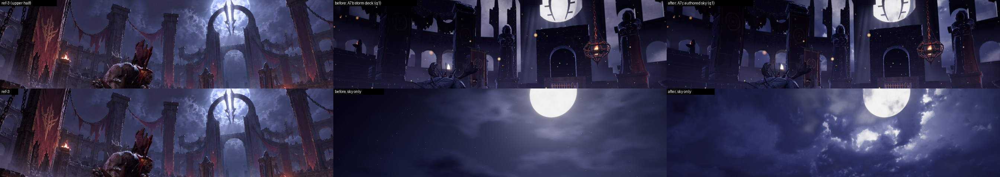
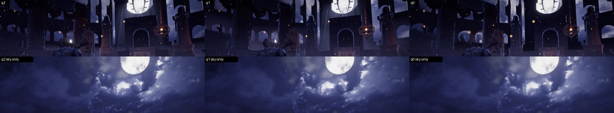
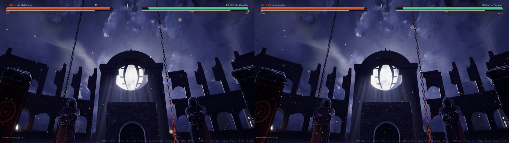
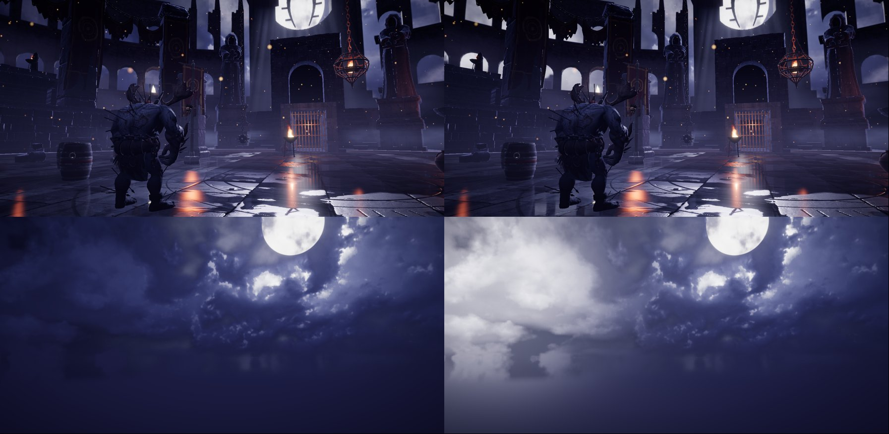

# A7c: Moon Gate sky (authored storm sky)

Branch `anim-plan`, 2026-10-18. Brief: the owner called ref-3's sky beautiful (layered storm clouds with depth and texture, a huge glowing moon with a soft halo, light breaking through cloud edges, bright rims near the moon, dark banks further out) and ours a flat dark void with a white disc and a procedural stand-in cloud deck. Make a real sky for the Moon Gate with a method reusable per theme. Scope: the colosseum theme in kit mode only; `src/sim` untouched. No Blender job (decision 1).

## Gates

| Gate | Result |
|---|---|
| `npm run build` | passes |
| `npm run fx:check` | all FX checks passed |
| `npm run sim:test -- 40` | unchanged (sim untouched): 0 timeouts, 0/2240 kills without contact, determinism true, colosseum 331 matches 69.7 s |
| `npm run arena:budget` | **PASS**. GPU texture memory (KTX2, kit + backdrop + sky): low 30.95 / 64, **medium 126.02 / 128**, high 164.08 / 192 MB. Sky alone 0.67 / 2.67 / 10.67 MB (q0 / q1 / q2). Runtime: the A7b storm texture (1 / 2 / 4 MB, not in the budget script) is no longer created when the sky loads, so the real medium total is about 126.6 MB (shipped 126.0 + 0.6 mist / card stand-ins), within 0.6 MB of A7b's 126 |
| Entrance validator, kit colosseum, 5 layouts x 2 gates x 8 fighters | **95 configs, 0 failures** (`entrances.json`) |
| Camera audit, standard list (`tools/arena/check_camera.cjs`) | **95.7 % readable** (A7b 96.0 %, floor 93.8 %), contact visible 96.9 %, cuts/min 21.9, short shots 13 (`camera_standard.json`). The small move is the A7b effect: kit mode creates more objects / textures (uuids from Math.random), which shifts the director's cosmetic choices; the audit measures occlusion, not the sky |
| `?arena=legacy` | **pixel-identical** to HEAD `c9a9efb` (ref-3, ref-4, ref-6 frames + sky-geo + sky-only masks, max difference 0; HEAD built in a temporary worktree, removed) |
| Other themes, kit mode | **pixel-identical** to HEAD (ref-4 .. ref-9: forge, sakura, desert, glacier, skytemple, moonlake; frames + masks, max difference 0) |
| Perf (sky <= 0.3 ms high) | the whole sky draw now costs **0.25 ms p50 on high in the ref-3 view** (0.39 ms when the sky fills the screen), **less** than the sky it replaces (0.56 / 1.05 ms in the same page). Details below |

## What shipped

| Part | Files |
|---|---|
| **Sky composer** (Python: numpy + OpenCV + Pillow, about 10 s, about 1.5 GB peak, no GPU): a CC0 HDRI -> a cloud **data** texture in the sky's own band (`u = 0.5 + az / 360`, `v = 1 - (dir.y + 0.1) / 1.1`, row 0 = zenith): **R** structure (log luminance minus its large-scale trend, contrast-shaped: the billow shading), **G** density (grey / white cloud vs the photo's blue sky; a front billow layer over a softer, darker back deck sampled from another part of the same photo, so there are no flat holes), **B** rim potential (thresholded high-pass of the structure on the bright half + a thin line where front cloud meets a gap), **A** moon shafts (a polar march outward from the moon's limb: light through the gaps, smeared along the rays). Per-tier PNGs, `layout.json` with a **6-stop palette ramp sampled from the concept image's sky boxes** (luminance quantiles), and a by-eye **preview** from the concept camera (the shader maths re-done in numpy) | new `tools/arena/sky_compose.py`, spec `tools/arena/sky/moongate.json` |
| **Build**: compose, encode each tier as KTX2 (**UASTC + zstd, linear RGBA, mips**: new `dataA` kind; ETC1S would bleed the four independent channels into each other) + WebP, write `public/arena/sky/<id>/sky.json` (palette, look, tiers), register `manifest.skies`, fill `usedBy` in the credits ledger | new `tools/arena/build_sky.mjs` (`npm run arena:sky`), `build_assets.mjs` (`dataA`) |
| **Budget**: sky files listed / present, sources in the ledger and CC0, block multiples, download caps (1 / 3 / 8 MB), GPU memory per tier added to kit + backdrop | `tools/arena/check_budget.mjs` |
| **Runtime sky** (`skyTex` in the existing sky shader): the texture is sampled twice (structure / density / rims drifting in u; shafts fixed to the moon) with `textureGrad` (no mip seam where atan wraps) and **lit in the shader by the moon**: ramp(structure x light), light = ambient + mid + wide moon falloff, HDR "hot" boost on the clouds right round the moon (bloom), silver rims on the rim channel near the moon, dark far banks (below `bankH`, less so toward the moon), thin gaps = night far / moon haze + halo near, shafts, a flat dark bank below the band, thick cloud partly crossing the moon disc. Stars and the crater noise are skipped / limited to the disc on this path (cost). `uSky = 0` everywhere else, so every other sky is unchanged | `src/render/arena/sky.ts` (`SkyLook`, `skyUniforms`, `halfK`) |
| **Drift**: the cloud layer scrolls in u (0.0003 / s, about 6 deg per minute) while the moon's glow, rims and banks stay put (the lighting is in the shader, not baked) | `sky.ts` |
| **Lightning** (optional, cosmetic): `lightningAt(t)` is a pure function of time (integer hash, no Math.random): one possible strike per 34 s slot (about 60 % fire, none in the first slot), a double / triple flicker at a hashed time and azimuth away from the moon, low in the sky. The arena drives it from **match time** (`applyFrame`'s `fr.t`, read only) in a fight and from its own clock otherwise: the sky flashes inside the cloud (thick cloud glows most) and `scene.environmentIntensity` pulses lightly (+25 % at full flash; the probe texture is not re-baked). About one strike every 50 s, lit about 1 % of the time. `?skyflash=<t>` holds the clock at t for stills (e.g. 86.42) | `sky.ts`, `arenaView.ts` |
| **Probe**: the A7b IBL probe bakes the sky mesh, so it now bakes the authored sky (no extra code); lighting follows it | `arenaView.ts` |
| **Loading / art**: `ThemeArt.sky = { id, look? }` (look overrides single keys of the json); `ArenaAssets.loadSky` (KTX2 / WebP fallback, repeat in u, cached per tier, disposed by `release`); `ArenaPack.sky`; `?sky=0` falls back to the A7b storm deck (A/B: renders exactly A7b, C2 10.8 / 17.9). When the sky loads the storm deck is not baked | `art/types.ts`, `art/index.ts`, `assets.ts`, `arenaView.ts`, `art/colosseum.ts` |
| **Backdrop**: the A6 blockout's baked Cycles cloud texels (AOV B) fade out (`tune.cloudHide`, only when the authored sky is drawn), so the sky shows through the arcade and above the ruins | `backdrop.ts`, `art/colosseum.ts` |
| **Checks**: `check_sky.cjs` (isolated GPU timer per tier on a sky-filling view and the ref-3 view, authored vs plain in alternating chunks; same-page scene-pass A/B; drift pair; lightning from match time, twice); `sky_metrics.py` (S1 colour Delta E, S2 cloud texture, S3 moon glow ratio inside the concept's sky boxes); `concept.cjs` passes `sky` / `skyflash` | `tools/arena/check_sky.cjs`, `tools/arena/sky_metrics.py`, `tools/shots/concept.cjs` |

Sources (`public/arena/credits.json`): Poly Haven **Quarry Cloudy** (Dimitrios Savva, Jarod Guest; CC0), 8k HDR, used for both layers. `Assets/` was checked first: `Assets/VFX` has only small tiling noise packs (128 / 512 px) and `Assets/fx` smoke / cloud flipbooks; nothing usable as a sky panorama. (A second HDRI, Aristea Wreck, was fetched and tried as the back deck: 4k was too soft next to the 8k front layer; not used, removed from the ledger, the raw file stays in `Assets/arena-src`.)

Tiers: q2 8192 x 1024 (10.7 MB GPU, 4.3 MB download), q1 4096 x 512 (2.7 MB, 1.3 MB), q0 2048 x 256 (0.7 MB, 0.4 MB). The low tier gets the same look at a quarter of the resolution.

## Before / after

Upper half, ref-3 | before (A7b storm deck, `?sky=0`) | after; second row sky only:

All three tiers (after): 

Sky-filling view, 10 s apart (drift): 

Lightning (`?skyflash=86.42`, a strike at azimuth -53 deg), normal | flash: 

Concept side by side: `concept/ref-3_side.jpg` (before: `before/ref-3_side.jpg`), contact sheets with the counter / flank / overview views `concept/contact_q1.jpg`.

## Metrics

Concept metrics (ref-3 preset; before = `?sky=0`, identical to A7b):

| Tier | C1 skyline IoU | C2 median / worst | C8 far / mid | hist |
|---|---|---|---|---|
| q1 | 0.02 -> **0.14** | 10.8 / 17.9 -> 11.2 / **16.6** | 2.03 -> 1.98 | 0.71 -> 0.73 |
| q2 | 0.03 -> **0.17** | 11.1 / 19.8 -> 11.2 / **17.8** | 1.86 -> 1.89 | 0.68 -> 0.70 |
| q0 | 0.03 -> **0.13** | 12.4 / 18.2 -> 12.5 / **17.2** | 2.45 -> 2.26 | 0.64 -> 0.66 |

C1 rose because the baked Cycles clouds no longer differ from the sky-only render (the A7b note: the IoU drop was the measurement); it still fails (>= 0.65) because the A6 arcade is the wrong scale (A8). C2 stays a pass. C3 / C4 / C5 unchanged.

Sky metrics (`sky_metrics.json`, inside ref-3's five pure-sky boxes; the concept: median Lab 35.5 / 8.4 / -24.1, texture 10.9, glow ratio 2.11):

| | S1 colour Delta E | S2 cloud texture (ratio) | S3 moon glow (ratio) |
|---|---|---|---|
| before, sky only (q1) | 6.3 | 9.7 (0.89) | 1.82 (0.86) |
| **after, sky only (q1)** | 6.6 | 12.9 (1.18) | 1.49 (0.71) |
| after, sky only q2 / q0 | 6.6 / 7.1 | 1.18 / 1.15 | 0.71 / 0.71 |

Honest reading: the numbers move little. The A7b storm deck was already close in average colour; the new sky is a bit bluer (b* -22.7 vs -18.8, the concept -24.1) but brighter (L* 41.9 vs 35.5) and has more texture than the concept inside these boxes; its moon-glow ratio is lower because the far boxes are brighter. I tuned toward the metrics once (S1 2.2, glow 0.81) and the sky went flat and dark with crumb-like rims; I chose the by-eye version (decision 4). In the gameplay frame the architecture covers most of these boxes (full-frame S1 25 before and after), so the frame-level gain from the sky is limited until A8 rescales the arcade.

## Perf (F1 / A6 method: same-page GPU timer queries, 1920 x 1080, headless Chromium ANGLE D3D11 on the Arc iGPU)

Isolated: after each normal frame the sky mesh is drawn again alone into the post's scene target with that frame's depth buffer bound, inside one timer query; 8 alternating chunks of 30 frames authored (uSky 1) / plain (uSky 0: gradient, stars, crater moon, no clouds) per view.

| Tier | ref-3 view: authored / plain (p50 ms) | sky-filling view: authored / plain | paired p50 difference | scene pass A/B (ref-3 view, on / off, paired median) |
|---|---|---|---|---|
| q2 | **0.25** / 0.56 | **0.39** / 1.05 | -0.31 / -0.65 | 10.18 / 10.61, -0.68 ms |
| q1 | 0.46 / 1.22 | 0.45 / 1.40 | -0.35 / -0.74 | 10.51 / 11.03, -0.83 ms |
| q0 | 0.30 / 0.80 | 0.26 / 0.61 | -0.48 / -0.38 | 11.84 / 12.66, -0.65 ms |

The first version cost +0.4 to +1.1 ms over plain: the generic shader evaluates an fbm for the milky band of the stars and another for the moon craters on every sky pixel. On the authored path the stars are skipped (no clear sky for them) and the crater noise runs only on the disc, so the authored sky is now cheaper than the plain sky and than A7b's (which also sampled the storm deck). The iGPU clock still moves whole-pass numbers by several ms between runs (as F1 / A6 / A7b noted); the isolated numbers are the reliable ones. One-time cost: the texture upload / transcode (q2 8192 x 1024 UASTC) at arena build; not timed separately.

## How close to ref-3's upper half by eye (honest)

- **Better**: the sky is now a textured storm: billowing cloud with real shading and a back deck behind it, bright lavender-white cloud round the moon with silver edges, dark indigo cloud away from it and toward the horizon, faint shafts, the moon partly crossed by cloud. Through the arcade arches and above the ruins it reads as cloud instead of flat haze. Looking away from the moon (counter view) the sky is dark navy with faint structure, as ref-3's edges are.
- **Still off**: ref-3's clouds round the moon are smaller cauliflower billows with crisp painterly rims all along the moon side; ours are photographic billows, softer, and the rims are sparse. ref-3's moon has a soft wide halo that blooms over the arch; ours has a clipped white disc (bloom threshold, A7b note). In the gameplay frame most of the sky is hidden by the oversized A6 arcade, so the change is far smaller there than in the sky-only renders (A8). Near the zenith the band is compressed (visible only from very low cameras looking up).
- **Not judged**: motion. The drift (about 6 deg per minute) and the lightning were checked as frame pairs and numbers only, not watched in real time; whether the flash is too strong / too frequent is the owner's call (`flashEvery`, `flashGain`, `flashEnv`, or `flashEvery: 0` to turn it off). Low tier on a real monitor.

## Reusable method: a new theme sky in about an hour

1. **Pick a cloud photo** (5 min): Poly Haven HDRIs with dense, structured cloud (search the API: `https://api.polyhaven.com/assets?t=hdris`, previews at `https://cdn.polyhaven.com/asset_img/primary/<id>.png?width=1024`). Storm / night: `quarry_cloudy` (used here), `kloppenheim_03_puresky`; sunset / dawn: `table_mountain_1_puresky`, `cedar_bridge_sunset_1`, `scythian_tombs_puresky`; overcast / blizzard: `kloofendal_overcast_puresky`, `snow_field_puresky`; puffy daylight: `kloofendal_48d_partly_cloudy_puresky`, `sunflowers_puresky`. Fetch with credits: `node tools/arena/fetch_cc0.mjs polyhaven:<id> --res=8k`.
2. **Write the spec** (10 min): copy `tools/arena/sky/moongate.json` to `tools/arena/sky/<id>.json`. Set `moon` (or the sun: same direction / size the theme uses in `themes.ts` / its `look.sky`), `source.rot` (which part of the photo frames the light: try 0..0.9 in steps of 0.15), `elev0` (skip the photo's ground / tree line), `k` (> 1 = smaller billows), the optional `back` deck (another rotation of the same photo, softer and darker), and the `palette.boxes`: 3-5 rectangles of pure sky in the theme's concept image (the ramp is sampled from them), or explicit `palette.colors` (6 linear RGB stops).
3. **Iterate on the preview** (20 min): `python tools/arena/sky_compose.py --spec tools/arena/sky/<id>.json` writes `tools/arena/_work/sky/<id>/preview.jpg` (concept | sky from the concept camera | whole band) in about 10 s. Tune `look`: `amb` / `mid` / `wide` (how the light falls off from the moon / sun), `hot` (HDR bloom round it), `rim*` (silver lining), `bank*` (dark or bright horizon: a sunset wants `bankDark` near 0 and warm `gapNear`), `sat`, `gain`. For a dawn / sunset sky, swap the palette boxes to the warm concept sky and raise `wide`; for an aurora, keep a dark storm-free photo (low `amb`) and leave the existing `aurora` sky params on (they draw before the sky texture: adjust in `sky.ts` if they must sit in front); for a blizzard, low `mid`, high `amb`, `sat` about 0.3 and `drift` x3.
4. **Build and wire** (10 min): `npm run arena:sky -- --id=<id>` (KTX2 + WebP + sky.json + manifest + credits), add `sky: { id: '<id>' }` to the theme's `ThemeArt` (kit mode; a `look.sky` must exist so the theme has its own sky params), `npm run arena:budget`.
5. **Check** (15 min): `npm run build`, `npm run arena:concept -- --refs=<ref>` and `--sky=0` for the before, `python tools/arena/sky_metrics.py --spec tools/arena/sky/<id>.json --game <render>_skyonly.png`, `node tools/arena/check_sky.cjs` (perf, drift, lightning). Fine tuning without a rebuild of the texture: edit `look` in the spec and run `npm run arena:sky -- --id=<id> --no-compose`, or override single keys in `ThemeArt.sky.look`.

## Decisions made while the owner was asleep (please confirm)

1. **No Blender / Cycles for the sky**: a photo-based data texture lit in the shader. The A6 reaper risk came from Cycles cloud volumes; this path needs about 1.5 GB in Python and no GPU, and the lighting stays live (drift, lightning, per-theme tuning without re-rendering).
2. **Lighting in the shader, structure in the texture** (instead of a fully painted colour panorama): it is what lets the clouds drift while the moon's glow and rims stay put, and makes a new theme mostly a palette / light-direction change. Cost: the look is a gradient map of a photo, less painterly than ref-3.
3. **One photo for both layers** (front billows + back deck from another rotation of Quarry Cloudy): sharper than mixing an 8k and a 4k source.
4. **By-eye tuning over the sky metrics** (S1 6.6 instead of the 2.2 a darker version reached; that version looked flat). `look.amb` / `gain` lower it if the owner wants a darker sky.
5. **Drift 0.0003 u/s** (about 6 deg per minute). **Lightning on**, about every 50 s, 1 % of the time lit, probe pulse +25 % at the peak; none in the first 34 s of a match (intro, concept shots).
6. **The A6 baked Cycles clouds are hidden** where the authored sky draws (`cloudHide: 1`).
7. **UASTC (not ETC1S)** for the sky data: four independent channels; same GPU size (1 B/px), larger download (q2 4.3 MB). Mips on every tier (medium +0.7 MB for them; drop with a mip-less encode if medium memory gets tight).
8. **Unrendered A6 pieces NOT done** (full-resolution far layer, hero inset, EEVEE shaft / fog-bank atlases): left to A8. Reason: the far layer's memory hog is its Cycles cloud volumes, and with the authored sky those clouds are hidden anyway; A8 should re-render the far layer **without cloud volumes** (mountains and outer ruins only), which removes the 4.9 GB peak (see "For A8").

## For A8

- **Far layer**: render it without the 34 storm-cloud volumes of `backdrop_moongate.py` (the authored sky replaces them; `cloudHide` already hides their texels): that is the job the low-memory reaper killed, and it should become cheap. Keep `tune.cloudHide: 1` or drop the cloud AOV.
- The sky is behind the A6 arcade in the ref-3 frame: once the arch / arcade are rescaled (A6 README numbers), much more of it shows; re-check S1-S3 then, on the full frame as well as sky only. If the moon area should be brighter / bloomier, `look.hot` / `hotDeg` (sky) and the bloom threshold in `THEME_LOOK.moongate`.
- The probe bakes the sky once per arena build: a new sky look changes the stone's ambient too; re-check C2 after tuning.
- Knobs: `tools/arena/sky/moongate.json` (`source`, `back`, `features` need a recompose; `look` only `--no-compose`), `COLOSSEUM_ART.sky.look` (single-key overrides at runtime), `?sky=0` (A7b storm deck), `?skyflash=<t>`.
- Medium GPU texture memory is at about 126.6 of 128 MB with runtime textures: A8's re-rendered layers must not grow medium's backdrop; drop the sky's q1 mips (0.7 MB) first if needed.
