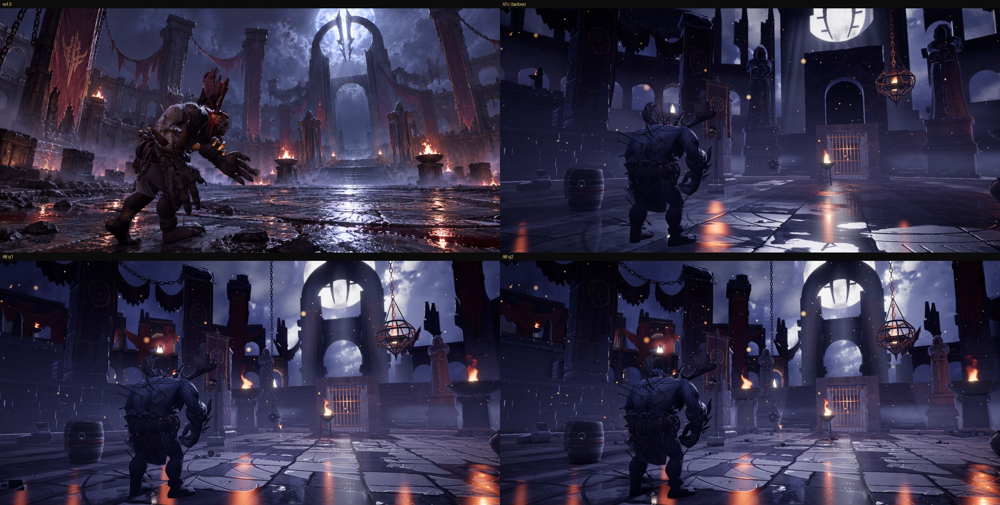
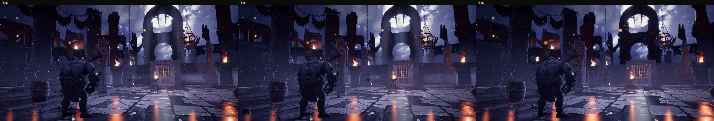

# A8: Moon Gate backdrop, arch rescale, floor, concept match

Branch `anim-plan`, 2026-10-19. Brief: make the Moon Gate (kit colosseum) mimic `docs/concept-art/ref-3.png` as closely as possible (the quality bar for every later arena): rescale and rebuild the backdrop (ring arch with the moon inside, ruined arcade at ref-3's elevation), finish the A6 pieces that were never rendered (far layer without cloud volumes, hero inset, EEVEE shaft / fog-bank atlases), re-bake the floor as big thick broken slabs (owner feedback), adjust the ref-3 dressing, iterate with `npm run arena:concept -- --refs=ref-3`. `src/sim` is untouched. The PC was shut down once mid-milestone; the work was saved in `bccc201` (WIP) and finished here.

## Gates

| Gate | Result |
|---|---|
| `npm run build` | passes |
| `npm run fx:check` | all FX checks passed |
| `npm run sim:test -- 40` | sim untouched: 0 timeouts, 0/2240 kills without contact, determinism true (same seed + arena identical, different arena differs) |
| `npm run arena:budget` | **PASS**. GPU texture memory (KTX2): low 30.95 / 64, **medium 127.35 / 128**, high 179.41 / 192 MB (A7c: 30.95 / 126.02 / 164.08). Medium: + 1.33 MB card atlases (the A7b runtime procedural stand-ins, about 0.6 MB, are no longer created); the new slab floor replaces the retired flagstone set at the same size. High: + 11.2 MB hero inset + 1.3 MB cards |
| Entrance validator, kit colosseum, 5 layouts x 2 gates x 8 fighters (`check_entrances.cjs`, run in 4 chunks of 2 fighters) | **95 configs, 0 failures** (`entrances.json`) |
| Camera audit, standard list (`check_camera.cjs`) | **96.1 % readable** (A7c 95.7 %, floor 93.8 %), contact visible 97.2 %, cuts/min 22.1, short shots 11; colosseum matches 99.9 % / 98.0 % (`camera_standard.json`) |
| `?arena=legacy` | **pixel-identical** to HEAD `fd8a227` (ref-3, ref-4, ref-6 frames + sky-geo + sky-only masks, max difference 0; HEAD built in a temporary worktree) |
| Other themes, kit mode | **pixel-identical** to HEAD (ref-4 .. ref-9: forge, sakura, desert, glacier, skytemple, moonlake; frames + masks, max difference 0) |
| Perf (GPU timer queries, F1 / A6 method, `check_backdrop.cjs`) | backdrop isolated **0.55 ms p50 high** (A6 0.33; budget 0.6) with the hero inset, 16 rendered fog banks and 3 shafts; medium 0.25 ms; low 0.18 ms. Details below |

## What shipped

| Part | Files |
|---|---|
| **Backdrop scene rescaled for ref-3** (Blender, `backdrop_moongate.py`; the brief's `scene_moongate.py` is this file, the renderer imports `backdrop_<scene>.py`). Measured from ref-3 with the calibrated camera (game (-7.5, 1, -0.3), pitch 6.94, vFOV 44.7) and checked by projecting the new geometry back into that camera: **ring centre 33.5 m, centreline radius 8.2 m + 2.8 m section** (outer 9.6 m), pylons at +-7.6 m (6.2 m tapering to 5.2 m), lintel bridge top 26.5 m, portal crown 22.5 m, stepped podium; ring top at y 18 / ring centre y 138 / lintel y 220 / pylon foot y 541 in the 1793 x 877 frame (ref-3: about 28 / 154 / 240 / 540). Two-blade crescent sigil hanging inside the ring, crimson banners on both pylons, shredded swags from the pylons to the arcade | `tools/arena/blender/backdrop_moongate.py` (`build_arch`) |
| **Arcade**: 3 storeys of **7.4 m** (22 m; A6 suggested 8.5 m, which still put the arcade above ref-3's by-eye skyline in the game frame), 5.2 m bays, pilasters + impost blocks, broken stumps, rubble, tier fires (more on the hero view's left), long crimson banners on a third of the tall bays near the vista, shredded swags between bays | `build_arcade` |
| **Two vista pillars** (r 38 m, azimuth +-24, 22 / 25 m) with banners and hanging chains: ref-3's pillar behind the creature (x 0.47) and the tall one at the right edge (x 0.96) | `build_vista_pillars` |
| Cloth material: tattered alpha (vertical shreds growing to the bottom, burn holes, ragged sides), dull-gold band, crimson strong enough to survive the backdrop grade (`sat 0.5`) | `mat_banner`, `cloth_strip`, `banner`, `swag`, `chain_line` |
| The A6 test cliff + waterfall (azimuth 160) dropped (ref-3 has none) | |
| **Moon centred in the arch**: az 0 / elev 26 (was -1.7 / 27); sky texture recomposed (`npm run arena:sky`), shaft cards and the post preview follow | `art/colosseum.ts`, `tools/arena/sky/moongate.json`, `backdrop_post.py` |
| **Renders finished**: full near / mid 8192 x 1368 (128 spp, 4 strips), **far layer 4096 x 684 without cloud volumes** (32 s; it was the job the A6 low-memory reaper killed), **hero inset** 4096 x 2048 (high tier only now), **EEVEE shaft / fog-bank atlases** (8 x 4 frames of 128 px); `proceduralCards: false` | jobs `backdrop_moongate`, `backdrop_moongate_inset`, `backdrop_cards` (`--no-clouds`, card px 128), group `a8` in `tools/arena/jobs.json` |
| **Slab floor** (owner feedback): new `--mode slabs` in `floor_set.py`: running-bond slabs (rows 0.9-1.8 m, slabs 1.0-2.6 m, a fifth split again, edges warped by 9 cm), per-slab height offset (0-25 mm) and tilt, 40 % of the slabs broken through with the halves settled 12 mm apart, rounded and chipped edges (bites up to 16 cm), joints 1.6-4.4 cm wide and 5 cm deep, crack network + wide breaks, `lichen_rock` micro surface with a per-slab offset, soot and blood-brown stains, grime along the joints, dull roughness 0.74-0.95, water rank = joints / cracks / chips / low corners first, numpy cavity AO on top of the Cycles AO. 8 m tile, 2048 px (256 px/m). Asset `floor/slabs_moongate`; `floor/flagstone_bluegrey` is retired from the shipped kit (its job stays) so the medium GPU budget does not grow | `tools/arena/blender/floor_set.py`, job `floor_slabs_moongate`, `public/arena/floor/slabs_moongate*.glb` |
| **Dull damp stone, wet glints in puddles**: `FloorArt.damp` (damp roughness = dry x 0.78 + 0.1 instead of the A2 x 0.34 + 0.05 polish), puddles 0.3; `FloorArt.streakGain` (fire-streak cards 0.35 instead of 0.6 on medium / high and `streakGainLow` 0.6 instead of 1 on low: they read as orange bars). Defaults keep every other theme identical | `floor.ts`, `art/types.ts`, `arenaView.ts`, `art/colosseum.ts` |
| **Ring carved deeper**: inlay re-baked at 26 mm grooves (was 12) | job `inlay_moongate --depth 0.026` |
| **Near field for the ref-3 composition**: no doorway block on the dais (from the ref-3 camera it hid the backdrop arch's portal, which is ref-3's doorway: `doorway` is optional now); guardians smaller (statue x 1.2, plinth x 1.3, +-6.9 m) so they flank the stair like ref-3's instead of towering over it; the pedestal braziers moved in to +-7.8 m so both bowls flank the stair in the ref-3 frame (x 0.52 and 0.89; ref-3 0.57 / 0.85); tier fires 7 -> 14 + 6 on the broken tiers of the vista sector; 9 burning-debris fires at the boundary foot; render-only floor rubble (a band at the boundary + small pieces inside, kept off gate paths, obstacles, props and hazards; 22 / 44 / 60 by tier); exposure 1.2 -> 1.4 (ref-3's mid-tones are brighter) | `nearField.ts`, `art/types.ts` (`fires.vista`, `fires.ground`, `floorRubble`), `art/index.ts`, `art/colosseum.ts` |

## Concept metrics (ref-3 preset; before = A7c `docs/milestones/A7c/concept`, q1)

Side by side `concept/ref-3_side.jpg`, blend `concept/ref-3_blend.jpg`, gameplay views (gate, tiers, overview, counter, flank) `concept/contact_q1.jpg`, renders in `concept/game/`. Floor set: `sheets/floor_slabs_preview.jpg` (Cycles, wet), `sheets/floor_slabs_basecolor.jpg` (one 8 m tile).

| Check | A7c q1 | **A8 q1** | A8 q2 | A8 q0 | Pass rule | Pass |
|---|---|---|---|---|---|---|
| C1 skyline IoU / profileErr | 0.14 / 0.101 | **0.37 / 0.081** | 0.37 / 0.083 | 0.33 / 0.083 | >= 0.65 (hero) | **no** (see below) |
| C2 colour median / worst | 11.2 / 16.6 | **7.0 / 13.5** | 6.5 / 13.7 | 8.1 / 13.6 | <= 12 / <= 20 | yes |
| C3 warm share ratio | 0.75 | **1.93** | 1.87 | 2.6 | 0.6 .. 1.4 | **no** (more fire than ref-3; see below) |
| C4 wet floor ratio, streaks | 1.42, 5 | **1.13, 5** | 1.11, 5 | 1.68, 9 | 0.5 .. 1.5, >= 3 | yes on q1 / q2 (q0 no: 1.68) |
| C5 detail per cell (3 x 3, row major) | 0.31 1.05 1.08 / 0.40 0.68 0.68 / 0.31 0.63 0.35 | **0.41 1.01 1.25 / 0.46 0.83 0.83 / 0.41 0.65 0.52** | 0.42 .. 1.28 | 0.35 .. 1.22 | each 0.7 .. 1.3 | **no** (5 of 9 cells pass, were 3) |
| C8 far / mid std | 1.98 | 2.10 | 2.05 | 2.27 | < 0.6 (ref-3 itself: 1.19) | **no** |
| Luminance median L* (ref-3 21.6) / histogram intersection | 12.8 / 0.73 | **17.9 / 0.81** | | | (info) | |
| C6 dressing (counted on the q1 render; ref-3: braziers 4, fires 10, banners 8, chains 6, statues 2) | | bowls 2 + tripod 1 + cage 1, fires about 12, banners about 9 (near 3 + backdrop 6), chains about 5, statues 2 | | | +-30 % | about yes (counted by eye) |
| C7 floor inlay | engraved | engraved, carved deeper (still subtler than ref-3's) | | | | yes |
| C9 motion | | not clipped (stills only) | | | | not judged |
| C10 readability | 95.7 % | **96.1 %** | | | not worse | yes |

Honest reading:
- **C1 0.14 -> 0.37**, still short of 0.65. The arch, the moon and the sky between the pillars now sit where ref-3 has them (the projected geometry matches ref-3's ring top / centre / lintel / pylon feet within about 20 px; `profileErr` 0.101 -> 0.081). Most of the remaining gap is how the metric is built: ref-3's mask is a by-eye profile that counts everything below the skyline as solid, while the game mask counts every sky pixel seen through the arcade arches, the portal and between the ruins (ref-3 paints sky there too); embers and shaft cards also differ from the sky-only frame and count as non-sky. Closing the arcade openings would raise the number and lower the likeness, so I did not.
- **C3** fails high: the vista and ground fires, the pedestal bowls moved into the frame and the crimson banners (hue 345-360) add warm pixels; ref-3 has as many fires but smaller in frame. By eye the warm accents stay small; the flame sizes (`ruins.fires`, `east.stair.braziers.flame`) are the knobs.
- **C5**: up on every left / bottom cell; the left column (ref-3: big near pillar + banner, burning debris, chains) and the floor near the camera (ref-3: high-contrast rubble, blood, glare) are still flatter than the painting.
- **C8** cannot pass as written (ref-3 itself scores 1.19); ours is about 2x ref-3 because the bright moon sits in the far band.

## Perf and memory

GPU timer queries in one headless page (ANGLE D3D11, Arc iGPU, 1920 x 1080; `check/check.json`): the backdrop's own draws re-issued alone with the frame's depth bound, 240 frames, plus paired on / off scene-pass rounds (noisy: GPU clock, as F1 / A6 / A7b noted).

| Tier | Backdrop isolated p50 (p95) | A6 | Contents | Scene pass on / off (median paired delta) |
|---|---|---|---|---|
| q2 | **0.55 ms** (0.60) | 0.33 | 3 layers + hero inset + 16 fog banks + 3 shafts (rendered atlases) | 15.2 / 14.9 ms (+0.73) |
| q1 | **0.25 ms** (0.41) | 0.32 | near + farc + 8 fog banks + 3 shafts | 14.1 / 14.1 ms (+0.11) |
| q0 | **0.18 ms** (0.18) | 0.16 | one composite | 12.8 / 12.4 ms (+0.51) |

Frame (ref-3 preset, q1, `renderer.info`): 238 draw calls / 701k triangles (A7c 236 / 558k): the floor rubble and burning-debris clusters (rubble_scatter instances merged into the ring) add about 140k triangles and no draw calls; the extra flames go through the existing fire-pool loop (fixed count per tier). Download: backdrop high 1.96 / medium 0.63 / low 0.13 MB, slab floor set about 3.4 MB (KTX2, replaces the flagstone set). Blender peaks: backdrop layers 3.9 GB, cards 1.2 GB, floor 4.0 GB, inlay 4.2 GB, **hero inset 5.5 GB** (one 4096 x 2048 Cycles frame; it finished with 2.1 GB free; render it in tiles or at 3072 if the PC is busier); far layer without cloud volumes: 32 s.

## How close to ref-3 by eye (honest)

- **Much closer**: the ring arch with the moon inside it now stands where ref-3 has it, with the two-blade sigil, the lintel bridge and the lit portal under it; the stair leads toward it with the guardians at its sides and two big fire bowls at its foot, all on one axis as in ref-3. Ruined arcade wings with crimson banners and shredded swags wrap round at about ref-3's height; sky and storm cloud show between pillars, arcade and arch. The floor reads as big thick slabs with dark joints, chipped edges, breaks, cracks, stains and rubble, dull stone with wet glints in the puddles, carved ring grooves. Brighter mid-tones (median L* 12.8 -> 17.9; ref-3 21.6).
- **Still off**: the lit portcullis portal between the two stair flights (ref-3: one wide stair) is the biggest compositional difference; the hanging fire cage and the chain weight (sim hazards in this seed) sit in the frame where ref-3 has open air; ref-3's left side is a wall of detail (huge near pillar with a banner, chains, burning debris, broken blocks), ours is plainer; ref-3's backdrop stone is painterly and richly carved, ours is clean blockout geometry with a procedural stone shader (sharper on high through the inset); fire-streak cards on the floor still read as straight orange bars; the moon disc clips to flat white (A7b / A7c note); ref-3's haze is more lavender and its floor glare stronger; the backdrop banners carry no sigil glyph.
- **Gameplay views** (`concept/contact_q1.jpg`: gate, tiers, overview, counter, flank): the arch and moon show behind the gate in the gate view; elsewhere the near field and pillars frame the fight; nothing new blocks the fighters (camera audit 96.1 %).

## For the next agents (independent review, then A18 entrances / camera / reveal for the Moon Gate)

- Knobs: `COLOSSEUM_ART.floor` (`damp`, `puddles`, `streakGain`, `streakGainLow`), `ring.ruins.fires` (`count`, `vista`, `ground`), `ring.ruins.floorRubble`, `east.stair.guardians` / `braziers`, `look.exposure`, `backdrop.tune`. Backdrop scene: `tools/arena/blender/backdrop_moongate.py` (`RC, RR, RT, RD, PY, PW0, PW1, PD` for the arch, `W, H` in `build_arcade`); re-render with `npm run arena:bake -- a8` (or single jobs), then `npm run arena:backdrop`, `npm run arena:budget`. Fast look loop: job `backdrop_look` + `node tools/arena/build_backdrop.mjs --src=backdrop_look` (it pairs with whatever inset is in `_bake/backdrop_moongate_inset`).
- A18: the reveal should end on the arch (moon az 0 now); the gate view already frames it.
- Medium GPU texture memory is now 127.35 of 128 MB: anything new on medium needs a cut first (sky q1 mips 0.7 MB, or the fog-bank atlas).
- New floor sets for other themes: `floor_set.py --mode slabs` with another `--albedo`, `--cc0` micro surface and tile size.
- Long browser checks: run them detached with output to a file and poll in short steps (the entrance validator takes about 12 min per 2 fighters).

## Decisions made while the owner was asleep (please confirm)

1. **Moon moved to azimuth 0 / elevation 26** (centred in the ring as in ref-3) instead of the plan's -1.7 / 27.
2. **Arcade storeys 7.4 m** instead of the A6 README's 8.5 m (ref-3's skyline sits at about 18 deg in the game frame).
3. **No doorway block on the dais**: the backdrop arch's lit portal is the doorway the stair leads to. The two flights + floor-level portal stay (A7 decision 1: entrances walk in at floor level); ref-3's single wide stair is not reproduced.
4. **Guardians smaller** (about 9 m to the hood instead of 12.4 m) and the stair braziers moved in (lateral 7.8 m instead of 10.2 m).
5. **Procedural slab floor** instead of a scan (no CC0 scan has ref-3's big broken slabs); `flagstone_bluegrey` retired from the shipped kit (memory); the slate set stays for the forge.
6. **Hero inset on high only**; medium keeps the A6 layers + the new card atlases (medium texture memory is the limit). **Card atlases at 128 px frames** (soft volumes; 2 x 0.67 MB).
7. **Brighter look** (exposure 1.4): ref-3's median L* is 21.6, A7c's game frame 12.8, now 18.0.
8. **Rubble on the floor is render only** (no collision, low pieces), so the sim and the fights are unchanged.
9. **Banner / swag cloth in the backdrop is baked** (no sway); the near-field banners sway as before.

## What I could not judge or verify

- Motion: the backdrop cloth is static by design; card animation (shafts, fog banks), the flicker of the new fires and the sky drift were seen as stills only.
- Whether the brighter exposure (1.4) hurts the night mood or fight readability in motion (the audit measures occlusion, not contrast).
- The floor up close in a live fight (rubble under the feet, puddle shapes while the camera moves); the low tier on a real 1080p monitor.
- Perf: headless Chromium on the Arc iGPU only; whole-pass numbers swing by several ms between runs, only the isolated backdrop timer is reliable.
- Incident: removing my temporary baseline worktree (`git worktree remove --force`) followed its `node_modules` junction and emptied the main `node_modules`; it was restored with `npm ci` from the lock file (build, fx:check and budget re-run afterwards, no lock file change). Use a copy, not a junction, for baseline worktrees.

## Checklist for the independent reviewer (game screenshots vs ref-3)

Produce the shots first (one browser at a time, nothing else heavy running): `npm run build`, then `node tools/shots/concept.cjs --refs=ref-3 --q=2 --views=gate,tiers,overview,counter,flank --out=<dir>` and the same with `--q=1` and `--q=0`. Compare `<dir>/ref-3_side.jpg` (concept left, game right), `ref-3_blend.jpg` and `game/*.png` against `docs/concept-art/ref-3.png`. Also look at a live fight on the colosseum (dev server or `vite preview`): the gameplay cameras must show the arch and the moon, fights must stay readable. For each item answer yes / partly / no with one sentence and, where it fails, what would fix it:

1. **Landmark**: is the ring arch with the moon inside it the first thing the eye goes to, at about x 0.69 of the frame? Is the moon centred in the ring and partly behind its top? Is the two-blade sigil readable?
2. **Scale contrast**: does the arch read as huge and far (about 75 m, 45 m tall) against the near field, as in ref-3, or as a close prop?
3. **Arcade**: three ruined storeys wrapping round, broken tops, sky through the upper arches, at roughly ref-3's height (top about a quarter down the frame)? Too regular / too clean?
4. **Skyline**: compare the sky silhouette (where the sky shows between pillars, arcade and arch) with ref-3's; list the biggest differences by frame position.
5. **Stair complex**: ref-3 has one wide stair to the portal, two hooded guardians at its sides, two big bowl braziers at its foot. Ours: two flights around a lit portcullis portal. How much does the portcullis hurt the likeness?
6. **Pillars, banners, chains, swags**: count them against ref-3 (C6 targets: braziers 4, fires 10, banners 8, chains 6, statues 2). Do the swags read as shredded rags?
7. **Fires**: are there ref-3's many small fires along the ruins on the left and at the foot of the walls? Warm accents only at fires?
8. **Floor**: big thick broken slabs, deep dark joints, chipped edges, cracks, rubble, stains, a dull stone surface with wet glints only in puddles / joints, an engraved ring that reads as carved? Does it still read as "modern tile" anywhere (owner complaint)?
9. **Wet reflections**: the moonlit streak from the stair toward the camera, orange streaks under the fires: present, too strong, too weak, artificial-looking?
10. **Light and palette**: blue-grey / indigo stone, lavender moon rim on edges, warm only at fires; mid-tones as bright as ref-3's? Any area that is a flat black hole?
11. **Fog / atmosphere**: ground mist at the stair foot and along the tiers, haze toward the arch, moon shafts through the arch (the new EEVEE atlases): visible, believable, not banded?
12. **Sky**: storm cloud texture and the moon's glow as in ref-3's upper half; does the clipped white moon disc bother?
13. **Detail density**: any large flat or empty area (left side, bottom) compared with ref-3?
14. **Artefacts**: seams in the backdrop (strip seams at azimuth -135 / -45 / 45 / 135), halos round the inset, popping between tiers, z-fighting, floating rubble, banners cut off, the inset not lining up with the near layer in the ref-3 view.
15. **Gameplay cameras** (gate, overview, counter, flank views and a live fight): does the arch / moon appear behind the fighters often? Is anything distracting during fights (rubble under feet, flicker, too dark fighters)?
16. **Tiers**: q2 vs q1 vs q0: does medium (no inset) or low (one composite layer) lose the likeness badly?
17. **Overall**: score 1-10 "would the owner show this to friends as the ref-3 arena?", and the top three changes that would move it most.
